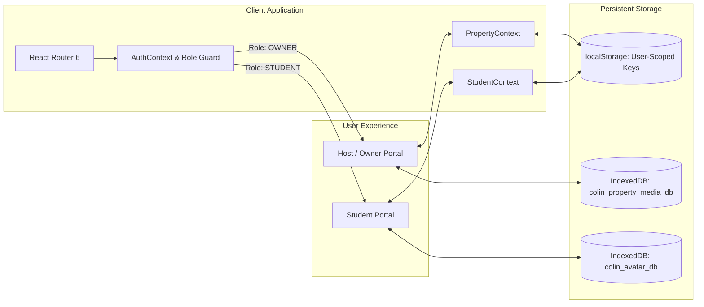

<div align="center">


# COLIN — Student Accommodation Discovery & Management Platform

**A full-stack, enterprise-grade student accommodation discovery, booking, and property management ecosystem.**

[](https://react.dev/)
[](https://www.typescriptlang.org/)
[](https://tailwindcss.com/)
[](https://vitejs.dev/)
[](https://vitest.dev/)
[](LICENSE)

[Live Demo](#demo-credentials) • [Key Features](#key-features) • [Architecture](#architecture) • [Directory Structure](#repository-structure) • [Documentation](#documentation) • [Getting Started](#getting-started)

---

</div>

## Overview

**COLIN** bridges the trust and operational gap between university students searching for safe, affordable accommodation and property owners managing student housing. 

Engineered with role-based authentication, interactive discovery maps, 3D room walkthroughs, verified physical audit badges, centralized field concierge booking, and client-side binary media storage, COLIN provides a dual-sided marketplace tailored for student living.

---

## Key Features

### 🎓 Student Experience & Discovery Portal
* **Intelligent Discovery Engine**: Multi-mode browsing (Grid, List, Map views) with real-time filters for university proximity, budget, AC/Non-AC, meal inclusion, and private vs. shared rooms.
* **COLIN Certified Shield**: 50-point physical inspection badge verifying fire safety, structural integrity, CCTV security, hygiene standards, and verified Wi-Fi speed.
* **Interactive 3D Virtual Tours**: High-fidelity panoramic room walkthroughs allowing students to inspect layout and dimensions prior to booking.
* **Centralized Field Concierge Booking**: Visit scheduling coordinated by trained COLIN Field Executives to protect student safety and eliminate direct broker spam.
* **12-Hour Decision Window & 55% Refund Guarantee**: After an in-person visit, students receive a 12-hour reserved decision window; if they choose not to proceed, 55% of their deposit is promptly refunded.
* **Student Journey Widget & Compare Stays**: Persistent progress tracker guiding students through discovery, scheduling, peer roommate matching, and lease confirmation.
* **Tiffin Connect**: Curated local meal plan discovery integrated with dietary preferences.

### 🏢 Host & Property Owner Management Portal
* **Fixed Viewport Navigation**: 3-tier desktop sidebar with fixed branding, independently scrollable navigation items, and anchored subscription/logout actions.
* **Executive Performance Dashboard**: 12-column balanced grid displaying real-time occupancy rates, bed counts, monthly revenue projections, and certification statuses.
* **Property Lifecycle & Inventory (CRUD)**: Create and edit properties with 6-month or 12-month listing durations, dynamic pricing, and an in-app Student Portal Preview modal.
* **Granular Bed Inventory**: Room-by-room and bed-by-bed occupancy tracking across Single, Double, and Triple sharing units.
* **Client-Side Photo Upload Pipeline**:
  - Drag-and-drop dropzone supporting up to 8 high-resolution photos per property (JPG, JPEG, PNG, WEBP, max 5 MB).
  - Fast IndexedDB binary storage (`colin_property_media_db`) preventing browser quota exceptions.
  - Cover photo selection, thumbnail reordering, live photo counters, and fallback SVG cards.
* **Monetisation & Subscriptions**: Tiered host memberships (`FREE`, `VERIFIED_HOST`, and `PREMIUM_PARTNER`) providing sponsored search ranking and homepage spotlight carousels.
* **Privacy-Shielded Enquiries**: Direct student contact details remain masked until a confirmed booking is finalized through COLIN Concierge.

---

## Architecture & Data Isolation



* **Complete Multi-User Account Isolation**: All user state is isolated using user-scoped storage namespaces (`colin_student_${userId}_*` and `colin_owner_${userId}_*`). Newly registered users start completely clean with zero inherited demo data.
* **Persistent Re-Login**: Accounts maintain state across logout and login sessions without cross-contamination.
* **Binary Media Persistence**: Profile avatars and property photographs are stored directly as client-side binary blobs in dedicated IndexedDB databases (`colin_avatar_db` and `colin_property_media_db`), ensuring high performance and reliable storage.

---

## Repository Structure

```text
COLIN/
├── public/                     # Static public assets (logos, icons)
│   └── assets/
│       └── colin-logo.png      # Official COLIN brand mark
├── docs/                       # Project documentation & engineering reports
│   ├── MONETIZATION_STRATEGY.md # Economic model, fees, and refund architecture
│   └── reports/                # Milestone audit & acceptance reports
│       ├── PHASE_1_REPORT.md
│       ├── PHASE_2_REPORT.md
│       ├── PHASE_2_UI_REDESIGN_REPORT.md
│       ├── PHASE_2_UI_REDESIGN_V2_REPORT.md
│       ├── PHASE_2_UI_REDESIGN_V3_REPORT.md
│       ├── PHASE_2_DISCOVERY_AND_TRUST_V5_REPORT.md
│       ├── PHASE_2_FINAL_ACCEPTANCE_REPORT.md
│       ├── PHASE_3_REPORT.md
│       ├── PHASE_3A_ACCEPTANCE_REPORT.md
│       └── PHASE_3_COMPREHENSIVE_REPORT.md
├── src/
│   ├── components/
│   │   ├── common/             # Reusable UI (Navbar, Footer, Buttons, Badges)
│   │   ├── home/               # Homepage landing sections & discovery bars
│   │   ├── owner/              # Host layout, photo uploader, and management UI
│   │   ├── property/           # Property cards, slot booking modals, placeholders
│   │   └── student/            # Student portal layouts, journey widgets, cards
│   ├── constants/              # Application-wide constants (booking policies)
│   ├── context/                # React context providers (Auth, Student, Property, Toast)
│   ├── data/                   # Mock seed data (properties, initial owners)
│   ├── pages/
│   │   ├── owner/              # Host portal pages (Dashboard, Inventory, Photos, Audits)
│   │   └── student/            # Student portal pages (Explore, Compare, Wishlist, Visits)
│   ├── services/               # Geolocation and calculation services
│   ├── test/                   # Vitest unit and integration test suites
│   ├── types/                  # TypeScript interface definitions
│   ├── utils/                  # IndexedDB image storage & validation utilities
│   ├── App.tsx                 # Root application routes & role-based guards
│   ├── index.css               # Global Tailwind CSS directives & custom styling
│   └── main.tsx                # React DOM entrypoint
├── index.html                  # HTML5 entrypoint template
├── package.json                # Project dependencies & build scripts
├── postcss.config.js           # PostCSS configuration
├── tailwind.config.js          # Tailwind CSS theme & typography tokens
├── tsconfig.json               # TypeScript compiler configuration
└── vite.config.ts              # Vite bundler configuration
```

---

## Demo Credentials

You can use the following pre-configured credentials to evaluate the platform:

| Role | Email | Password | Access Level |
| :--- | :--- | :--- | :--- |
| **Student (Demo)** | `student.demo@colin.in` | `colin123` | Full student discovery, visits, wishlist, journey tracker |
| **Property Owner (Demo)** | `owner.demo@colin.in` | `colin123` | Full host dashboard, property CRUD, rooms, certification |
| **Fresh Registration** | Any valid email | Custom | Starts with clean, isolated, empty profile and inventory |

---

## Getting Started

### Prerequisites
* [Node.js](https://nodejs.org/) (v18.0.0 or higher recommended)
* `npm` or `pnpm`

### Installation & Local Setup

1. **Clone the repository**:
   ```bash
   git clone https://github.com/SiDdHaRtH-0509/COLIN.git
   cd COLIN
   ```

2. **Install dependencies**:
   ```bash
   npm install
   ```

3. **Start the development server**:
   ```bash
   npm run dev
   ```
   Open [http://localhost:5173](http://localhost:5173) in your browser.

4. **Run test suites**:
   ```bash
   npm run test
   ```

5. **Build for production**:
   ```bash
   npm run build
   ```

---

## Testing & Quality Assurance

The codebase is thoroughly tested using **Vitest** and **React Testing Library**:

```bash
✓ src/test/auth.test.tsx (5 tests)
✓ src/test/navigation.test.tsx (4 tests)
✓ src/test/properties.test.tsx (3 tests)
✓ src/test/phase3b_isolation.test.tsx (10 tests)
✓ src/test/phase3_final_refinement.test.tsx (8 tests)
✓ src/test/phase3a_booking.test.tsx (11 tests)
✓ src/test/owner.test.tsx (26 tests)
✓ src/test/student.test.tsx (35 tests)

Test Files  8 passed (8)
     Tests  102 passed (102)
```

* **Type Safety**: Strictly checked with `npx tsc --noEmit` (0 errors).
* **Production Bundle**: Successfully builds with Vite tree-shaking and asset minification.

---

## Documentation

Full architectural documentation and milestone progress reports are available in the [`docs/`](docs/) directory:
* [Platform Monetization Strategy](docs/MONETIZATION_STRATEGY.md)
* [Phase 3 Comprehensive Report](docs/reports/PHASE_3_COMPREHENSIVE_REPORT.md)
* [Phase 3A Acceptance Report](docs/reports/PHASE_3A_ACCEPTANCE_REPORT.md)
* [Phase 2 Final Acceptance Report](docs/reports/PHASE_2_FINAL_ACCEPTANCE_REPORT.md)
* [Phase 1 Foundation Report](docs/reports/PHASE_1_REPORT.md)

---

## License

This project is licensed under the [MIT License](LICENSE).
