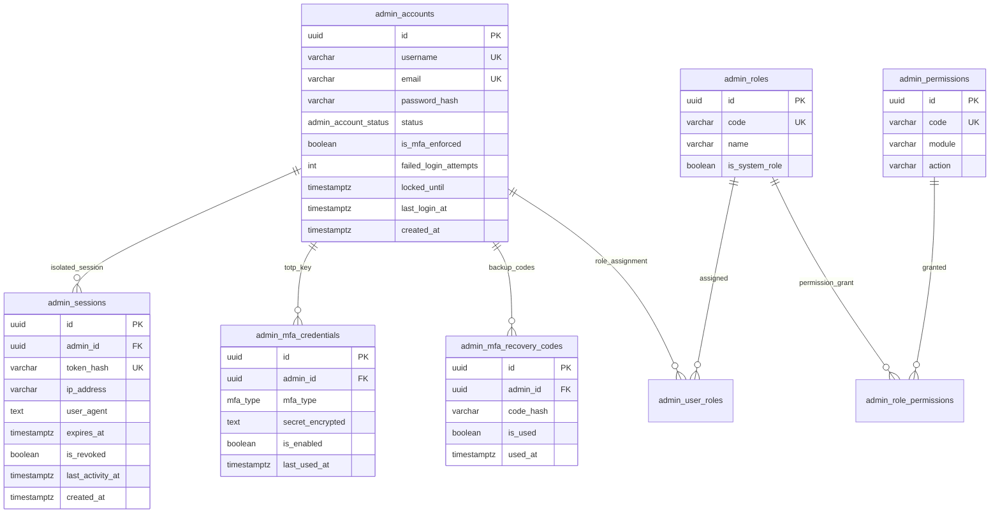
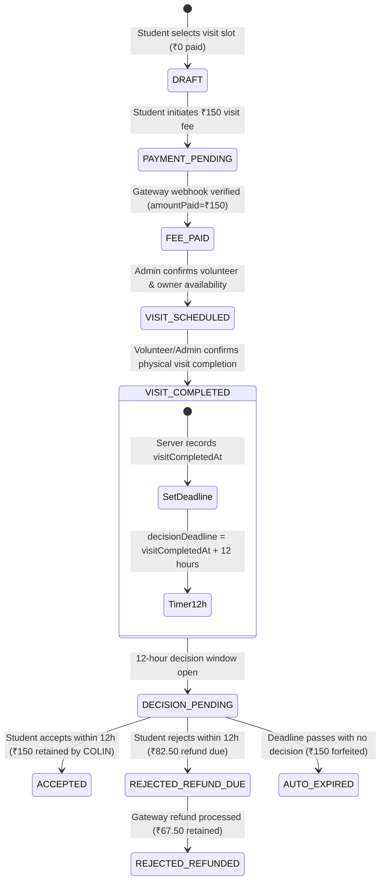
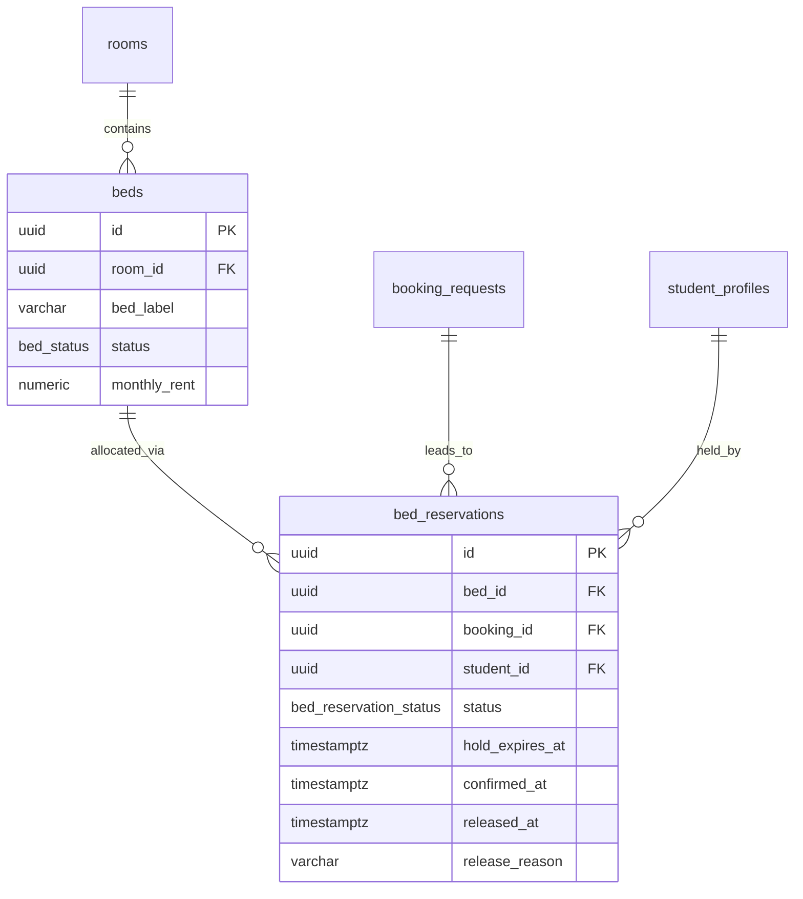
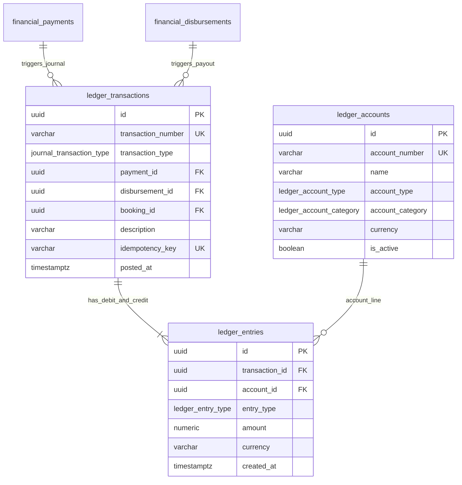

# COLIN Central Database Entity-Relationship Diagram (ERD)

**Document Version:** 2.2.0 (Phase 4A.2.2.1-R2.1 Critical Integrity Closure Baseline)  
**Engine:** PostgreSQL 16+ Relational Architecture  
**Notation:** Mermaid ER Diagram (`erDiagram`)  
**Scope:** Reconciled & Hardened Schema Across All 13 Core Modules (54 Entities, 47 Enums)  

---

## 1. Unified Master ER Diagram

```mermaid
erDiagram
    %% MODULE A: USER & ADMIN AUTHENTICATION ISOLATION
    users ||--|| user_profiles : "has"
    users ||--o{ user_sessions : "maintains"
    users ||--o{ mfa_credentials : "secures"
    users ||--o{ mfa_recovery_codes : "stores_recovery"
    users ||--o{ password_reset_tokens : "requests"
    
    admin_accounts ||--o{ admin_sessions : "maintains_isolated"
    admin_accounts ||--o{ admin_mfa_credentials : "mfa_auth"
    admin_accounts ||--o{ admin_mfa_recovery_codes : "mfa_recovery"
    admin_accounts ||--o{ admin_user_roles : "assigned_role"
    admin_roles ||--o{ admin_user_roles : "has_admin"
    admin_roles ||--o{ admin_role_permissions : "grants"
    admin_permissions ||--o{ admin_role_permissions : "granted_to"

    %% MODULE B & C: PERSONA PROFILES
    users ||--o| student_profiles : "student_persona"
    student_profiles ||--o{ student_verification_documents : "submits"
    student_profiles ||--o| student_preferences : "configures"
    student_profiles ||--o{ student_saved_properties : "bookmarks"
    student_profiles ||--o{ student_search_histories : "logs"

    users ||--o| owner_profiles : "owner_persona"
    owner_profiles ||--o{ owner_kyc_documents : "verifies_with"
    owner_profiles ||--o{ owner_bank_accounts : "payout_destination"
    owner_profiles ||--o{ properties : "owns"

    %% MODULE D: PROPERTY MANAGEMENT
    properties ||--o{ property_photos : "displays_max_8"
    properties ||--o{ property_amenities : "offers"
    properties ||--o{ property_rules : "stipulates"
    properties ||--o{ property_verification_audits : "inspected_by"
    admin_accounts ||--o{ property_verification_audits : "conducts"

    %% MODULE E: INVENTORY & RESERVATION SAFETY
    properties ||--o{ rooms : "contains"
    rooms ||--o{ beds : "has"
    beds ||--o{ bed_reservations : "held_or_booked_by"
    student_profiles ||--o{ bed_reservations : "holds"
    booking_requests ||--o{ bed_reservations : "leads_to"

    %% MODULE F: BOOKING LIFECYCLE & MEDIATION
    student_profiles ||--o{ booking_requests : "initiates"
    properties ||--o{ booking_requests : "target_property"
    beds ||--o{ booking_requests : "target_bed"
    booking_requests ||--o| visit_slots : "scheduled_in"
    booking_requests ||--o{ visit_availability_options : "availability_proposals"
    booking_requests ||--o| visit_coordinations : "dispatched_via"
    booking_requests ||--o| visit_decisions : "decided_via"
    booking_requests ||--o{ visit_reminders : "reminder_queue"
    booking_requests ||--o{ visit_assignment_histories : "volunteer_history"
    booking_requests ||--o{ booking_status_histories : "audits_state"
    booking_requests ||--o{ visit_feedbacks : "rates"

    %% MODULE G: VOLUNTEERS
    users ||--o| volunteer_profiles : "volunteer_persona"
    volunteer_profiles ||--o{ volunteer_assignments : "performs"
    volunteer_profiles ||--o{ volunteer_reviews : "evaluated_by"
    volunteer_profiles ||--o{ visit_coordinations : "assigned_to"
    admin_accounts ||--o{ volunteer_assignments : "assigns"
    admin_accounts ||--o{ volunteer_reviews : "reviews"

    %% MODULE H: BALANCED DOUBLE-ENTRY FINANCIAL LEDGER
    users ||--o{ financial_payments : "submits_payment"
    booking_requests ||--o{ financial_payments : "pays_visit_fee"
    financial_payments ||--o{ ledger_transactions : "posts_journal"
    booking_requests ||--o{ ledger_transactions : "refund_or_settle"
    financial_disbursements ||--o{ ledger_transactions : "posts_payout"
    ledger_transactions ||--o{ ledger_entries : "balanced_double_entry"
    ledger_accounts ||--o{ ledger_entries : "account_postings"
    owner_profiles ||--o{ financial_disbursements : "receives_disbursement"
    owner_bank_accounts ||--o{ financial_disbursements : "credited_to"

    %% MODULE I, J, K, L, M: SUBSCRIPTIONS, SPONSORSHIPS, SUPPORT & AUDIT
    owner_profiles ||--o{ owner_subscriptions : "subscribes"
    student_profiles ||--o{ student_subscriptions : "subscribes"
    owner_profiles ||--o{ sponsorship_campaigns : "funds"
    properties ||--o{ sponsorship_campaigns : "boosts"
    users ||--o{ system_notifications : "notified"
    users ||--o{ support_tickets : "submits_ticket"
    admin_accounts ||--o{ support_tickets : "assigned_admin"
    support_tickets ||--o{ support_messages : "thread"
    admin_accounts ||--o{ admin_audit_logs : "records_action"
```

---

## 2. Admin Security & Authentication Isolation Subsystem (Task A)

---

## 3. Mediated Booking Lifecycle & 12-Hour Decision Engine (Task B & C)

---

## 4. Bed Allocation & Reservation Concurrency Subsystem (Task D)

*Note: Guaranteed by PostgreSQL partial unique index `uq_active_bed_reservation` on `(bed_id) WHERE status IN ('TEMPORARY_HOLD', 'CONFIRMED')`.*

---

## 5. Balanced Double-Entry Financial Journal Architecture (Task E)

*Accounting Invariant: $\sum \text{Debits} = \sum \text{Credits}$ across $\ge 2$ entries per transaction, enforced via deferred constraint trigger `trg_verify_balanced_ledger_transaction`.*
