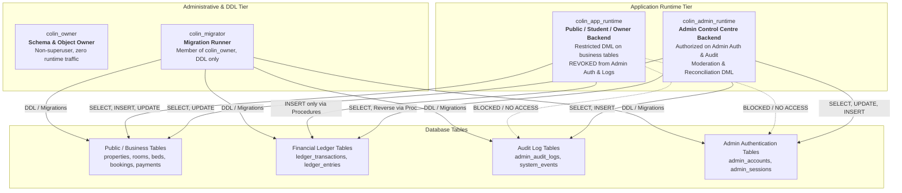

# COLIN — Database Role & Permission Matrix

**Document Version:** 1.1.0  
**Phase:** 4A.2.2.1-R2.1.2  
**Target Engine:** PostgreSQL 16+  
**Security Standard:** Principle of Least Privilege (PoLP), Non-Superuser Ownership, & Hard Separation of Administrative Duties

---

## 1. Executive Security Architecture

COLIN enforces strict database-level role separation to eliminate shared-credential vulnerabilities and prevent vertical privilege escalation. Even if a customer-facing API endpoint (Public Website, Student Portal, or Owner Portal) suffers an SQL injection or credential leakage vulnerability, the database role connecting that endpoint (`colin_app_runtime`) possesses **zero permissions** to read administrative passwords, view admin session tokens, or tamper with system audit trails.

### The Four Tier Role Model



---

## 2. Role Definitions & Privilege Profiles

### 2.1 `colin_owner` (Schema & Object Owner)
- **Purpose**: Schema creation, extension management, initial database setup.
- **Runtime Traffic**: **NONE**. Never utilized by application servers, background workers, or CI scripts.
- **Privileges**: `CREATEDB`, `CREATEROLE`, full ownership of schema `public`. **Non-superuser**.

### 2.2 `colin_migrator` (Migration Runner)
- **Purpose**: Executes Prisma migrations, applies custom triggers, indexes, and SQL constraints.
- **Runtime Traffic**: **NONE**. Executed strictly within ephemeral CI/CD deployment pipelines.
- **Privileges**:
  - Granted membership in `colin_owner` (`GRANT colin_owner TO colin_migrator;`).
  - `CREATE`, `ALTER`, `DROP` on tables, views, sequences, types, triggers, and functions.
  - Temporary elevated DML privileges during data backfills and structural transformations.

### 2.3 `colin_app_runtime` (Customer Backend Services)
- **Purpose**: Connects Student Portal, Owner Portal, Public Search, and Booking API services.
- **Runtime Traffic**: All non-administrative user interactions.
- **Privileges**:
  - `SELECT`, `INSERT`, `UPDATE`, `DELETE` on customer-facing business entities (properties, beds, bookings, reviews).
  - `INSERT` on immutable payment transaction records.
  - `EXECUTE` on designated transactional stored procedures.
  - **Explicit Denials (`REVOKE ALL`)**:
    - `admin_accounts`
    - `admin_sessions`
    - `admin_mfa_credentials`
    - `admin_mfa_recovery_codes`
    - `admin_password_reset_tokens`
    - `admin_roles`
    - `admin_permissions`
    - `admin_role_permissions`
    - `admin_user_roles`
    - `admin_audit_logs`
    - `property_verification_audits`
    - `volunteer_reviews`
  - **Global Structural Denials**: `CREATE` on schema public, `TRUNCATE`, `DROP`, `ALTER`, `GRANT` revoked across all tables.

### 2.4 `colin_admin_runtime` (Admin Control Centre Backend)
- **Purpose**: Connects the private COLIN Admin Control Centre API.
- **Runtime Traffic**: Operational management, property verification, KYC approvals, dispute resolution, financial reconciliation.
- **Privileges**:
  - `SELECT`, `INSERT`, `UPDATE` on `admin_accounts`, `admin_sessions`, `admin_mfa_credentials`, `admin_mfa_recovery_codes`, `admin_user_roles`, `volunteer_reviews`.
  - `SELECT` on `admin_roles`, `admin_permissions`, `admin_role_permissions`.
  - `SELECT`, `INSERT` on `admin_audit_logs`, `property_verification_audits` (UPDATE and DELETE prohibited by engine triggers).
  - `SELECT`, `UPDATE` across student, owner, and property tables for administrative approvals.
  - `EXECUTE` on financial reversal stored procedures (`reverse_ledger_transaction()`).
  - **Global Structural Denials**: `TRUNCATE`, `DROP`, `ALTER` revoked across all tables.

---

## 3. Default Privileges Security Policy

To prevent schema drift or accidental privilege leaks during future migrations, PostgreSQL default privileges are explicitly configured:

```sql
ALTER DEFAULT PRIVILEGES FOR ROLE colin_owner IN SCHEMA public 
  REVOKE ALL ON TABLES FROM colin_app_runtime;

ALTER DEFAULT PRIVILEGES FOR ROLE colin_migrator IN SCHEMA public 
  REVOKE ALL ON TABLES FROM colin_app_runtime;
```

---

## 4. Statement-Level TRUNCATE Defense

Statement-level triggers permanently block `TRUNCATE` operations across:
- `admin_audit_logs`
- `property_verification_audits`
- `booking_status_histories`
- `visit_assignment_histories`
- `ledger_entries`
- `ledger_transactions`
