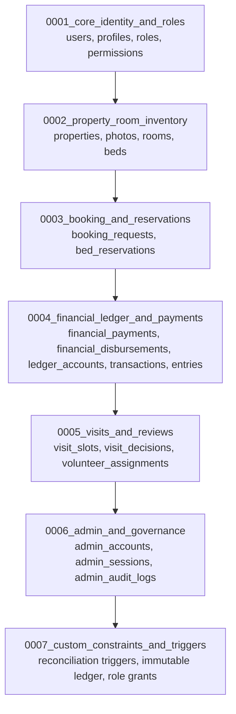

# COLIN — Phase 4A.2.2.2 Migration Readiness Document

**Document Version:** 1.2.0  
**Baseline Phase:** 4A.2.2.1-R2.1.2  
**Target Execution Phase:** 4A.2.2.2 (Database Connectivity, Migration Generation & Live ORM Integration)  
**Target Engine:** PostgreSQL 16+  
**Schema Definition:** `prisma/schema.prisma` (54 Models, 47 Enums)  
**Custom Constraints:** `docs/database/COLIN_CUSTOM_POSTGRESQL_CONSTRAINTS.sql`  
**Test Fixtures:** `src/test/database/fixtures/` (12 modules)

---

## 1. Migration Strategy Overview

The transition from static relational schema modelling (Phase 4A.2.2.1) to live PostgreSQL database connectivity and Prisma migration execution (Phase 4A.2.2.2) follows a deterministic, phased migration sequence.

Because COLIN enforces strict engine-level check constraints, composite unique indexes, exclusion constraints, and complex foreign key relationships across 54 tables, migrations are divided into **seven sequential steps**.

---

## 2. Migration Sequence & Dependency Ordering

### Step 0001: Core Identity & Access Control
- **Dependencies**: `uuid-ossp`, `pgcrypto` PostgreSQL extensions.
- **Tables**: `users`, `user_profiles`, `user_sessions`, `mfa_credentials`, `mfa_recovery_codes`, `password_reset_tokens`.
- **Enums**: `UserStatus`, `UserRoleType`, `MfaType`.

### Step 0002: Property, Room & Bed Inventory
- **Dependencies**: 0001 (Owner identity).
- **Tables**: `owner_profiles`, `owner_kyc_documents`, `properties`, `property_photos`, `property_amenities`, `property_rules`, `rooms`, `beds`.
- **Enums**: `OwnerVerificationStatus`, `OwnerBusinessStructure`, `OwnerTier`, `PropertyType`, `PropertyGenderPolicy`, `PropertyVerificationStatus`, `PropertyOccupancyStatus`, `RoomType`, `BedStatus`.

### Step 0003: Booking & Bed Reservation Lifecycle
- **Dependencies**: 0001 (Student identity), 0002 (Beds, Rooms, Properties).
- **Tables**: `student_profiles`, `student_verification_documents`, `student_preferences`, `booking_requests`, `booking_status_histories`, `bed_reservations`.
- **Enums**: `StudentVerificationStatus`, `IdDocumentType`, `BookingStatus`, `BookingPaymentStatus`, `BedReservationStatus`, `StudentDecision`.

### Step 0004: Financial Payments, Disbursements & Double-Entry Ledger
- **Dependencies**: 0001 (Users/Owners), 0003 (Booking requests).
- **Tables**: `financial_payments`, `owner_bank_accounts`, `financial_disbursements`, `ledger_accounts`, `ledger_transactions`, `ledger_entries`.
- **Enums**: `PaymentType`, `PaymentStatus`, `PaymentGateway`, `LedgerAccountType`, `LedgerAccountCategory`, `JournalTransactionType`, `LedgerTransactionStatus`, `LedgerEntryType`, `DisbursementStatus`.
- **Integrity Requirements**:
  - `reverses_transaction_id` self-referencing foreign key on `ledger_transactions`.
  - Zero-sum balance check constraint on posted `ledger_transactions`.

### Step 0005: Field Visits, Verification & Community Reviews
- **Dependencies**: 0001 (Users/Volunteers), 0002 (Properties), 0003 (Booking requests).
- **Tables**: `visit_slots`, `visit_availability_options`, `visit_coordinations`, `visit_decisions`, `visit_reminders`, `visit_assignment_histories`, `visit_feedbacks`, `volunteer_profiles`, `volunteer_assignments`, `volunteer_reviews`.
- **Enums**: `VisitSlotStatus`, `VisitReminderType`, `VolunteerStatus`, `VolunteerTaskType`, `VolunteerTaskStatus`.

### Step 0006: Private Administrative Governance
- **Dependencies**: None (Completely decoupled from student/owner customer auth tables).
- **Tables**: `admin_accounts`, `admin_sessions`, `admin_mfa_credentials`, `admin_mfa_recovery_codes`, `admin_roles`, `admin_permissions`, `admin_role_permissions`, `admin_user_roles`, `admin_audit_logs`.
- **Enums**: `AdminAccountStatus`, `AuditActionCategory`, `AuditSeverity`.
- **Integrity Requirements**: Argon2id password hash storage format (`$argon2id$...`).

### Step 0007: Custom Constraints, Triggers & Database Roles
- **Dependencies**: Steps 0001 through 0006.
- **SQL Source**: `docs/database/COLIN_CUSTOM_POSTGRESQL_CONSTRAINTS.sql`.
- **Installed Artifacts**:
  - `fn_enforce_booking_payment_reconciliation()` (Strict ₹150 penalty vs full refund rules).
  - `fn_prevent_posted_ledger_mutation()` (Entry immutability, immutable `transaction_id`).
  - `reverse_ledger_transaction()` (Dynamic `JournalTransactionType` mapping, atomic reversal).
  - `validate_disbursement_payout_eligibility()` (Row locking on `owner_bank_accounts`, re-validation on `status = 'PROCESSING'`).
  - `fn_maintain_property_photo_order()` (Deterministic cross-property photo movement locks).
  - Non-superuser `colin_owner`, `colin_migrator`, `colin_app_runtime`, and `colin_admin_runtime` with default privileges.
