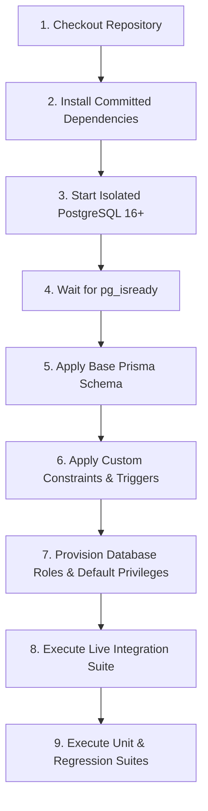

# COLIN — PostgreSQL Integration Test Guide

**Document Version:** 1.1.0  
**Phase:** 4A.2.2.1-R2.1.2  
**Target Database:** PostgreSQL 16+  
**Integration Test Suite:** `src/test/database/postgres-integrity.integration.test.ts`  
**Unit Invariant Suite:** `src/test/database_integrity_verification_r2.test.ts`  
**Test Runner:** Vitest (Node.js 20+ runtime)

---

## 1. Overview & Architecture

The COLIN Central Database Architecture relies on strict PostgreSQL engine-level constraints, custom triggers, stored procedures, and fine-grained database roles to enforce financial, operational, and structural invariants.

The integration test suite (`src/test/database/postgres-integrity.integration.test.ts`) contains **77 comprehensive live SQL test cases** across 10 critical domains:
1. Engine Version & Extension Verification (1 test)
2. Booking Payment Reconciliation & Rejection Integrity (11 tests)
3. Double-Entry General Ledger Immutability & Reversals (14 tests)
4. Verification Visit Snapshot Integrity (6 tests)
5. Payout Beneficiary Row-Locking & Validation (10 tests)
6. Bed Reservation Lifecycle & Auto-Release Concurrency (10 tests)
7. Property Photo Ordering & Cross-Property Serialization (8 tests)
8. Admin Review Decision Immutability (5 tests)
9. Database Role Separation & Credential Isolation (8 tests)
10. Multi-Session Concurrency & Race Condition Verifications (4 tests)

An additional environment availability reporter test brings the total assertion count to **78 tests**.

---

## 2. Prerequisites & Environment Setup

Running the live integration tests requires:
1. **Node.js**: v20.0.0 or higher.
2. **pnpm**: v9.0.0 or higher.
3. **PostgreSQL**: PostgreSQL 16.0 or higher running on accessible TCP host/port.
4. **PostgreSQL Client Driver**: `pg` and `@types/pg` installed and committed in `package.json` and `pnpm-lock.yaml`.

### 2.1 Provisioning PostgreSQL with Docker (Recommended)

To spin up an isolated, dedicated PostgreSQL 16 instance for integration testing:

```bash
docker run -d \
  --name colin-postgres-test \
  -e POSTGRES_USER=postgres \
  -e POSTGRES_PASSWORD=<REDACTED_PASSWORD> \
  -e POSTGRES_DB=colin_test \
  -p 5433:5432 \
  postgres:16-alpine
```

Verify that the container is healthy and ready:
```bash
docker exec -it colin-postgres-test pg_isready -U postgres
```

### 2.2 Provisioning PostgreSQL on Native Host

If running native PostgreSQL:
```sql
CREATE USER colin_test_admin WITH PASSWORD '<REDACTED_PASSWORD>' CREATEDB CREATEROLE;
CREATE DATABASE colin_test OWNER colin_test_admin;
```

---

## 3. Environment Variable Configuration

The integration test suite detects the presence of a live database via `DATABASE_URL`.

### Format:
```env
DATABASE_URL="postgresql://<username>:<password>@<host>:<port>/<database>?schema=<schema>"
```

### Example `.env.test`:
```env
DATABASE_URL="postgresql://<REDACTED>@127.0.0.1:5433/colin_test?schema=public"
```

> **Lifecycle Architecture:**  
> If `DATABASE_URL` is omitted or empty, the test suite cleanly skips the 77 live database assertions at test registration time. The diagnostic test (`Integration Test Suite Environment Status`) will output:  
> `[INTEGRATION STATUS] BLOCKED — Required PostgreSQL environment unavailable (DATABASE_URL not configured)`.

---

## 4. Correct Provisioning & Execution Sequence

The deterministic deployment and testing sequence must follow this exact order:



### Step 1: Apply Base Database Schema
```bash
pnpm prisma db push --schema=prisma/schema.prisma
```
*(Or run Prisma migrations once generated in Phase 4A.2.2.2)*.

### Step 2: Apply Custom PostgreSQL Constraints, Triggers & Roles
```bash
psql -d colin_test -U postgres -f docs/database/COLIN_CUSTOM_POSTGRESQL_CONSTRAINTS.sql
```

The script installs:
- Extensions: `uuid-ossp`, `pgcrypto`.
- Stored procedures: `reverse_ledger_transaction()`, `fn_expire_stale_bed_reservations()`.
- Financial audit triggers: `fn_enforce_booking_payment_reconciliation()`, `validate_disbursement_payout_eligibility()`.
- Ledger triggers: `fn_prevent_posted_ledger_mutation()`.
- Bed reservation triggers: `fn_enforce_bed_reservation_integrity()`.
- Photo ordering triggers: `fn_maintain_property_photo_order()`.
- Roles: `colin_owner`, `colin_migrator`, `colin_app_runtime`, `colin_admin_runtime`.
- Default privileges to prevent access leaks on future migration tables.

---

## 5. Executing the Test Suites

### 5.1 Unit Invariant Test Suite
```bash
pnpm run test:unit
```
Executes the fast in-memory invariant tests (32 tests in ~25ms).

### 5.2 PostgreSQL Real Integration Suite
```bash
pnpm run test:db:integration
```
Executes the 78 integration tests sequentially (`--fileParallelism=false`) against `colin_test`.

### 5.3 Full Regression Suite
```bash
pnpm test
```
Executes all 12 test files across the repository.

---

## 6. CI/CD Pipeline Implementation (GitHub Actions)

```yaml
name: Database Integration & Invariant Tests

on:
  push:
    branches: [main, develop, 'feature/**']
  pull_request:
    branches: [main, develop]

jobs:
  test-postgres-integrity:
    runs-on: ubuntu-latest

    services:
      postgres:
        image: postgres:16-alpine
        env:
          POSTGRES_USER: postgres
          POSTGRES_PASSWORD: postgres
          POSTGRES_DB: colin_test
        ports:
          - 5432:5432
        options: >-
          --health-cmd pg_isready
          --health-interval 10s
          --health-timeout 5s
          --health-retries 5

    steps:
      - name: Checkout Code
        uses: actions/checkout@v4

      - name: Setup Node.js 20
        uses: actions/setup-node@v4
        with:
          node-version: 20

      - name: Setup pnpm
        uses: pnpm/action-setup@v3
        with:
          version: 9

      - name: Install Committed Dependencies
        run: pnpm install --frozen-lockfile

      - name: Apply Base Database Schema
        run: npx prisma db push --schema=prisma/schema.prisma
        env:
          DATABASE_URL: "postgresql://postgres:${{ secrets.CI_DB_PASSWORD }}@127.0.0.1:5433/colin_test"

      - name: Apply Hardened Custom Constraints & Roles
        run: psql -h 127.0.0.1 -p 5433 -U postgres -d colin_test -f docs/database/COLIN_CUSTOM_POSTGRESQL_CONSTRAINTS.sql
        env:
          PGPASSWORD: ${{ secrets.CI_DB_PASSWORD }}

      - name: Execute Live PostgreSQL Integration Suite
        run: pnpm run test:db:integration
        env:
          DATABASE_URL: "postgresql://postgres:${{ secrets.CI_DB_PASSWORD }}@127.0.0.1:5433/colin_test"

      - name: Execute Unit & Invariant Tests
        run: pnpm run test:unit

      - name: Execute TypeScript Checks
        run: npx tsc --noEmit

      - name: Execute Production Build
        run: pnpm run build
```
