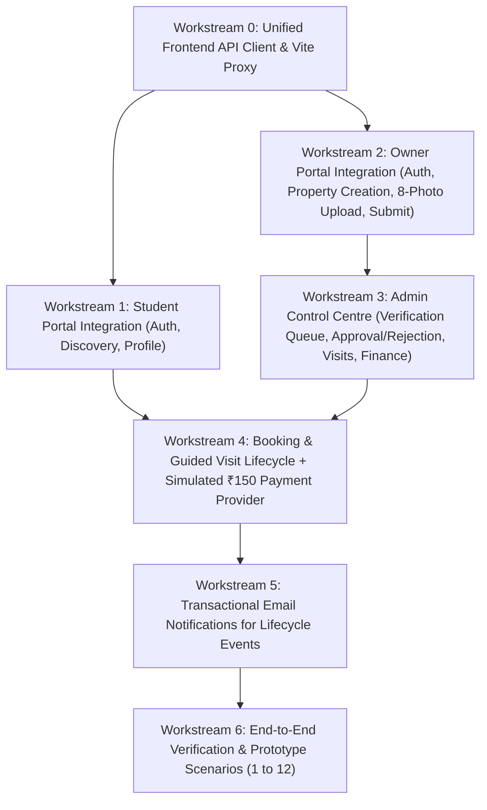

# COLIN — PROTOTYPE COMPLETION GAP ANALYSIS

**Project:** COLIN — Campus Living Verified  
**Parent Phase:** Prototype Completion Sprint  
**Document:** End-to-End Architecture Reconnaissance & Gap Analysis  
**Branch:** `colin-prototype-completion`  
**Date:** November 9, 2026  
**Status:** **APPROVED FOR EXECUTION**  

---

## 1. EXECUTIVE SUMMARY & RECONNAISSANCE FINDINGS

Following the completion and final acceptance of Phase 4A.2.5.8 (731 passing tests, fully reconciled external infrastructure), the COLIN codebase possesses an exceptionally mature, robust foundational backend (Express 5, PostgreSQL 18 with Prisma ORM, Redis 7, S3 image pipeline with Sharp, Google Maps geolocation, and transactional email outbox).

However, a critical architectural gap exists between the **backend platform** and the **frontend user experience**:
1. **Frontend Disconnection:** The React frontend (Phase 1–3) operates largely on `localStorage` state and mock fixtures (`mockData.ts`, `mockOwnerData.ts`) within `AuthContext`, `PropertyContext`, and `StudentContext`. It does not yet invoke the production backend APIs (`/api/v1/properties`, `/api/v1/owner/properties`, `/api/v1/students`, `/api/v1/owners`).
2. **Missing Booking & Visit Backend Engine:** While the Prisma schema (`prisma/schema.prisma`) meticulously models `BookingRequest`, `VisitSlot`, `VisitCoordination`, `VisitDecision`, `FinancialPayment`, and double-entry `LedgerTransaction`, there are currently **no backend API endpoints, service layer, or controller** for bookings and guided visits under `/api/v1`.
3. **Simulated Payment Gateway:** A dedicated payment abstraction and simulated payment provider (handling ₹150 fee payment, idempotency, failure simulation, and ledger balance integration) is required.
4. **Admin Control Centre Placeholders:** The Admin UI has routes defined in `App.tsx`, but sub-departments (`/admin/properties`, `/admin/verification`, `/admin/visits`, `/admin/finance`, `/admin/students`, `/admin/owners`) currently render `AdminPlaceholderPage`. The backend already has administrative property moderation endpoints (`/api/v1/admin/properties/pending`, `/approve`, `/reject`) which must be connected to functional Admin UI screens.
5. **Lifecycle Notifications:** The transactional email outbox infrastructure (`EmailOutboxService`, `EmailWorker`) is fully operational for auth events, but lacks templates and hooks for property submissions, verification outcomes, booking confirmations, visit scheduling, visit completion, and 12-hour decision deadlines.

---

## 2. DETAILED GAP ANALYSIS & RECONCILIATION TABLE

### 2.1 Standard Gap Analysis Matrix

| Feature | Existing Status | Missing Work | Frontend Status | Backend Status | Priority |
| :--- | :--- | :--- | :--- | :--- | :--- |
| **Unified API Client & Auth Integration** | `auth.routes.ts` with `/register`, `/login`, `/me`, `/logout`, JWT cookies, Redis sessions. | Frontend `AuthContext` uses `localStorage` demo accounts (`DEMO_STUDENT`, `DEMO_OWNER`) without calling backend `/api/v1/auth`. | Disconnected (local state only) | Complete (`AuthService`, `auth.controller.ts`) | **P0 (Urgent)** |
| **Student Portal Discovery & Real Listings** | `/api/v1/properties` supports full-text search, geospatial distance, filters (gender, budget, property type), sorting, pagination. | `StudentExplorePage` and `HomePage` read from `mockData.ts`. Need real backend query integration with loading, empty, and error states. | Needs API Hook | Complete (`public.property.controller.ts`) | **P0 (Urgent)** |
| **Student Profile & Preferences** | `/api/v1/students/me` (GET/PATCH) updates college, course, preferences, and computes profile completion percentage. | `StudentProfilePage` saves profile changes only to `localStorage`. | Needs API Hook | Complete (`student.controller.ts`, `StudentRepository.ts`) | **P1 (High)** |
| **Owner Onboarding & Profile Management** | `/api/v1/owners/me` (GET/PATCH) and `/dashboard-summary` compute property status counts and bed metrics. | `OwnerSettingsPage` and `OwnerDashboardPage` read from `mockOwnerData.ts`. | Needs API Hook | Complete (`owner.controller.ts`, `OwnerRepository.ts`) | **P1 (High)** |
| **Owner Property Creation & Photo Upload** | `/api/v1/owner/properties` supports CRUD, `/photos/upload` (Sharp WebP + 8-photo limit), `/submit` for review. | `OwnerPropertiesPage` uses client-side state and simulated base64 uploads without calling backend. | Needs API Hook | Complete (`owner.property.controller.ts`, `S3StorageProvider`) | **P0 (Urgent)** |
| **Booking & Visit Backend Engine** | `BookingRequest`, `VisitSlot`, `VisitCoordination`, `VisitDecision` Prisma models exist in schema. | No API routes, no controller, no service for creating booking requests, scheduling visits, recording completion, or recording student decisions. | Simulated UI (`StudentVisitsPage`, `VisitSlotModal`) | Missing | **P0 (Urgent)** |
| **Simulated Payment Provider & Ledger Integration** | `LedgerRepository`, `FinancialPayment`, `LedgerTransaction`, `LedgerEntry` Prisma models and live balance triggers exist. | Payment provider abstraction and simulated gateway for ₹150 visit fee with refund calculation (₹82.50 refund on reject, ₹67.50 retained). | UI simulated only | Partial (`LedgerRepository` exists, no payment service) | **P0 (Urgent)** |
| **Authoritative 12-Hour Decision Window** | DB schema has `visit_completed_at`, `decision_deadline`, `student_decision` fields and enum `StudentDecision`. | Auto-expiration worker/service to transition `DECISION_PENDING` to `AUTO_EXPIRED` past 12 hours from server timestamp. | Client-side timer (insecure) | Missing | **P0 (Urgent)** |
| **Admin Control Centre Property Queue** | Backend `/api/v1/admin/properties/pending`, `/approve`, `/reject` are fully implemented and tested. | `AdminPlaceholderPage` renders on `/admin/verification` and `/admin/properties`. Real UI for queue, inspection view, approval, and rejection is missing. | Placeholder Page | Complete (`admin.property.controller.ts`) | **P0 (Urgent)** |
| **Admin Control Centre Visit & Booking Management** | Schema supports `VisitCoordination` and `VolunteerAssignment`. | Admin endpoints and UI to list all visits across statuses, assign coordinators/volunteers, schedule visit slots, and mark visit completion. | Placeholder Page (`/admin/visits`) | Missing | **P1 (High)** |
| **Admin Financial Monitoring** | DB schema has `LedgerTransaction`, `LedgerEntry`, `FinancialPayment` with triggers and immutability. | Admin endpoint to query ledger transactions and financial balances; UI for `/admin/finance`. | Placeholder Page (`/admin/finance`) | Partial (`LedgerRepository` exists) | **P1 (High)** |
| **Lifecycle Transactional Email Notifications** | `EmailOutboxService`, `EmailWorker`, `email.templates.ts` exist with auth templates. | Email templates and outbox enqueueing for: student registration, owner registration, property submission, verification outcome, booking confirmation, payment status, visit scheduling, visit completion, decision deadline. | N/A (Backend outbox worker) | Partial (Auth templates exist, business templates missing) | **P1 (High)** |
| **End-to-End Scenario Verification** | 731 passing backend and isolated unit tests. | Comprehensive end-to-end integration tests proving Scenarios 1 through 14 across the connected stack. | Individual units pass | Individual units pass | **P0 (Urgent)** |

---

## 3. IMPLEMENTATION WORKSTREAMS EXECUTION PLAN

### Workstream 0: Unified Frontend API Client & Vite Proxy
- Create `src/services/apiClient.ts` with standardized error wrapping, token management, credentials (`include`), and JSON serialization.
- Configure `vite.config.ts` proxy for `/api` targeting `http://localhost:3000`.

### Workstream 1: Student Portal Integration
- Connect `AuthContext` to backend `/api/v1/auth/login`, `/register`, `/me`, `/logout`.
- Connect `PropertyContext` and `StudentExplorePage` to `GET /api/v1/properties` (filtering, sorting, location).
- Connect `StudentProfilePage` to `GET /api/v1/students/me` and `PATCH /api/v1/students/me`.
- Connect `PropertyDetailPage` to `GET /api/v1/properties/:idOrSlug`.

### Workstream 2: Owner Portal Integration
- Connect Owner auth and onboarding to `/api/v1/auth` and `/api/v1/owners/me`.
- Connect `OwnerPropertiesPage` to `GET /api/v1/owner/properties` and `POST /api/v1/owner/properties`.
- Connect multi-part photo upload to `POST /api/v1/owner/properties/:id/photos/upload` (enforcing max 8 photos).
- Connect property submission to `POST /api/v1/owner/properties/:id/submit`.

### Workstream 3: Admin Control Centre Completion
- Connect `AdminAuthContext` to live backend `/api/v1/auth/admin/login`.
- Replace `AdminPlaceholderPage` on `/admin/verification` with `AdminVerificationQueuePage.tsx` using `/api/v1/admin/properties/pending`, `/approve`, `/reject`.
- Replace `AdminPlaceholderPage` on `/admin/properties` with full inventory view.
- Build admin endpoints and UI for `/admin/visits` and `/admin/finance`.

### Workstream 4: Booking & Guided Visit Workflow + Simulated Payment
- Implement `BookingRepository`, `BookingService`, `booking.controller.ts`, `booking.routes.ts`.
- Implement `SimulatedPaymentProvider` (simulating ₹150 payment with test cards/UPI, idempotency, ledger posting).
- Implement authoritative 12-hour server timestamp window upon visit completion.
- Support student decision: `accept` (₹0 refund, ₹150 retained), `reject` (₹82.50 refund, ₹67.50 retained), `auto_expire` (₹0 refund, ₹150 retained).
- Double-entry ledger integration using existing `LedgerRepository`.

### Workstream 5: Transactional Email Notifications
- Add templates to `email.templates.ts` for property submission, approval, rejection, booking confirmation, payment status, visit scheduling, visit completion, decision deadline, and final decision.
- Enqueue via `EmailOutboxService` inside transaction hooks or service callbacks.

### Workstream 6: End-to-End Scenarios Testing & Polish
- Write `src/test/e2e/prototype-scenarios.test.ts` covering Scenarios 1 through 12.
- Verify all 731 existing tests continue to pass alongside the new E2E tests.
- Produce final deliverables (`COLIN_PROTOTYPE_COMPLETION_REPORT.md`, `COLIN_FEATURE_COMPLETION_MATRIX.md`, `COLIN_END_TO_END_TEST_REPORT.md`, `COLIN_KNOWN_LIMITATIONS.md`).

---

**Execution Approval:**  
This gap analysis represents the verified source of truth for the COLIN Prototype Completion Sprint. Execution begins immediately with Workstream 0 and Workstream 1.
