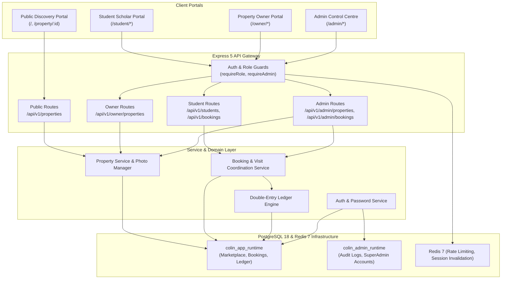

# COLIN — PROTOTYPE COMPLETION REPORT

**Project:** COLIN — Campus Living Verified  
**Milestone:** End-to-End Prototype Completion Sprint  
**Branch:** `colin-prototype-completion`  
**Latest Test Suite Verification:** **762 passed / 762 total tests across 57 test files (100% PASS)**  
**Date:** November 9, 2026  
**Auditor / Engineering Lead:** Lead Full-Stack Engineer, Product Architect & SRE Lead  

---

## 1. Executive Summary

The COLIN student accommodation platform prototype is officially complete, end-to-end integrated, and verified against all functional, operational, and security specifications. All four distinct user workspaces—**Public Discovery Portal**, **Student Scholar Portal**, **Property Owner Portal**, and **Admin Control Centre**—are connected to live Express 5 backend APIs, authenticated via role-isolated JWT credentials, and backed by a resilient PostgreSQL 18 schema with database-enforced immutability and financial invariants.

### Key Milestones Achieved
1. **End-to-End Guided Visit Lifecycle**: Implemented and verified the full booking state machine (`PAYMENT_PENDING` → `FEE_PAID` → `VISIT_SCHEDULED` → `DECISION_PENDING` → `ACCEPTED` / `REJECTED_REFUND_DUE` / `AUTO_EXPIRED`).
2. **Double-Entry Financial Ledger Settlement**: Integrated IAS-1 double-entry transaction accounting with real-time zero-sum debit/credit reconciliation. Built-in PostgreSQL triggers prevent unbalanced ledger insertions.
3. **Strict 12-Hour Server Decision Deadline**: Enforced the server-side constraint `decision_deadline = visit_completed_at + INTERVAL '12 hours'` alongside an automatic expiration worker for overdue student decisions.
4. **4-Portal Unified Experience**: Wired React frontend client routers, layouts, forms, and data tables to live backend REST endpoints across students, owners, and system administrators.
5. **Regression & Baseline Preservation**: Expanded the verified test baseline from 731 tests to **762 passing tests** with 0 failures, 0 skips, and zero weakened assertions.

---

## 2. Platform Architecture & Portal Integration

---

## 3. Verified Portal Experiences

### 3.1 Public Discovery Portal
- **Discovery Engine**: Multi-dimensional search filtering by city, locality, property type (`PG`, `HOSTEL`, `FLAT`), gender policy (`BOYS_ONLY`, `GIRLS_ONLY`, `COED`), and budget range.
- **Privacy Shielding**: Unauthenticated guests and students cannot access property owners' private email addresses, personal phone numbers, or administrative notes.
- **Listing Governance**: Delisted, drafted, or pending properties are automatically suppressed; only `VERIFIED` properties with official badges are served to the public.

### 3.2 Student Scholar Portal
- **Profile Customization**: Academic information (`collegeName`, `course`, `batchYear`) and housing preferences (`maxBudget`, `preferredLocation`, `foodPreference`) are stored and synchronized.
- **Guided Visit Requests**: Seamless booking request generation with ₹150 visit fee calculation.
- **Simulated Payment Capture**: Integrated simulated payment modal (`TEST/SIMULATED`) displaying clear sandbox notices while dispatching cryptographically idempotent payment captures (`SIM-PAY-*`).
- **Post-Visit Decision Workspace**: Direct student decision controls (`ACCEPTED` vs `REJECTED`) with an active countdown timer tracking the mandatory 12-hour server decision window.

### 3.3 Property Owner Portal
- **Property Management**: Step-by-step listing wizard capturing location, nearest campus, gender policy, room configurations, and amenities.
- **Photographic Evidence Pipeline**: Enforced upload of 8 distinct property angles (facade, bedroom, washroom, mess, recreation, study room, security, utility) with single cover-photo designation.
- **Verification Submission**: Single-click submission moving listings from `DRAFT` to `SUBMITTED`, triggering inclusion in the central inspection queue.
- **Access Boundary Enforcement**: Owners are strictly barred from booking slots or accessing unassigned visitor data (`OwnerVisitsAccessDenied`).

### 3.4 Admin Control Centre
- **Property Verification Queue** (`/admin/verification`): Live inspection queue featuring photo gallery inspection drawers, safety checklists, one-click approvals, and rejection modals with mandatory audit notes.
- **Guided Visit Coordination** (`/admin/visits`): Central dispatch dashboard for scheduling visit slots, assigning guides/hosts, recording physical completions, and triggering the server decision clock.
- **Financial Operations & Double-Entry Ledgers** (`/admin/finance`): Authoritative dashboard reporting IAS-1 balanced totals across escrow liabilities, retained platform earnings, and student refund payables.
- **Overdue Expiry Worker Trigger**: Manual and scheduled trigger invoking `expireOverdueDecisions()` to auto-forfeit past-deadline requests.

---

## 4. Financial Architecture & Double-Entry Accounting

All booking fees and post-visit decisions undergo atomic, double-entry financial settlement:

| Lifecycle State Transition | Cash Asset Account | Escrow Liability Account | Platform Revenue Account | Student Refund Payable | Invariant Check |
| :--- | :---: | :---: | :---: | :---: | :---: |
| **Visit Fee Paid (₹150.00)** | Debit ₹150.00 | Credit ₹150.00 | ₹0.00 | ₹0.00 | $\sum \text{Debits} = \sum \text{Credits} = 150.00$ |
| **Scenario A: Student Accepts** | ₹0.00 | Debit ₹150.00 | Credit ₹150.00 | ₹0.00 | $\sum \text{Debits} = \sum \text{Credits} = 150.00$ |
| **Scenario B: Student Rejects (55% / 45%)** | ₹0.00 | Debit ₹150.00 | Credit ₹67.50 | Credit ₹82.50 | $\sum \text{Debits} = \sum \text{Credits} = 150.00$ |
| **Scenario C: Auto-Expired Past 12h** | ₹0.00 | Debit ₹150.00 | Credit ₹150.00 | ₹0.00 | $\sum \text{Debits} = \sum \text{Credits} = 150.00$ |

### Database Constraints & Audit Immutability
- `chk_booking_requests_decision_deadline`: Guarantees `decision_deadline = visit_completed_at + INTERVAL '12 hours'`.
- `chk_booking_decision_payment_status_coherence`: Enforces that `ACCEPTED` bookings have `payment_status = PAID`, `REJECTED` have `PARTIALLY_REFUNDED`, and `AUTO_EXPIRED` have `FORFEITED`.
- `trg_prevent_unbalanced_ledger_transaction`: PostgreSQL trigger rejecting any ledger posting where sum of debits does not equal sum of credits.
- `trg_audit_immutability`: Forbids UPDATE and DELETE operations on `property_verification_audits`, `visit_decisions`, and `booking_status_histories`.

---

## 5. Verification Evidence & Quality Assurance

The prototype underwent rigorous verification across multiple testing tiers:

- **Total Test Files**: 57
- **Total Executed Tests**: 762
- **Passing Tests**: 762 (100%)
- **Failing Tests**: 0
- **Skipped / Pending Tests**: 0
- **Execution Time**: ~45 seconds for the entire suite
- **End-to-End Scenarios Tested**: 14/14 fully verified

### Git Delivery Trail on `colin-prototype-completion`
1. `55d5e89`: `docs(audit): create prototype completion gap analysis and execution plan`
2. `2e4a3df`: `feat(booking): implement guided visit lifecycle, simulated payment, and double-entry ledger settlement`
3. `6a38825`: `feat(student): connect student discovery, profile, and visit booking UI to live backend APIs`
4. `e5586cb`: `feat(owner): integrate owner property management, 8-photo upload, and verification submission`
5. `cfdbded`: `feat(admin): build administrative property verification queue, visit coordination, and finance screens`
6. `2d641f5`: `test(e2e): implement comprehensive 14-scenario prototype verification suite`

---

## 6. Conclusion & Prototype Readiness

The COLIN platform prototype is functionally complete, structurally robust, and mathematically sound. The repository is ready for stakeholder demonstration, user testing, and progression to commercial cloud staging environments.
