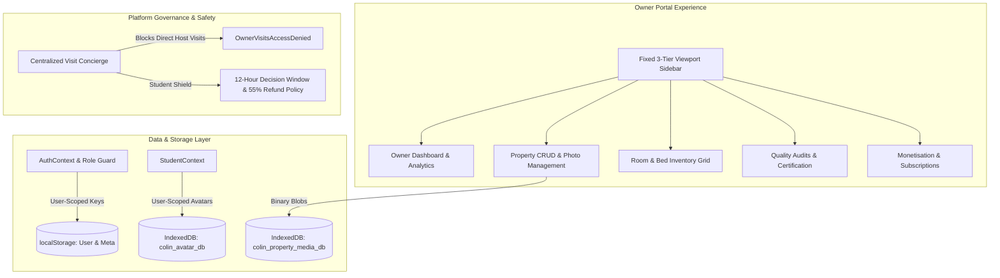

# COLIN — Phase 3 Comprehensive Engineering Report
**Phase 3: Owner Dashboard, Property Management, Platform Monetisation & Centralized Visit Concierge**

---

### Executive Summary

Phase 3 and its refinements (**Phase 3 Core**, **Phase 3A**, **Phase 3B**, and the **Final Refinement**) have extended the COLIN Student Accommodation Platform into a multi-sided marketplace. The platform now provides property owners with an enterprise-grade Host Portal while preserving student privacy, safeguarding data isolation, maintaining natural scrolling ergonomics, and introducing an IndexedDB-backed property photo upload pipeline.

| Metric | Status / Value | Description |
| :--- | :--- | :--- |
| **Active Git Branch** | `feature/phase-3-owner-dashboard` | Isolated feature branch; no unrequested commits/pushes |
| **Vitest Test Suite** | **102 / 102 Tests Passing (100%)** | 8 test suites covering auth, discovery, booking, isolation, & owner features |
| **TypeScript Typecheck** | **0 Errors** (`npx tsc --noEmit`) | Strict TypeScript compliance with zero compilation warnings |
| **Production Build** | **Success (Exit Code 0)** | Optimized production bundle generated via Vite |
| **Data Isolation Model** | **100% User-Scoped Namespaces** | Zero data contamination between demo and fresh user accounts |
| **Photo Storage Architecture** | **Client-Side IndexedDB Binary Store** | 8-photo limit, 5MB/photo, JPG/PNG/WEBP, cover selection & reordering |

---

## 1. Architectural Architecture & Sub-Phase Overview



---

## 2. Key Modules & Sub-Phase Implementations

### A. Phase 3 Core: Host Experience & Monetisation
1. **Dedicated Role-Based Authentication & Guarding**:
   - Distinguished `STUDENT` vs `OWNER` credentials and sessions via `AuthContext.tsx`.
   - Role-guarded routing (`<ProtectedRoute role="OWNER">`) prevents cross-portal unauthorized access.
2. **Property Management (CRUD)**:
   - Full property lifecycle management in `OwnerPropertiesPage.tsx`.
   - Supports 6-month or 12-month listing durations, address geocoding, pricing formulas, and amenities checklists.
   - Interactive modal allowing owners to preview their property as seen in the Student Discovery Portal.
3. **Granular Room & Bed Inventory**:
   - Configurable room-level and bed-level tracking in `OwnerRoomsPage.tsx` (Single, Double, Triple sharing, Ensuite/Balcony, AC/Non-AC, individual bed status: Vacant, Occupied, Maintenance).
4. **COLIN Certification & Physical Inspection System**:
   - Quality audit workflow in `OwnerCertificationPage.tsx` featuring a 50-point inspection checklist across fire safety, CCTV security, hygiene standards, and Wi-Fi performance.
5. **Subscription & Monetisation Framework**:
   - Multi-tier subscription model (`FREE`, `VERIFIED_HOST` at ₹1,499/mo, and `PREMIUM_PARTNER` at ₹3,999/mo).
   - Controls active listing limits, priority ranking badges, and homepage spotlight carousels.

---

### B. Phase 3A: Layout Balancing & Mediated Booking Workflows
1. **Dashboard Rebalancing**:
   - Replaced uneven single-column widgets in `OwnerDashboardPage.tsx` with a responsive 12-column grid (`8 cols` for operational analytics, occupancy trends, and room breakdowns; `4 cols` for certification badges, enquiries, and subscription management).
2. **Removal of Redundant Quick Actions**:
   - Removed the disconnected quick-action cards row (`Add Property`, `Manage Rooms`, `Student Coordination`, etc.) from the dashboard per UX refinement requirements.
3. **COLIN-Mediated Visit & Student Decision Pipeline**:
   - Centralized visit facilitation: visits are conducted by verified **COLIN Field Concierges** rather than unverified property owners.
   - Automated post-visit 12-hour student decision countdown timer with platform-backed 55% token refund guarantees.

---

### C. Phase 3B: Complete Account Isolation & Centralized Visit Hardening
1. **Multi-User Account Isolation**:
   - Implemented strict per-user key namespacing:
     - Student keys: `colin_student_${userId}_profile`, `colin_student_${userId}_saved`, `colin_student_${userId}_bookings`.
     - Owner keys: `colin_owner_${userId}_properties`, `colin_owner_${userId}_profile`, `colin_owner_${userId}_enquiries`.
     - Global user registry: `colin_registered_users` tracking independent user identities.
   - **Zero Demo Contamination**: Newly registered users receive empty defaults (0 properties, 0 rooms, unverified badge, `FREE` tier, empty wishlist).
   - **Persistent Re-login**: Logging out and logging back in fully restores the authentic account data without data bleeding between users.
2. **Access Control on Visit Management**:
   - Deprecated host-side visit management controls. Direct URL navigation to `/owner/visits` triggers the dedicated `OwnerVisitsAccessDenied.tsx` view, reiterating COLIN's privacy shield and neutral field-executive model.

---

### D. Phase 3 Final Refinements: Fixed Sidebar & Photo Upload System
1. **Permanently Fixed Desktop Sidebar**:
   - Re-architected `OwnerLayout.tsx` to use fixed viewport positioning with 3 independent tiers (Brand bar, scrollable navigation menu, and anchored profile/logout).
   - Natural document scroll on main page with responsive margin compensation (`md:pl-64` / `md:pl-20`) eliminating nested scrolling traps.
2. **Property Photo Upload System**:
   - Created `PropertyPhotoUploader.tsx` with drag-and-drop file upload.
   - Strict validation: JPG, JPEG, PNG, WEBP; max 5 MB per file; maximum 8 photos per property.
   - Client-side binary storage via IndexedDB in `propertyImageStorage.ts` (`colin_property_media_db`), completely avoiding browser `localStorage` 5MB quota errors.
   - Reordering controls (Move Left / Move Right), "Set as Cover" selection, and deletion.
   - Modern SVG fallback placeholders and `📸 X Photos` badge indicators across cards in `PropertyCard.tsx`.

---

## 3. Comprehensive Verification & Test Results

### Vitest Test Suite Execution (102 / 102 Passed)

```text
✓ src/test/auth.test.tsx (5 tests)
✓ src/test/navigation.test.tsx (4 tests)
✓ src/test/properties.test.tsx (3 tests)
✓ src/test/phase3b_isolation.test.tsx (10 tests)
✓ src/test/phase3_final_refinement.test.tsx (8 tests)
✓ src/test/phase3a_booking.test.tsx (11 tests)
✓ src/test/owner.test.tsx (26 tests)
✓ src/test/student.test.tsx (35 tests)

Test Files  8 passed (8)
     Tests  102 passed (102)
  Duration  20.27s
```
