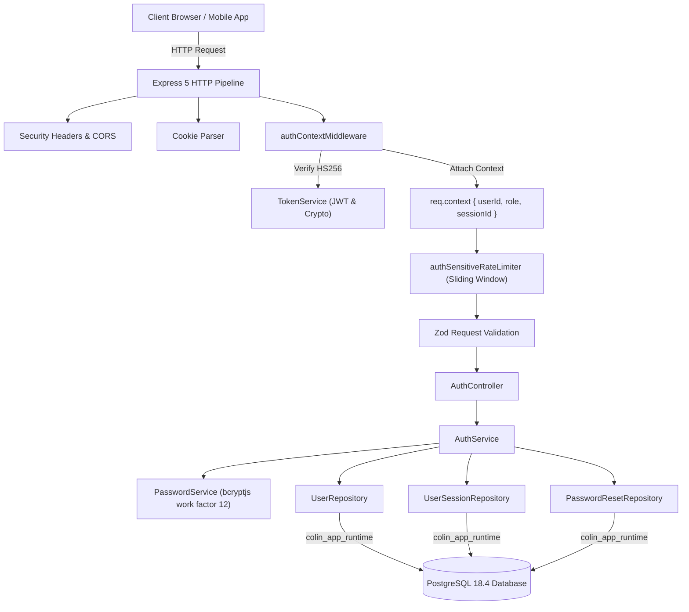
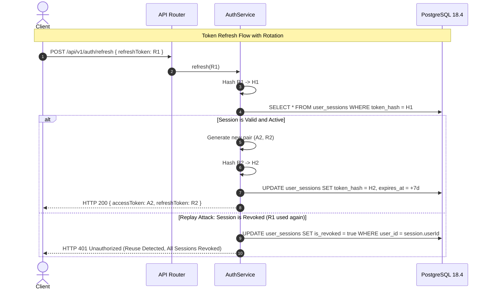

# PHASE 4A.2.3 — AUTHENTICATION & AUTHORIZATION ARCHITECTURE REPORT

**Project:** COLIN — Campus Living Verified  
**Phase:** Phase 4A.2.3 (Authentication & Authorization Integration)  
**Engineering Roles:** Principal Backend Architect, Authentication & Identity Architect, Application Security Engineer  
**Status:** COMPLETE & VERIFIED  
**Date:** 2026-11-06  

---

## 1. Architectural Overview & Design Philosophy

Phase 4A.2.3 establishes the production-grade authentication and authorization foundation for COLIN. The architecture bridges the decoupled Express 5 HTTP pipeline established in Phase 4A.2.2.3 with the hardened PostgreSQL 18.4 schema verified in Phase 4A.2.2.1.

The primary design tenets are:

1. **Zero-Trust Identity Extraction:** Client-supplied role assertions, identity headers (`x-user-id`, `x-role`), and query parameters are strictly discarded. Request authentication is derived exclusively from cryptographically signed JWT access tokens or verified database sessions.
2. **Short-Lived Access & Rotated Refresh Credentials:** Access tokens are short-lived (15 minutes / 900s) HS256 JWTs. Refresh tokens are long-lived (7 days), high-entropy 256-bit random strings stored in PostgreSQL as SHA-256 hashes. Refresh token rotation is mandatory, and token reuse immediately triggers complete session family invalidation.
3. **Multi-Tenant Role Isolation:** Strict boundaries govern the three distinct marketplace personas:
   - **Student Portal:** Role `STUDENT`, attached to verified `StudentProfile`.
   - **Owner Portal:** Role `OWNER`, attached to verified `OwnerProfile`.
   - **Admin Control Centre:** Role `ADMIN`, attached to isolated `AdminAccount` and `AdminSession` infrastructure.
4. **Defense in Depth & Least-Privilege Persistence:** Database interactions utilize `colin_app_runtime` for regular user authentication and session persistence, completely segregated from `colin_admin_runtime` which governs administrative audit logs.

---

## 2. Component Architecture

### 2.1 Core Services
* **`PasswordService` (`src/server/auth/password.service.ts`):** Implements salted bcrypt hashing with configurable work factor (12 in production, 10 in test), timing-safe comparison, and strict complexity policy verification (minimum 8 characters, maximum 128 characters, requiring at least one letter and one number).
* **`TokenService` (`src/server/auth/token.service.ts`):** Signs and verifies JWT access tokens (HS256) with 900-second expiration. Generates 256-bit opaque random hex tokens and computes deterministic SHA-256 hashes for secure database persistence.
* **`AuthService` (`src/server/services/AuthService.ts`):** Coordinates user registration, login credential verification, session creation, token refresh with reuse detection, password changes, forgot/reset workflows, and session audits.

### 2.2 Persistence Repositories
* **`UserRepository` (`src/server/database/repositories/UserRepository.ts`):** Executes queries under `colin_app_runtime`. Provides atomic user and profile creation (`UserProfile`, `StudentProfile`, `OwnerProfile`), email uniqueness checks, password updates, and login timestamp audits.
* **`UserSessionRepository` (`src/server/database/repositories/UserSessionRepository.ts`):** Persists session tokens as SHA-256 hashes in `user_sessions`. Supports token hash rotation, single session revocation, and family-wide revocation for replay-attack defense.
* **`PasswordResetRepository` (`src/server/database/repositories/PasswordResetRepository.ts`):** Manages single-use, 1-hour expiration password reset token hashes in `password_reset_tokens`.

### 2.3 Middleware & Guards
* **`authContextMiddleware` (`src/server/middleware/authContext.ts`):** Inspects incoming requests for `Authorization: Bearer <token>` or `accessToken` cookie. Validates token cryptographically and sets `req.context`. In non-production, preserves backwards compatibility with fixture test tokens (`test-token-<userId>-<role>`).
* **Route Guards:**
  - `requireAuth()`: Rejects unauthenticated requests with HTTP 401.
  - `requireRole([roles])`: Rejects unauthorized roles with HTTP 403.
  - `requireResourceOwner((req) => ownerId)`: Ensures a user can only manipulate their own records or allows `ADMIN` override.
  - `requireAdmin(minRole)`: Strictly guards administrative operations.
* **`authSensitiveRateLimiter` (`src/server/middleware/rateLimiter.ts`):** In-memory sliding-window rate limiter enforcing a maximum of 10 requests per 15-minute window on sensitive auth endpoints, returning HTTP 429 upon breach.

---

## 3. Token Lifecycle & Reuse Detection Sequence

---

## 4. Architectural Verification Verdict

The architecture has been fully implemented, integrated with the central Express pipeline, and validated against live PostgreSQL 18.4 without mocks. All components adhere strictly to least-privilege runtime security and modern authentication standards.
