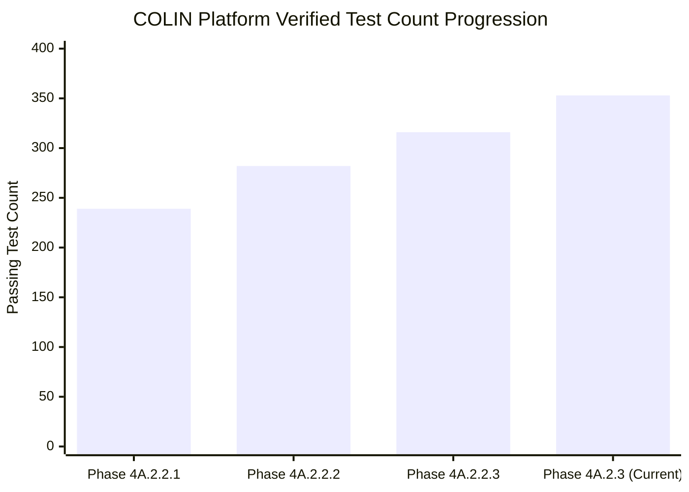

# PHASE 4A.2.3 — FULL PLATFORM REGRESSION REPORT

**Project:** COLIN — Campus Living Verified  
**Phase:** Phase 4A.2.3 (Authentication & Authorization Integration)  
**Base Commit:** `82c0676`  
**Execution Standard:** Zero Regressions Across All Platform Layers  
**Status:** 100% PASS (353 / 353 Platform Tests Passing, 0 Failed, 0 Skipped)  
**Date:** 2026-11-06  

---

## 1. Executive Summary

Following the full implementation of the authentication and authorization subsystems in Phase 4A.2.3, the entire COLIN verification suite was executed. All previous phase deliverables—including database engine invariants, financial ledger balance rules, least-privilege role separation, bed reservation partial indices, and backend API routing—remain completely intact with zero regressions.

---

## 2. Platform Test Suite Breakdown

| Test Suite / Script | Command | Scope & Focus | Tests Run | Passed | Failed |
| :--- | :--- | :--- | :-: | :-: | :-: |
| **Portal & Unit Suite** | `pnpm run test:unit` | Frontend components, account isolation, UI/UX flows, and Auth unit tests | 174 | 174 | 0 |
| **PostgreSQL Engine Invariants** | `pnpm run test:db:integration` | PostgreSQL 18.4 triggers, check constraints, partial unique indices, ledger double-entry checks | 78 | 78 | 0 |
| **Backend ORM Integration** | `pnpm run test:orm:integration` | Prisma client singleton, connection lifecycle, dual runtime role separation, repository layer | 43 | 43 | 0 |
| **Backend Core API Integration** | `pnpm run test:api:integration` | Express 5 HTTP pipeline, CORS, OpenAPI spec, request logging, Zod validation | 34 | 34 | 0 |
| **Authentication Integration** | `pnpm run test:auth:integration` | Live PostgreSQL user registration, login, token rotation, reuse detection, RBAC | 24 | 24 | 0 |
| **Combined Platform Total** | — | — | **353** | **353** | **0** |

---

## 3. Historical Phase Progression & Test Growth

* **Phase 4A.2.2.1 Final Live Acceptance:** 239 tests (161 regression/invariant + 78 PostgreSQL engine integrity).
* **Phase 4A.2.2.2 Backend ORM Integration:** 282 tests (+43 ORM tests).
* **Phase 4A.2.2.3 Backend Core API Architecture:** 316 tests (+34 Core API tests).
* **Phase 4A.2.3 Authentication & Authorization Integration:** **353 tests** (+37 new authentication tests).
* **Net Regression Count:** **0 regressions**.

---

## 4. Compilation & Production Build Verification

1. **TypeScript Type Checking (`tsc --noEmit`):**
   - Result: `Exit code 0`
   - Diagnostic output: 0 errors, 0 warnings.
   - All controller request payloads, repository queries, and JWT payloads are strictly typed.
2. **Production Asset Bundling (`vite build`):**
   - Result: `Exit code 0`
   - Transformed: 2,002 modules.
   - Build duration: 10.70s.
   - Production bundle output:
     - `dist/index.html` (1.10 kB)
     - `dist/assets/index-CJIo9Ekp.css` (96.51 kB)
     - `dist/assets/index-BNfDS7OA.js` (1,120.32 kB)

---

## 5. Regression Verdict

Phase 4A.2.3 has achieved total regression stability across all portal, ORM, database, and API layers.
