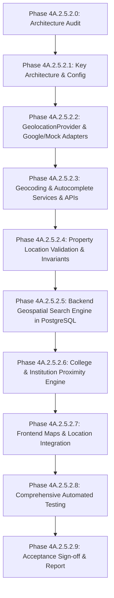

# COLIN — Phase 4A.2.5.2.0 Geolocation & Location Architecture Audit

**Project:** COLIN — Campus Living Verified (Student Accommodation Marketplace)  
**Parent Phase:** Phase 4A.2.5 — External Services & Infrastructure Integration  
**Sub-Phase:** Phase 4A.2.5.2.0 — Initial Location Architecture Audit  
**Date:** November 7, 2026  
**Auditor:** Principal Backend Engineer, Geospatial Systems Architect, Google Maps Platform Engineer, Application Security Engineer  
**Feature Branch:** `phase-4a-2-5-external-infrastructure`  
**Current HEAD:** `4259cbf`  

---

## 1. Executive Summary & Purpose

This audit establishes the baseline architectural assessment for integrating Google Maps Platform and server-controlled geospatial capabilities into COLIN.

COLIN's student accommodation marketplace relies heavily on location relevance: students require accommodation within short, predictable distances of their university campuses, coaching institutes, or transit hubs. Property owners require an intuitive, accurate method to pinpoint properties without entering arbitrary coordinate floats.

The audit evaluates COLIN's existing codebase, identifying architectural strengths, critical gaps, database schemas, security postures, and cost implications before implementing Phase 4A.2.5.2.

---

## 2. Existing Architecture & Baseline Inspection

### 2.1 Git Repository & Working Tree Status
* **Active Branch:** `phase-4a-2-5-external-infrastructure`
* **Current HEAD:** `4259cbf` (`feat(storage): Phase 4A.2.5.1 -- Cloud Image Storage Infrastructure`)
* **Working Tree:** Completely clean (zero unstaged changes or untracked files).
* **Automated Test Baseline:** 486 platform automated tests passing with 100% success rate across 10 test suites; TypeScript strict mode clean (`tsc --noEmit` exit code 0).

### 2.2 Existing Location Infrastructure
1. **Frontend Service (`src/services/locationService.ts`)**:
   - `Coordinates` interface (`{ latitude: number, longitude: number }`).
   - `calculateHaversineDistance()`: Great-circle spherical distance computation based on mean Earth radius $R = 6371\text{ km}$.
   - `formatDistance()`: Human-friendly string formatter (`"450 m away"` or `"2.3 km away"`).
   - `getCurrentUserLocation()`: Browser `navigator.geolocation` wrapper respecting user consent (invoked only on explicit click).
   - `MAP_CONFIG`: Configuration stub indicating future Google Maps integration.
2. **Database Schema & Prisma Model (`prisma/schema.prisma`)**:
   - Model `Property` defines:
     - `addressLine1` (`address_line1`, VarChar(255))
     - `addressLine2` (`address_line2`, VarChar(255), optional)
     - `landmark` (`landmark`, VarChar(150), optional)
     - `city` (`city`, VarChar(100))
     - `state` (`state`, VarChar(100))
     - `pincode` (`pincode`, VarChar(10))
     - `latitude` (`latitude`, Decimal(10, 7), optional)
     - `longitude` (`longitude`, Decimal(10, 7), optional)
     - `nearestCampus` (`nearest_campus`, VarChar(255), optional)
     - `distanceToCampusKm` (`distance_to_campus_km`, Decimal(5, 2), optional)
     - Relational Index: `@@index([latitude, longitude])` already exists in PostgreSQL.
3. **Public Discovery Endpoints (`src/server/api/v1/controllers/public.property.controller.ts`)**:
   - `GET /api/v1/properties`: Filters by keyword, city, locality, propertyType, genderPolicy, occupancyStatus, minRent, maxRent, amenities.
   - Does **not** yet accept `latitude`, `longitude`, `radiusKm`, or `sortBy: 'distance'`.
   - `formatPublicPropertyDto()` formats address fields including `latitude`, `longitude`, `nearestCampus`, `distanceToCampusKm`.
4. **Owner Management Endpoints (`src/server/api/v1/controllers/owner.property.controller.ts`)**:
   - `POST /api/v1/owner/properties` and `PATCH /api/v1/owner/properties/:id`: Accept address strings and optional `latitude` and `longitude`.
   - Coordinates are currently not validated or geocoded on the server.
5. **Frontend UI Components**:
   - `StudentExplorePage.tsx`: Includes view toggle (`grid`, `list`, `map`), GPS location trigger button, and client-side distance calculations against mock properties.
   - `OwnerPropertiesPage.tsx`: Property creation modal includes manual text inputs for address, neighborhood, city, and campus, but generates mock random coordinates rather than resolving true locations.

---

## 3. Identified Architecture Gaps

| Area | Current State | Required Target State |
| :--- | :--- | :--- |
| **Geospatial Search Engine** | Filtering done in-memory on the client; backend has no radius or coordinate search. | High-performance, parameterized SQL geospatial search in `PropertyRepository` using bounding-box prefilter and spherical Haversine distance calculation. |
| **Geocoding & Reverse Geocoding** | None. Address strings are saved without coordinate resolution or verification. | Server-controlled `GeolocationService` supporting forward and reverse geocoding with caching, coordinate validation, and fallback mechanisms. |
| **Provider Abstraction** | None. Direct stubs in frontend. | Pluggable `GeolocationProvider` interface with `GoogleGeolocationProvider` and `MockGeolocationProvider`. |
| **Address Autocomplete** | Hardcoded city/campus dropdowns. | Backend-proxied Places Autocomplete endpoint with session tokens, debouncing, and caching to avoid frontend key leaks and runaway API costs. |
| **API Key Architecture** | None. | Strict segregation between browser-facing restricted key and backend server key. |
| **College / Campus Directory** | Static string list in `mockData.ts`. | Structured institutional location dataset / service supporting campus coordinate queries and proximity searches. |
| **Coordinate Validation** | None. | Strict DTO and service-level bounds checking: $-90 \le \text{lat} \le 90$, $-180 \le \text{lng} \le 180$, rejecting NaN, Infinity, and malformed inputs. |
| **Privacy Safeguards** | Client handles raw coordinates. | Student location is never persisted without consent, never logged, and never transmitted to property owners. |

---

## 4. Google Maps Platform API Evaluation

### 4.1 Selected APIs & Roles

1. **Geocoding API (Server-Side)**:
   - **Purpose**: Forward geocoding of owner-submitted property addresses into verified coordinates; reverse geocoding for student-selected map markers.
   - **Execution**: Server-to-server only using `GOOGLE_MAPS_SERVER_KEY`.
   - **Fields**: `geometry.location` (lat/lng), `formatted_address`, `address_components` (locality, city, state, postal_code).
2. **Places API (New) (Server-Proxied / Client Autocomplete)**:
   - **Purpose**: Address and institution autocomplete for students searching stays and owners listing properties.
   - **Execution**: Proxied through backend endpoint `GET /api/v1/location/autocomplete` with session tokens to minimize costs, or direct client autocomplete with restricted browser key.
   - **Field Masks**: `places.id`, `places.displayName`, `places.formattedAddress`, `places.location`. Request only essential fields.
3. **Maps JavaScript API (Client-Side)**:
   - **Purpose**: Interactive map rendering in Student Portal (`StudentExplorePage` map view) and Owner Portal (pin confirmation).
   - **Execution**: Client-side loaded with `VITE_GOOGLE_MAPS_BROWSER_KEY` restricted to authorized HTTP referrers.

### 4.2 Architectural Invariant
**Google Maps provides external geolocation capabilities; COLIN owns its property search engine.**  
Google Places Nearby Search will **never** be used to search for student accommodations. COLIN's database remains the single source of truth for all properties, room inventories, and pricing.

---

## 5. Backend Geospatial Search Architecture

### 5.1 Distance Calculation Methodology
COLIN will implement a two-tier database geospatial query in PostgreSQL:

1. **Bounding-Box Prefilter (Fast Index Scan)**:
   Given search center $(\text{lat}_0, \text{lng}_0)$ and radius $r$ km:
   $$\Delta \text{lat} = \frac{r}{111.32}$$
   $$\Delta \text{lng} = \frac{r}{111.32 \times \cos(\text{lat}_0 \times \frac{\pi}{180})}$$
   The query applies:
   $$\text{latitude} \in [\text{lat}_0 - \Delta \text{lat}, \text{lat}_0 + \Delta \text{lat}]$$
   $$\text{longitude} \in [\text{lng}_0 - \Delta \text{lng}, \text{lng}_0 + \Delta \text{lng}]$$
   This utilizes PostgreSQL's existing `@@index([latitude, longitude])` index for rapid candidate pruning.

2. **Exact Spherical Haversine Distance Calculation**:
   For candidates within the bounding box, PostgreSQL calculates the great-circle distance:
   $$d = 2 R \arcsin \left( \sqrt{ \sin^2\left(\frac{\Delta \phi}{2}\right) + \cos(\phi_1)\cos(\phi_2)\sin^2\left(\frac{\Delta \lambda}{2}\right) } \right)$$
   Where $R = 6371\text{ km}$, $\phi = \text{latitude in radians}$, $\lambda = \text{longitude in radians}$.
   - Candidates with $d \le r$ are retained.
   - When `sortBy: 'distance'` is requested, results are sorted by $d$ ascending.

3. **Antimeridian & Polar Handling**:
   - If $\text{lng}_0 + \Delta \text{lng} > 180$ or $\text{lng}_0 - \Delta \text{lng} < -180$, the bounding-box wraps across two longitude segments.
   - Latitude bounding box is clamped to $[-90, 90]$.

---

## 6. Security Architecture & Threat Modeling

1. **API Key Segregation**:
   - `GOOGLE_MAPS_SERVER_KEY`: Stored in backend environment variables (`.env`). Restricted by IP address in Google Cloud Console. Never returned in API responses, never exposed in client bundles, never logged.
   - `VITE_GOOGLE_MAPS_BROWSER_KEY`: Exposed to client browser for Maps JS SDK only. Restricted by HTTP referrer (`colin.in/*`, `localhost:*`) and restricted specifically to Maps JavaScript API.
2. **SQL Injection Prevention**:
   - Raw SQL Haversine expressions must use parameterized values (`$1, $2, $3...` or Prisma `$queryRaw` tagged templates). User coordinates and radius parameters are validated as strict numbers before query execution.
3. **SSRF & Rate Limiting**:
   - Location proxy endpoints (`/api/v1/location/autocomplete`, `/api/v1/location/geocode`) will enforce rate limiting and parameter validation to prevent abuse.
4. **Student Privacy**:
   - Current GPS coordinates obtained via browser Geolocation are retained solely in client-side memory for the active discovery session.
   - Precise student coordinates are never stored in the database, never exposed to owners, and never attached to public requests.

---

## 7. Cost Optimization & Google ToS Compliance

1. **Field Masking**: Always specify minimal field masks (`displayName,formattedAddress,location`) to avoid higher Places API billing tiers.
2. **Session Tokens**: Group autocomplete keystrokes and place detail selections under single session tokens to benefit from Google's session-based billing.
3. **In-Memory Caching**: Cache geocoding results for repeated address queries using an in-memory TTL cache (e.g. 24 hours), avoiding redundant billable calls for unchanged property addresses.
4. **Google Terms of Service Compliance**:
   - Only cache permitted fields (`latitude`, `longitude`, `place_id`, `formatted_address`) for property location records.
   - Do not store ephemeral place details or photos outside permitted caching windows.
   - Display required Google attribution and logos on Maps JavaScript UI.

---

## 8. Implementation Plan & Phased Roadmap

---

## 9. Testing & Verification Strategy

1. **Provider Unit Tests**:
   - Mock provider responses for forward geocoding, reverse geocoding, and autocomplete.
   - Error handling: network timeout, quota exceeded, invalid API key, malformed JSON.
2. **Coordinate & Bounds Validation**:
   - Valid coordinates (e.g., Delhi: 28.6942, 77.2085; Bangalore: 12.9352, 77.6245).
   - Boundary coordinates: (0, 0), (90, 180), (-90, -180).
   - Invalid coordinates: lat > 90, lat < -90, lng > 180, lng < -180, NaN, Infinity, non-numeric strings.
3. **Independent Distance Oracle Tests**:
   - Reference distance tests verified against independent geodetic calculation (WGS84 / Haversine reference values: 0 km, 1 km, 5 km, 10 km, 25 km, antimeridian).
4. **PostgreSQL Integration Tests**:
   - Live query testing against disposable PostgreSQL 18.4 on port 5433.
   - Verify bounding box filters, radius constraints, distance sorting, unverified property exclusion, and pagination consistency.
5. **Regression Verification**:
   - All 486 existing tests must continue passing with zero regressions.

---

## 10. Audit Sign-Off
- **Status:** **APPROVED TO PROCEED**
- **Next Sub-Phase:** Phase 4A.2.5.2.1 — API Key Architecture & Configuration Setup.
