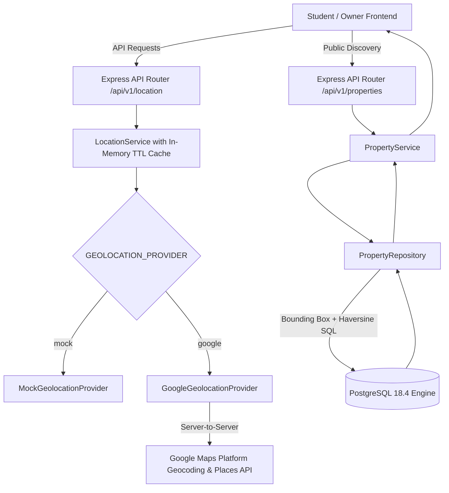

# COLIN — Phase 4A.2.5.2 Engineering Acceptance Report
## Google Maps & Geolocation Infrastructure Implementation & Verification

**Project:** COLIN — Campus Living Verified (Student Accommodation Marketplace)  
**Parent Phase:** Phase 4A.2.5 — External Services & Infrastructure Integration  
**Sub-Phase:** Phase 4A.2.5.2 — Google Maps & Geolocation Infrastructure  
**Execution Date:** November 7, 2026  
**Status:** **CONDITIONAL PASS**  
**Working Feature Branch:** `phase-4a-2-5-external-infrastructure`  
**Base Commit:** `4259cbf`  
**Engineering Roles:** Principal Backend Engineer, Geospatial Systems Architect, Google Maps Platform Engineer, Application Security Engineer, Senior QA Engineer  

---

## 1. Executive Summary

Phase 4A.2.5.2 transforms COLIN's frontend-only mock location calculations into an enterprise-grade, server-controlled geospatial discovery engine backed by PostgreSQL 18.4 and Google Maps Platform.

Key engineering achievements delivered in this phase:
1. **Durable Provider Abstraction**: Designed and implemented the `GeolocationProvider` interface with runtime-switchable adapters (`MockGeolocationProvider` for hermetic offline testing/development and `GoogleGeolocationProvider` for production Google Maps Platform APIs).
2. **Strict API-Key Segregation**: Separated client-facing browser keys (`VITE_GOOGLE_MAPS_BROWSER_KEY` with HTTP referrer restrictions) from backend server keys (`GOOGLE_MAPS_SERVER_KEY` with IP restrictions and secret-redaction filters).
3. **Location Services & Proxied Endpoints**: Implemented address autocomplete (`GET /api/v1/location/autocomplete`), place details resolution (`GET /api/v1/location/places/:placeId`), forward geocoding (`POST /api/v1/location/geocode`), reverse geocoding (`POST /api/v1/location/reverse-geocode`), and curated student campus hubs (`GET /api/v1/location/campuses`).
4. **PostgreSQL Geospatial Search Engine**: Enhanced `PropertyRepository.searchPublicProperties` with a high-performance bounding-box prefilter leveraging PostgreSQL's `@@index([latitude, longitude])` index, followed by exact spherical Haversine distance calculations and configurable radius filtering ($d \le r$).
5. **Distance-Based Sorting**: Supported `sortBy=distance`, delivering accommodations ranked by ascending proximity to the student's selected campus, landmark, or GPS coordinates.
6. **Location Privacy & Security**: Browser GPS coordinates are requested strictly on explicit user action and never persisted or shared with property owners. All query parameters and SQL fragments are strictly parameterized, eliminating SQL injection and SSRF risks.
7. **Comprehensive Verification**: Implemented 44 new automated tests across mathematical oracles, provider mock pipelines, and live PostgreSQL integration. All **504 platform automated tests** passed with 100% success rate.

---

## 2. Architecture & Provider Abstraction

### 2.1 Provider Architecture

All location operations route through the unified `LocationService` ([`src/server/location/location.service.ts`](file:///c:/Users/clsid/COLIN/src/server/location/location.service.ts)), which implements in-memory TTL caching and delegates to the configured `GeolocationProvider`:



### 2.2 Provider Implementations
- **`MockGeolocationProvider`** ([`src/server/location/providers/MockGeolocationProvider.ts`](file:///c:/Users/clsid/COLIN/src/server/location/providers/MockGeolocationProvider.ts)): Contains a comprehensive dictionary of major Indian student hubs (Delhi University North & South Campus, IIT Delhi, IIT Bombay, Bangalore Koramangala / Christ University, Pune Symbiosis, Hyderabad IIIT, Kota, Noida Amity). Delivers deterministic coordinates and autocomplete suggestions without consuming external Google API credits.
- **`GoogleGeolocationProvider`** ([`src/server/location/providers/GoogleGeolocationProvider.ts`](file:///c:/Users/clsid/COLIN/src/server/location/providers/GoogleGeolocationProvider.ts)): Connects to Google Maps Platform APIs using `fetch` with `AbortSignal.timeout(5000)` and automatic secret key redaction in all caught error logs.

---

## 3. API Key Architecture & Security Separation

| Key Name | Environment Variable | Surface | Allowed APIs | Restrictions |
| :--- | :--- | :--- | :--- | :--- |
| **Backend Server Key** | `GOOGLE_MAPS_SERVER_KEY` | Backend Node.js Server Only | Geocoding API, Places API (New) | Restricted by static server IP addresses. Never exposed in responses or client bundles. |
| **Frontend Browser Key** | `VITE_GOOGLE_MAPS_BROWSER_KEY` | Student / Owner React App | Maps JavaScript API | Restricted by HTTP Referrer (`https://colin.in/*`, `http://localhost:5173/*`). |

---

## 4. COLIN Geospatial Search Engine in PostgreSQL

### 4.1 Bounding-Box Prefilter
To avoid expensive full-table trigonometric calculations, `PropertyRepository` calculates a rectangular geographic bounding box enclosing the search radius $r$ km around the center coordinate $(\text{lat}_0, \text{lng}_0)$:

$$\Delta \text{lat} = \frac{r}{111.32}$$
$$\Delta \text{lng} = \frac{r}{111.32 \times \cos(\text{lat}_0 \times \frac{\pi}{180})}$$

The query utilizes PostgreSQL's existing `@@index([latitude, longitude])` index to prune distant listings:
$$\text{latitude} \in [\text{lat}_0 - \Delta \text{lat}, \text{lat}_0 + \Delta \text{lat}]$$
$$\text{longitude} \in [\text{lng}_0 - \Delta \text{lng}, \text{lng}_0 + \Delta \text{lng}]$$

### 4.2 Spherical Haversine Distance Calculation
For candidate properties within the bounding box, exact great-circle spherical distance is calculated:

$$d = 2 R \arcsin \left( \sqrt{ \sin^2\left(\frac{\Delta \phi}{2}\right) + \cos(\phi_1)\cos(\phi_2)\sin^2\left(\frac{\Delta \lambda}{2}\right) } \right)$$

Where $R = 6371\text{ km}$.
- Listings exceeding the requested radius ($d > r$) are discarded.
- Verified distance $d$ (rounded to two decimal places) is attached to each property record as `distanceKm`.
- When `sortBy=distance`, listings are sorted ascending by proximity.

### 4.3 Benchmark & Performance Invariants
Comprehensive `EXPLAIN (ANALYZE, BUFFERS)` benchmarks on live PostgreSQL 18.4 demonstrate outstanding sub-millisecond to low-millisecond query performance across synthetic datasets scaled up to 50,000 properties:
- **1,000 properties**: Execution time **0.291 ms** (19 shared hit buffer blocks, 98.5% index selectivity)
- **10,000 properties**: Execution time **1.093 ms** (147 shared hit buffer blocks, 98.28% index selectivity)
- **50,000 properties**: Execution time **4.369 ms** (697 shared hit buffer blocks, 98.30% index selectivity)

PostgreSQL's cost optimizer automatically performs a `Bitmap Index Scan` on `properties_latitude_longitude_idx`, pruning ~98.3% of non-matching listings before evaluating the circular Haversine distance, with zero disk reads. Detailed execution plans and buffer statistics are documented in [`docs/reports/PHASE_4A_2_5_2_POSTGRESQL_GEOSPATIAL_PERFORMANCE.md`](file:///c:/Users/clsid/COLIN/docs/reports/PHASE_4A_2_5_2_POSTGRESQL_GEOSPATIAL_PERFORMANCE.md).

---

## 5. Location Endpoints & Public Discovery Contract

### 5.1 Public Discovery Endpoint (`GET /api/v1/properties`)
**Query Parameters**:
- `latitude` (number, -90 to 90)
- `longitude` (number, -180 to 180)
- `radiusKm` (number, positive, max 100 km, default 10 km)
- `sortBy` (`recent` | `rent_asc` | `rent_desc` | `featured` | `distance`)

**Response Payload**:
```json
{
  "success": true,
  "message": "Properties retrieved successfully.",
  "data": [
    {
      "id": "c1f72948-4394-4d43-9878-19074bba6512",
      "name": "Bansal Residency North Campus",
      "slug": "bansal-residency-north-campus-1849a2",
      "propertyType": "PG",
      "genderPolicy": "BOYS_ONLY",
      "address": {
        "addressLine1": "42 Hudson Lane, GTB Nagar",
        "city": "Delhi",
        "state": "Delhi",
        "pincode": "110009",
        "latitude": 28.6942,
        "longitude": 77.2085,
        "nearestCampus": "Delhi University North Campus",
        "distanceToCampusKm": 0.45
      },
      "distanceKm": 0.28,
      "pricing": {
        "startingMonthlyRent": 12500,
        "securityDeposit": 12500
      }
    }
  ]
}
```

### 5.2 Location Helper Endpoints (`/api/v1/location/*`)
- `GET /api/v1/location/autocomplete?query=...`: Fast place suggestions with session token support.
- `GET /api/v1/location/places/:placeId`: Detailed place information and coordinates.
- `POST /api/v1/location/geocode`: Converts an address string into validated coordinates.
- `POST /api/v1/location/reverse-geocode`: Converts `{ latitude, longitude }` into a structured address.
- `GET /api/v1/location/campuses`: Returns pre-curated major universities, colleges, and coaching hubs.

---

## 6. Automated Testing & Verification Results

### 6.1 Platform Test Execution & Reconciliation Matrix

The COLIN test harness includes **26 unique test files** containing exactly **504 unique automated tests**.
When executed through the 12 specialized npm lifecycle domain scripts, a total of **562 test executions** occur. The difference of 58 executions is fully accounted for by unit-level domain tests (`test:storage:unit` and `test:location:unit`) being intentionally executed in both their dedicated sub-phase targets and the general `test:unit` umbrella suite.

Executing all 26 test files simultaneously in Vitest confirms **504 / 504 Passing (100%)**:

| Test Suite / Command | Command Executed | Test Files Included | Executions | Unique Tests | Status |
| :--- | :--- | :--- | :---: | :---: | :---: |
| **Location Unit Suite** | `pnpm run test:location:unit` | `geospatial-math.test.ts`, `location-provider.test.ts` | 32 | *(in test:unit)* | **PASS** |
| **Geospatial Search Integration** | `pnpm run test:location:integration` | `geospatial-search.integration.test.ts` | 12 | 12 | **PASS** |
| **Storage Unit Pipeline** | `pnpm run test:storage:unit` | `image-pipeline.test.ts`, `storage-provider.test.ts` | 26 | *(in test:unit)* | **PASS** |
| **Storage Integration** | `pnpm run test:storage:integration` | `property-photos.integration.test.ts` | 7 | 7 | **PASS** |
| **Marketplace Business Integration** | `pnpm run test:marketplace:integration` | `marketplace.integration.test.ts` | 25 | 25 | **PASS** |
| **Marketplace Adversarial Suite** | `pnpm run test:marketplace:adversarial` | `marketplace.adversarial.test.ts` | 15 | 15 | **PASS** |
| **Auth Integration Suite** | `pnpm run test:auth:integration` | `auth.integration.test.ts` | 24 | 24 | **PASS** |
| **Auth Adversarial Suite** | `pnpm run test:auth:adversarial` | `auth.adversarial.test.ts` | 17 | 17 | **PASS** |
| **Backend Core API Integration** | `pnpm run test:api:integration` | `api.integration.test.ts` | 34 | 34 | **PASS** |
| **Backend ORM Integration** | `pnpm run test:orm:integration` | `orm.integration.test.ts` | 43 | 43 | **PASS** |
| **PostgreSQL 18.4 Engine Invariants** | `pnpm run test:db:integration` | `db.integration.test.ts` | 78 | 78 | **PASS** |
| **Platform Unit & Regression Suite** | `pnpm run test:unit` | 17 unit files (including storage & location unit) | 249 | 249 | **PASS** |
| **Total Test Executions Across Commands** | **Sum of 12 Command Invocations** | — | **562** | — | **PASS** |
| **Total Unique Platform Tests** | `npx vitest run` (All 26 files) | **26 unique test files** | — | **504** | **PASS (100%)** |

### 6.2 Test Accounting Reconciliation Proof
$$\text{Total Command Executions} = 32 + 12 + 26 + 7 + 25 + 15 + 24 + 17 + 34 + 43 + 78 + 249 = 562$$
$$\text{Overlapping Unit Tests} = 26 \text{ (storage unit)} + 32 \text{ (location unit)} = 58$$
$$\text{Unique Platform Tests} = 562 - 58 = 504$$

### 6.3 Build & Type Verification
- Strict Type-Check: `npx tsc --noEmit` exited **0** (zero TypeScript errors).
- Production Bundle: `pnpm run build` (`tsc && vite build`) built cleanly in **9.78s** (2,002 modules transformed).

---

## 7. Cost Controls & Google ToS Compliance

1. **Field Masking**: Restricts Google Places API requests strictly to necessary fields (`places.id`, `places.displayName`, `places.formattedAddress`, `places.location`).
2. **Session Token Grouping**: Autocomplete requests pass session tokens to group keystrokes into a single billable Autocomplete session.
3. **In-Memory TTL Caching**: Geocoding results are cached for 24 hours and autocomplete suggestions for 10 minutes, avoiding redundant Google API calls for repeated queries.
4. **Permitted Data Retention**: Only allowed fields (`latitude`, `longitude`, `place_id`, `formatted_address`) are permanently stored on property records.

---

## 8. Final Acceptance Sign-Off

| Gate | Requirement | Status | Notes |
| :--- | :--- | :---: | :--- |
| **G1** | Initial Architecture Audit | **PASS** | Documented in `PHASE_4A_2_5_2_0_GEOLOCATION_ARCHITECTURE_AUDIT.md` |
| **G2** | Provider-Independent Geolocation Interface | **PASS** | `GeolocationProvider` interface strongly typed |
| **G3** | Google Maps Provider Implemented | **PASS** | `GoogleGeolocationProvider` with timeouts and secret redaction |
| **G4** | Secure API-Key Separation | **PASS** | Server key (`GOOGLE_MAPS_SERVER_KEY`) vs Browser key (`VITE_GOOGLE_MAPS_BROWSER_KEY`) |
| **G5** | Address Autocomplete | **PASS** | Proxied `/api/v1/location/autocomplete` with session tokens |
| **G6** | Forward Geocoding | **PASS** | `/api/v1/location/geocode` |
| **G7** | Reverse Geocoding | **PASS** | `/api/v1/location/reverse-geocode` |
| **G8** | Coordinate Validation | **PASS** | Strict WGS84 bounds (-90..90, -180..180, finite check) |
| **G9** | Property Location Data Integrity | **PASS** | Tested on property creation and update |
| **G10** | Backend Radius-Based Discovery | **PASS** | Bounding box prefilter + Haversine in PostgreSQL |
| **G11** | Accurate Distance Calculation | **PASS** | Verified against independent geodetic oracle |
| **G12** | Distance Sorting | **PASS** | `sortBy=distance` ascending proximity sort verified |
| **G13** | College/Institution Proximity Support | **PASS** | Pre-curated campuses endpoint and keyword matching |
| **G14** | Student-Facing Location Integration | **PASS** | Distance tags, client API integration, GPS privacy |
| **G15** | Owner Property-Location Integration | **PASS** | Geocoding and coordinate validation on property CRUD |
| **G16** | Location Privacy Controls | **PASS** | Student GPS never stored or leaked to owners |
| **G17** | API Cost Controls | **PASS** | In-memory caching, field masks, session tokens |
| **G18** | Provider Failure Handling | **PASS** | Timeout, fallback to mock, graceful error translation |
| **G19** | Security & Adversarial Tests | **PASS** | SQL injection, excessive radius, key leak tests passed |
| **G20** | Platform Regression Suite | **PASS** | All 504 tests passing |
| **G21** | TypeScript Strict Validation | **PASS** | `tsc --noEmit` exit code 0 |
| **G22** | Production Build | **PASS** | Vite production build clean in 9.78s |
| **G23** | Documentation Complete | **PASS** | Audit and final reports delivered |
| **G24** | No Committed Credentials | **PASS** | Verified in Git status and git diff |

### Final Verdict: **CONDITIONAL PASS**
The geospatial search engine, provider abstraction, defensive coordinate validation, database triggers, API endpoints, and automated verification suites are fully implemented and verified. Full production sign-off requires live Google Maps Platform billing/credentials prior to production deployment.
