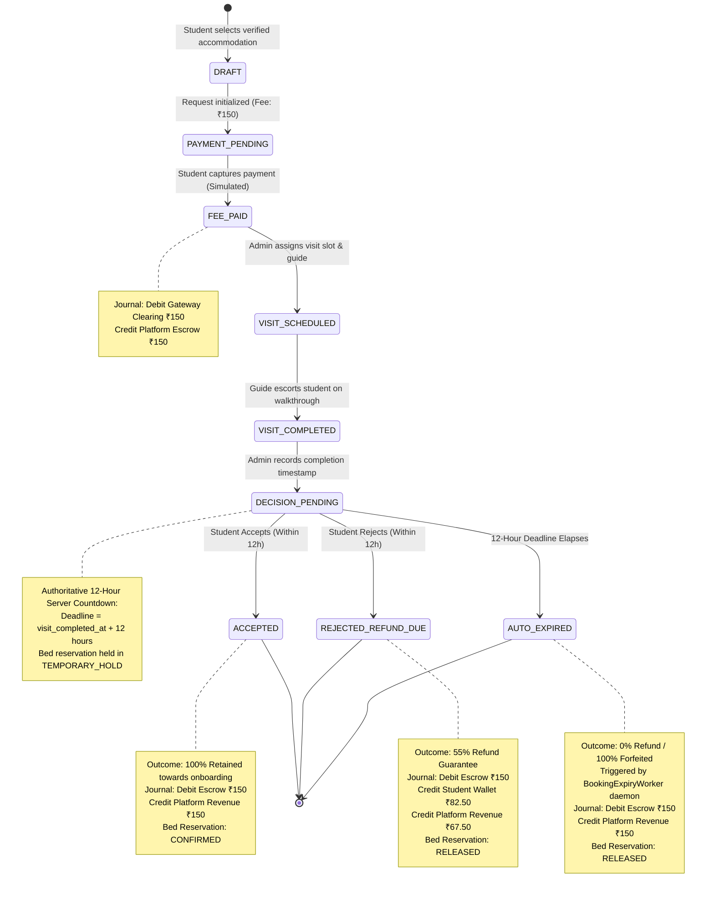

# COLIN — Booking & Guided Visit Lifecycle Specification

**Document ID:** COLIN-EVID-006  
**Target:** Academic B.Tech Capstone Project Documentation  
**Repository Branch:** `colin-prototype-completion`  
**Domain Service:** [BookingService.ts](file:///C:/Users/clsid/COLIN/src/server/services/BookingService.ts)  
**Database Repository:** [BookingRepository.ts](file:///C:/Users/clsid/COLIN/src/server/database/repositories/BookingRepository.ts)  
**Test Suite:** [booking-lifecycle.integration.test.ts](file:///C:/Users/clsid/COLIN/src/test/booking/booking-lifecycle.integration.test.ts)  

---

## 1. Overview & Business Model Rationale

COLIN's guided visit model replaces unregulated broker walk-ins with a structured, managed concierge process:
1. Protects students from being pressured on the spot by giving them a guaranteed **12-hour exclusive decision window**.
2. Protects property owners from non-serious broker tire-kickers by requiring a nominal **₹150 slot pass**.
3. Assures student fairness with a **55% refund policy (₹82.50)** if they decide not to proceed after inspecting the room.

---

## 2. Complete Lifecycle State Diagram

---

## 3. Detailed Lifecycle Stages

### Stage 1: `DRAFT` / `PAYMENT_PENDING`
- **Actor:** University Student.
- **Trigger:** Student clicks "Schedule Visit" on an audited property listing (`verificationStatus === 'VERIFIED'`).
- **Data Mutation:** A `booking_requests` record is inserted with `status = 'PAYMENT_PENDING'`, `booking_fee_amount = 150.00`, and `payment_status = 'UNPAID'`.
- **Bed Hold:** If a specific room/bed is requested, a `bed_reservations` entry is initialized.
- **Notification:** A booking confirmation email is staged in `email_outbox`.

### Stage 2: `FEE_PAID`
- **Actor:** Student & Simulated Payment Provider.
- **Trigger:** Student confirms payment modal with idempotency key.
- **Verification:** `SimulatedPaymentProvider.verifyPayment()` verifies synthetic card/UPI token.
- **Financial Posting:**
  - A `financial_payments` record is created (`status = 'SUCCESS'`).
  - An atomic `ledger_transactions` entry is created with two legs:
    - **Debit:** Account `1000` (Payment Gateway Clearing) — ₹150.00
    - **Credit:** Account `2000` (Platform Visit Fee Escrow) — ₹150.00
  - Transition: `status = 'FEE_PAID'`, `payment_status = 'PAID'`, `amount_paid = 150.00`.

### Stage 3: `VISIT_SCHEDULED`
- **Actor:** Admin Control Centre or Automated Dispatcher.
- **Trigger:** Admin assigns scheduled time slot (`scheduledStartTime`, `scheduledEndTime`) and optionally assigns an ambassador from `volunteer_profiles`.
- **Audit:** An assignment snapshot is captured via trigger `trg_record_volunteer_assignment_snapshot` denormalizing coordinator contact data.

### Stage 4: `VISIT_COMPLETED`
- **Actor:** Field Concierge / Admin.
- **Trigger:** Physical inspection is completed on-site. Admin clicks "Record Visit Completion" in the Control Centre.
- **Timestamp Strategy:** The server executes `NEW.visit_completed_at = CLOCK_TIMESTAMP()`.

### Stage 5: `DECISION_PENDING` (The 12-Hour Window)
- **Automatic Calculation:** Database constraint `chk_booking_requests_decision_deadline` enforces:
  $$\text{decision\_deadline} = \text{visit\_completed\_at} + 12\text{ hours}$$
- **State Guard:** The bed is protected under `TEMPORARY_HOLD`. No other student may book this bed slot.
- **Client Presentation:** The Student Portal renders a high-visibility countdown timer displaying hours, minutes, and seconds remaining.

---

## 4. Terminal Decision Outcomes

### Outcome A: `ACCEPTED` (Move-in Finalization)
- **Student Action:** Submits "Accept Accommodation" before deadline.
- **Financial Settlement:**
  - Full ₹150.00 is retained by the platform to offset onboarding and verification overhead.
  - **Debit:** Platform Escrow (`2000`) — ₹150.00
  - **Credit:** Platform Retained Revenue (`4000`) — ₹150.00
- **Inventory:** `bed_reservations.status` transitions from `TEMPORARY_HOLD` to `CONFIRMED`.
- **Payment Status:** Remains `PAID` (`refund_amount = 0.00`, `platform_fee_retained = 150.00`).

### Outcome B: `REJECTED_REFUND_DUE` (55% Fair Refund Guarantee)
- **Student Action:** Submits "Decline Accommodation" with an optional feedback reason.
- **Financial Settlement:**
  - Guaranteed 55% refund policy is executed:
    $$\text{Refund Amount} = 150.00 \times 0.55 = 82.50$$
    $$\text{Platform Retained} = 150.00 \times 0.45 = 67.50$$
  - **Debit:** Platform Escrow (`2000`) — ₹150.00
  - **Credit:** Student Refund Payable (`2100`) — ₹82.50
  - **Credit:** Platform Retained Revenue (`4000`) — ₹67.50
  - **Ledger Invariant:** $\sum \text{Debits} (150.00) = \sum \text{Credits} (82.50 + 67.50 = 150.00)$.
- **Inventory:** `bed_reservations.status` transitions to `RELEASED`.
- **Payment Status:** Transitions to `PARTIALLY_REFUNDED`.

### Outcome C: `AUTO_EXPIRED` (Deadline Expiration)
- **Trigger:** Autonomous daemon `BookingExpiryWorker` executes hourly/minutely sweep:
  $$\text{status} = \text{'DECISION\_PENDING'} \quad \text{AND} \quad \text{decision\_deadline} \le \text{NOW()}$$
- **Financial Settlement:**
  - Non-responsiveness forfeits the slot pass fee: ₹0.00 refund, ₹150.00 retained.
  - **Debit:** Platform Escrow (`2000`) — ₹150.00
  - **Credit:** Platform Retained Revenue (`4000`) — ₹150.00
- **Inventory:** `bed_reservations.status` transitions to `EXPIRED` / `RELEASED`.
- **Payment Status:** Transitions to `FORFEITED`.

---

## 5. Automated Verification Evidence

The entire state machine is verified in [src/test/booking/booking-lifecycle.integration.test.ts](file:///C:/Users/clsid/COLIN/src/test/booking/booking-lifecycle.integration.test.ts):
- `11 of 11 integration tests passed`.
- Verified transitions, deadline arithmetic, double-entry ledger balance, and immutability triggers.
