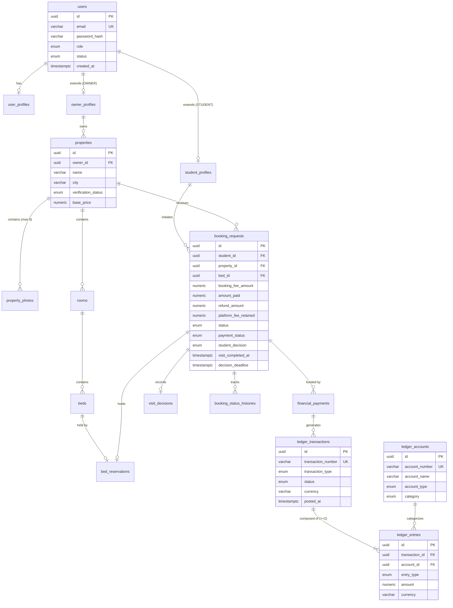

# COLIN — Database Architecture & Entity Specifications

**Document ID:** COLIN-EVID-004  
**Target:** Academic B.Tech Capstone Project Documentation  
**Repository Branch:** `colin-prototype-completion`  
**Schema Definition:** [schema.prisma](file:///C:/Users/clsid/COLIN/prisma/schema.prisma)  
**Database Engine:** PostgreSQL 18.4 (Port 5433 / 5432)  
**SQL Constraints Specification:** [COLIN_CUSTOM_POSTGRESQL_CONSTRAINTS.sql](file:///C:/Users/clsid/COLIN/docs/database/COLIN_CUSTOM_POSTGRESQL_CONSTRAINTS.sql)  

---

## 1. Database Architecture & Design Principles

The COLIN persistence architecture utilizes PostgreSQL 18 with 58 relational models defined via Prisma ORM and hardened by custom PL/pgSQL database triggers and integrity constraints.

Key engineering invariants include:
1. **Financial Precision Strategy:** All monetary columns (`booking_fee_amount`, `amount_paid`, `refund_amount`, `platform_fee_retained`, `monthly_rent`, ledger `amount`) strictly employ `NUMERIC(12, 2)` (or `DECIMAL(12, 2)`). Floating-point representations (`FLOAT`, `DOUBLE`) are prohibited across all financial entities to prevent fractional rounding drift.
2. **UTC Timestamp Strategy:** All temporal columns (`created_at`, `updated_at`, `visit_completed_at`, `decision_deadline`, `posted_at`) utilize `TIMESTAMPTZ` (timestamp with time zone), evaluated at `CLOCK_TIMESTAMP()` or `NOW() AT TIME ZONE 'UTC'`.
3. **Database-Level Immutability:** Core audit trails and general ledger journal entries are append-only. Modifying or deleting posted transactions or audit logs is blocked by row-level and statement-level triggers.

---

## 2. Entity-Relationship (ER) Diagram



---

## 3. Core Database Tables & Data Dictionary

### 3.1 `booking_requests` Table
The central transactional record managing the guided visit and 12-hour reservation window:
- `id` (`UUID`, Primary Key, default `gen_random_uuid()`): Unique identifier.
- `student_id` (`UUID`, Foreign Key $\to$ `student_profiles.user_id`): Requesting student.
- `property_id` (`UUID`, Foreign Key $\to$ `properties.id`): Target verified property.
- `bed_id` (`UUID`, Nullable, Foreign Key $\to$ `beds.id`): Preferred room/bed slot.
- `booking_fee_amount` (`NUMERIC(12, 2)`, NOT NULL, default `150.00`): Statutory fee.
- `amount_paid` (`NUMERIC(12, 2)`, NOT NULL, default `0.00`): Captured payment.
- `refund_amount` (`NUMERIC(12, 2)`, NOT NULL, default `0.00`): Allocated refund payable.
- `platform_fee_retained` (`NUMERIC(12, 2)`, NOT NULL, default `0.00`): Retained platform revenue.
- `status` (`BookingStatus`, NOT NULL, default `'PAYMENT_PENDING'`): Lifecycle state.
- `payment_status` (`BookingPaymentStatus`, NOT NULL, default `'UNPAID'`): Financial state.
- `student_decision` (`StudentDecision`, NOT NULL, default `'PENDING'`): Final outcome.
- `visit_completed_at` (`TIMESTAMPTZ`, Nullable): Physical visit completion timestamp.
- `decision_deadline` (`TIMESTAMPTZ`, Nullable): Authoritative 12-hour expiration boundary.

### 3.2 `ledger_transactions` Table
Stores immutable journal transaction headers:
- `id` (`UUID`, Primary Key): Transaction record identifier.
- `transaction_number` (`VARCHAR(50)`, Unique, NOT NULL): Human-readable reference.
- `transaction_type` (`JournalTransactionType`, NOT NULL): Event categorization (`VISIT_FEE_COLLECTION`, `VISIT_REJECTION_REFUND`, `VISIT_ACCEPTANCE_SETTLEMENT`, `VISIT_EXPIRATION_SETTLEMENT`).
- `status` (`LedgerTransactionStatus`, NOT NULL, default `'DRAFT'`): Lifecycle state (`DRAFT`, `POSTED`, `REVERSED`).
- `currency` (`VARCHAR(3)`, NOT NULL, default `'INR'`): ISO-4217 currency code.
- `idempotency_key` (`VARCHAR(100)`, Unique, NOT NULL): Anti-duplication key.
- `posted_at` (`TIMESTAMPTZ`, Nullable): Irreversible posting timestamp.
- `reverses_transaction_id` (`UUID`, Nullable, Foreign Key $\to$ `ledger_transactions.id`): Reversal pointer.

### 3.3 `ledger_entries` Table
Stores individual balanced debits and credits:
- `id` (`UUID`, Primary Key): Entry identifier.
- `transaction_id` (`UUID`, Foreign Key $\to$ `ledger_transactions.id`, NOT NULL): Parent journal transaction.
- `account_id` (`UUID`, Foreign Key $\to$ `ledger_accounts.id`, NOT NULL): Chart-of-accounts account.
- `entry_type` (`LedgerEntryType`, NOT NULL): Either `DEBIT` or `CREDIT`.
- `amount` (`NUMERIC(12, 2)`, NOT NULL): Strictly positive entry amount.
- `currency` (`VARCHAR(3)`, NOT NULL): Currency matching the parent transaction.

### 3.4 `property_photos` Table
Stores photographic verification assets:
- `id` (`UUID`, Primary Key): Photo asset identifier.
- `property_id` (`UUID`, Foreign Key $\to$ `properties.id`, NOT NULL): Parent property.
- `photo_url` (`TEXT`, NOT NULL): Master WebP processed image URL.
- `thumbnail_url` (`TEXT`, NOT NULL): 400×300 WebP preview thumbnail URL.
- `is_cover` (`BOOLEAN`, NOT NULL, default `FALSE`): Cover photo designation.
- `display_order` (`INT`, NOT NULL): Sorting priority in gallery.

---

## 4. Custom Database Constraints & Business Invariants

Extracted from [COLIN_CUSTOM_POSTGRESQL_CONSTRAINTS.sql](file:///C:/Users/clsid/COLIN/docs/database/COLIN_CUSTOM_POSTGRESQL_CONSTRAINTS.sql):

### 4.1 Financial Invariants on `booking_requests`
1. **`chk_booking_financial_reconciliation`:**
   Guarantees that an unpaid booking has zero amount paid, and paid states match the exact fee:
   ```sql
   CHECK (
     (amount_paid = 0.00 AND payment_status = 'UNPAID') OR
     (amount_paid = booking_fee_amount AND payment_status IN ('PAID', 'PARTIALLY_REFUNDED', 'REFUNDED', 'FORFEITED'))
   )
   ```
2. **`chk_booking_settlement_exact_allocation`:**
   Guarantees exact 100% allocation of funds upon terminal decision (no under- or over-allocation):
   ```sql
   CHECK (
     (student_decision = 'PENDING' AND refund_amount = 0.00 AND platform_fee_retained = 0.00) OR
     (student_decision IN ('ACCEPTED', 'REJECTED', 'EXPIRED') AND (refund_amount + platform_fee_retained) = amount_paid)
   )
   ```
3. **`chk_booking_decision_payment_status_coherence`:**
   Enforces exact mathematical fee partitions:
   - `ACCEPTED`: `refund_amount = 0.00`, `retained = amount_paid`, `status = PAID`.
   - `REJECTED`: `refund_amount = 82.50`, `retained = 67.50`, `status = PARTIALLY_REFUNDED`.
   - `EXPIRED`: `refund_amount = 0.00`, `retained = amount_paid`, `status = FORFEITED`.
4. **`chk_booking_requests_decision_deadline`:**
   Ensures the decision deadline mathematically equals `visit_completed_at + INTERVAL '12 hours'`.

---

## 5. PostgreSQL Triggers & Immutability Rules

### 5.1 General Ledger Posting Balance Trigger (`trg_verify_posted_ledger_transaction`)
Before any transaction transitions to `POSTED`, the database evaluates:
1. `v_entry_count >= 2`: Every journal transaction must have at least two legs.
2. `v_total_debits == v_total_credits`: Total debits must equal total credits ($\sum \text{Debits} - \sum \text{Credits} = 0$).
3. `v_mismatched_currency_count == 0`: All entry currencies must match the transaction currency.
If unbalanced, the trigger throws `EXCEPTION 'Accounting Invariant Violation: Unbalanced journal transaction'`.

### 5.2 Ledger Entry & Transaction Immutability Triggers
- `trg_immutable_ledger_entries`: Prohibits `INSERT`, `UPDATE`, or `DELETE` on entries belonging to transactions in `POSTED` or `REVERSED` status.
- `trg_immutable_posted_ledger_transactions`: Prohibits modifying or deleting posted transactions, permitting only transition to `REVERSED` via the official reversal procedure [reverse_ledger_transaction](file:///C:/Users/clsid/COLIN/docs/database/COLIN_CUSTOM_POSTGRESQL_CONSTRAINTS.sql#L288).

### 5.3 8-Photo Maximum Limit Trigger (`trg_enforce_max_property_photos`)
Locks the parent property row using `SELECT id FROM properties WHERE id = ... FOR UPDATE` and asserts that existing photo count is strictly $< 8$. Rejects attempts to insert a 9th photo.

### 5.4 Statement-Level TRUNCATE Protection
Statement-level triggers (`trg_prevent_truncate_*`) block table truncation across all audit and ledger infrastructure (`admin_audit_logs`, `booking_status_histories`, `ledger_entries`, `ledger_transactions`, `email_delivery_events`).
