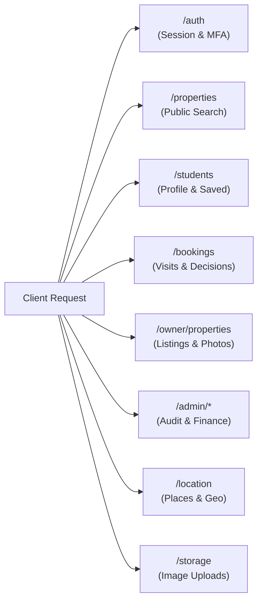

# Academic Project Report: REST API Specification

## 1. API Architecture & Standards

The COLIN backend exposes an enterprise RESTful HTTP API conforming to the following standards:
- **Base URI:** `http://localhost:3001/api/v1` (Development proxy via `http://localhost:5173/api/v1`)
- **Protocol:** HTTP/1.1 (JSON payload encoding over UTF-8)
- **Authentication:** Dual-token JWT (HTTP-only cookie `colin_access_token` and optional `Authorization: Bearer <token>`)
- **Request Validation:** Runtime input parsing and type coercion using Zod schemas (`src/server/api/v1/schemas/`)
- **Error Response Protocol:** RFC-7807 compliant standardized error envelope:

```json
{
  "success": false,
  "error": {
    "code": "VALIDATION_FAILED",
    "message": "Invalid request payload parameters.",
    "details": [
      {
        "field": "visitDate",
        "message": "Visit date must be scheduled at least 2 hours in the future."
      }
    ]
  },
  "meta": {
    "requestId": "req-7f8e9a2b-3c4d",
    "timestamp": "2026-11-12T19:30:00.000Z"
  }
}
```

---

## 2. API Endpoint Matrix



### 2.1 Authentication & Session (`/api/v1/auth`)

| HTTP Method | Path | Required Role | Description |
|---|---|---|---|
| `POST` | `/register` | Public | Register new user account (`STUDENT` or `OWNER`). |
| `POST` | `/login` | Public | Authenticate credentials; sets HTTP-only JWT session cookie. |
| `GET` | `/me` | Authenticated | Retrieve profile details of the authenticated caller. |
| `POST` | `/logout` | Authenticated | Revoke active session and clear authentication cookies. |
| `POST` | `/refresh` | Authenticated | Issue fresh access token from unexpired session token. |

### 2.2 Public Discovery (`/api/v1/properties`)

| HTTP Method | Path | Required Role | Description |
|---|---|---|---|
| `GET` | `/` | Public | Query verified accommodations with filters (city, type, gender, budget). PII stripped. |
| `GET` | `/:id` | Public | Retrieve detailed view of a verified property (rooms, amenities, house rules). |
| `GET` | `/featured` | Public | Fetch curated high-rating accommodations for homepage showcase. |

### 2.3 Guided Visits & Bookings (`/api/v1/bookings`)

| HTTP Method | Path | Required Role | Description |
|---|---|---|---|
| `POST` | `/` | `STUDENT` | Create a new guided visit request (`status: PAYMENT_PENDING`). |
| `GET` | `/` | Authenticated | List all bookings for caller (filtered by `studentId` or `ownerId`). |
| `GET` | `/:id` | Authenticated | Retrieve booking status, assigned guide, visit time, and decision deadline. |
| `POST` | `/:id/payment` | `STUDENT` | Capture ₹150 visit pass fee (Simulated gateway, posts Escrow ledger). |
| `POST` | `/:id/decision`| `STUDENT` | Execute 12h decision (`ACCEPTED` vs `REJECTED_REFUND_DUE`). Posts double-entry refund. |

### 2.4 Owner Property Management (`/api/v1/owner/properties`)

| HTTP Method | Path | Required Role | Description |
|---|---|---|---|
| `GET` | `/` | `OWNER` | List all properties owned by caller (includes `DRAFT`, `SUBMITTED`, `VERIFIED`). |
| `POST` | `/` | `OWNER` | Create new property listing in `DRAFT` status. Checks tier quota. |
| `GET` | `/:id` | `OWNER` | Retrieve owner-specific listing details, rooms, and audit history. |
| `PUT` | `/:id` | `OWNER` | Update listing attributes (rent, rules, amenities) while in `DRAFT`. |
| `POST` | `/:id/submit-verification` | `OWNER` | Submit listing to central inspection queue (`SUBMITTED`). Validates 8 photos. |
| `POST` | `/:id/photos` | `OWNER` | Upload property photo. Enforces maximum 8-angle limit and WebP compression. |

### 2.5 Admin Control Centre (`/api/v1/admin/*`)

| HTTP Method | Path | Required Role | Description |
|---|---|---|---|
| `GET` | `/admin/properties/verification-queue` | `ADMIN` | List pending property listings submitted for in-person verification. |
| `POST` | `/admin/properties/:id/approve` | `ADMIN` | Approve property; sets status to `VERIFIED`, assigns verified badge. |
| `POST` | `/admin/properties/:id/reject` | `ADMIN` | Reject listing with required audit remediation notes. |
| `GET` | `/admin/bookings` | `ADMIN` | Central dispatch of guided visits, coordinator assignments, and scheduling. |
| `POST` | `/admin/bookings/:id/complete-visit` | `ADMIN` | Coordinator marks physical visit complete; starts 12-hour decision clock. |
| `POST` | `/admin/bookings/process-expirations` | `ADMIN` | Operational trigger to manually sweep and expire overdue visit decisions. |
| `GET` | `/admin/finance/ledger-summary` | `ADMIN` | Real-time aggregate ledger totals verifying $\sum \text{Debits} = \sum \text{Credits}$. |

### 2.6 Storage & Geolocation Services

| HTTP Method | Path | Required Role | Description |
|---|---|---|---|
| `POST` | `/storage/upload` | Authenticated | Upload multipart image file; transcodes to WebP and applies metadata tags. |
| `POST` | `/storage/presigned-url` | `OWNER` | Generate secure time-limited presigned S3 upload URL. |
| `GET` | `/location/autocomplete` | Public | Google Places / local dataset campus and locality search autocomplete. |
| `GET` | `/location/geocode` | Public | Convert address string to latitude/longitude coordinates. |
| `GET` | `/location/distance` | Public | Compute distance (km) between property and university campus via Haversine. |

### 2.7 Observability & Health Probes

| HTTP Method | Path | Required Role | Description |
|---|---|---|---|
| `GET` | `/health/live` | Public | Kubernetes/Docker liveness probe; returns HTTP 200 if process is active. |
| `GET` | `/health/ready` | Public | Readiness probe; verifies active database and Redis socket connectivity. |
| `GET` | `/api/v1/system/status` | `ADMIN` | Server memory ceiling, event loop latency, and worker execution statistics. |
