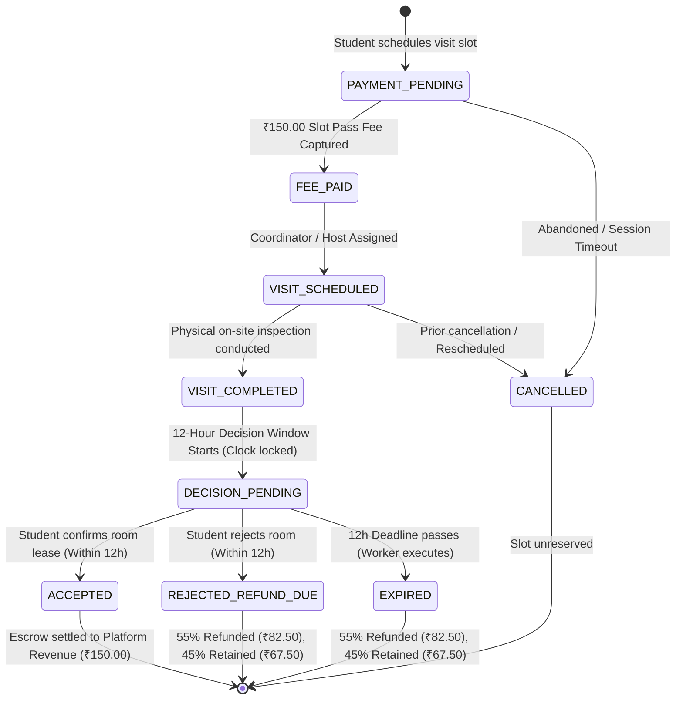
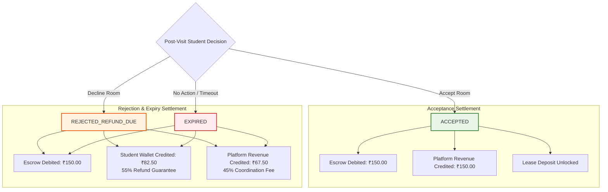

# Academic Project Report: Guided Visit Booking & Decision Lifecycle

## 1. Lifecycle Overview & State Machine

The guided visit lifecycle in COLIN is modeled as a deterministic finite state machine (FSM). It eliminates informal verbal agreements, prevents unverified property access, and guarantees consumer financial protection through a strict 12-hour post-visit decision window and double-entry escrow settlement.

---

## 2. Chronological Stage-by-Stage Walkthrough

### Stage 1: Visit Slot Scheduling (`PAYMENT_PENDING`)
- **Actor:** Student Scholar
- **Action:** Selects a verified property listing, picks an available inspection calendar slot (`VisitSlot`), and initiates the booking.
- **System State:** A new `BookingRequest` record is generated in `PAYMENT_PENDING` status. The target slot is temporarily held.

### Stage 2: Fee Capture & Escrow Ledgering (`FEE_PAID`)
- **Actor:** Student Scholar / Payment Gateway Adapter
- **Action:** Submits payment for the nominal ₹150.00 slot pass fee.
- **Financial Posting:** The system executes an atomic double-entry journal transaction (`TX-FEE-*`):
  - **Debit:** `ASSET: Gateway Clearing` $\rightarrow$ ₹150.00
  - **Credit:** `LIABILITY: Platform Escrow` $\rightarrow$ ₹150.00
- **System State:** Booking status advances to `FEE_PAID`. An email receipt is queued in `EmailOutbox`.

### Stage 3: Coordinator Assignment (`VISIT_SCHEDULED`)
- **Actor:** Admin Dispatcher / Field Volunteer
- **Action:** Assigns a verified local student guide or staff coordinator (`VisitCoordination`) to accompany the student during inspection.
- **System State:** Booking status updates to `VISIT_SCHEDULED`. SMS/Email confirmations are dispatched to both student and property owner.

### Stage 4: On-Site Inspection & Verification (`VISIT_COMPLETED`)
- **Actor:** COLIN Field Coordinator
- **Action:** Accompanies the student to the accommodation, verifies amenities against listing criteria, and marks the physical visit complete in the coordinator portal.
- **System Invariant:** The database records `visitCompletedAt = NOW()`.

### Stage 5: The 12-Hour Server Decision Lockout (`DECISION_PENDING`)
- **Server Rule:** The server immutably sets:
  $$\text{decisionDeadline} = \text{visitCompletedAt} + 12 \text{ hours}$$
- **Notification Schedule:** Automated reminders are triggered at specific elapsed intervals:
  - **0h (Immediately):** Decision window opened notification.
  - **3h Elapsed:** Initial status reminder.
  - **6h Elapsed (Halfway):** 6 hours remaining alert.
  - **9h Elapsed (3h Left):** Urgent 3-hour warning.
  - **11h Elapsed (1h Left):** Final 60-minute countdown notice.
- **User Interface:** The Student Portal renders an active real-time countdown widget with one-click "Accept Room" and "Decline Room" controls.

---

## 3. Terminal Settlement Outcomes

### Outcome A: Room Acceptance (`ACCEPTED`)
- **Financial Flow:** The student confirms tenancy. The ₹150.00 held in escrow is recognized as earned platform revenue:
  - **Debit:** `LIABILITY: Platform Escrow` $\rightarrow$ ₹150.00
  - **Credit:** `REVENUE: Platform Service Fees` $\rightarrow$ ₹150.00
  - $\sum \text{Debits} (150.00) = \sum \text{Credits} (150.00)$
- **Inventory Action:** The reserved bed inventory is locked for the student pending rental agreement execution.

### Outcome B: Rejection With 55% Refund (`REJECTED_REFUND_DUE`)
- **Financial Flow:** The student inspects the accommodation and determines it does not meet expectations. The 55% consumer protection guarantee triggers automatically:
  - **Debit:** `LIABILITY: Platform Escrow` $\rightarrow$ ₹150.00
  - **Credit:** `LIABILITY: Student Payable` $\rightarrow$ ₹82.50 (55.0% refund)
  - **Credit:** `REVENUE: Platform Service Fees` $\rightarrow$ ₹67.50 (45.0% retained coordination fee)
  - $\sum \text{Debits} (150.00) = \sum \text{Credits} (82.50 + 67.50 = 150.00)$
- **Inventory Action:** The held room slot is immediately restored to `AVAILABLE` for other student applicants.

### Outcome C: Automatic Decision Expiry (`EXPIRED`)
- **Trigger:** If the student takes no action and the server clock exceeds `decisionDeadline`, the autonomous `BookingExpiryWorker` executes an expiration sweep.
- **Financial Flow:** Identical to Outcome B: the student is credited the 55% refund guarantee (₹82.50), while ₹67.50 is retained to cover coordinator field costs.
- **Operational Benefit:** Eliminates orphaned reservations; landlords do not suffer indefinite room blocks from indecisive applicants.
