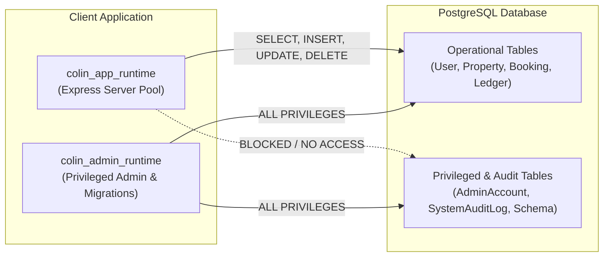

# Academic Project Report: Database Architecture & Documentation

## 1. Relational Database Overview

The COLIN persistence tier is powered by **PostgreSQL 18** and modeled via **Prisma ORM v5.22.0**. The schema consists of **58 relational models** and **50 enumerated types**, partitioned across seven distinct operational domains:

```mermaid
graph TD
    subgraph 1. Identity & Auth (15 Models)
        User["User"]
        UserProfile["UserProfile"]
        AdminAccount["AdminAccount"]
        AdminSession["AdminSession"]
        AdminRole["AdminRole"]
        AdminPermission["AdminPermission"]
        UserSession["UserSession"]
        MfaCredential["MfaCredential"]
    end

    subgraph 2. Student Domain (5 Models)
        StudentProfile["StudentProfile"]
        StudentVerificationDocument["StudentVerificationDocument"]
        StudentPreference["StudentPreference"]
        StudentSavedProperty["StudentSavedProperty"]
        StudentSearchHistory["StudentSearchHistory"]
    end

    subgraph 3. Owner Domain (4 Models)
        OwnerProfile["OwnerProfile"]
        OwnerKycDocument["OwnerKycDocument"]
        OwnerBankAccount["OwnerBankAccount"]
        OwnerSubscription["OwnerSubscription"]
    end

    subgraph 4. Property & Inventory (8 Models)
        Property["Property"]
        PropertyPhoto["PropertyPhoto"]
        PropertyAmenity["PropertyAmenity"]
        PropertyRule["PropertyRule"]
        PropertyVerificationAudit["PropertyVerificationAudit"]
        Room["Room"]
        Bed["Bed"]
        BedReservation["BedReservation"]
    end

    subgraph 5. Booking & Guided Visits (9 Models)
        BookingRequest["BookingRequest"]
        BookingStatusHistory["BookingStatusHistory"]
        VisitSlot["VisitSlot"]
        VisitCoordination["VisitCoordination"]
        VisitDecision["VisitDecision"]
        VisitReminder["VisitReminder"]
        VisitFeedback["VisitFeedback"]
    end

    subgraph 6. Financial Ledger (5 Models)
        FinancialPayment["FinancialPayment"]
        LedgerAccount["LedgerAccount"]
        LedgerTransaction["LedgerTransaction"]
        LedgerEntry["LedgerEntry"]
        FinancialDisbursement["FinancialDisbursement"]
    end

    subgraph 7. Support & Outbox (12 Models)
        VolunteerProfile["VolunteerProfile"]
        SupportTicket["SupportTicket"]
        AdminAuditLog["AdminAuditLog"]
        EmailOutbox["EmailOutbox"]
        EmailDeliveryEvent["EmailDeliveryEvent"]
    end

    User --> StudentProfile
    User --> OwnerProfile
    OwnerProfile --> Property
    Property --> Room --> Bed
    StudentProfile --> BookingRequest
    Property --> BookingRequest
    BookingRequest --> VisitCoordination
    BookingRequest --> VisitDecision
    BookingRequest --> LedgerTransaction
    LedgerTransaction --> LedgerEntry
    LedgerAccount --> LedgerEntry
```

---

## 2. Core Domain Models & Schemas

### 2.1 Booking & Guided Visit Lifecycle Models

#### `BookingRequest`
Central entity orchestrating student visit requests, slot assignments, payment status, and decision deadlines.

| Column | Type | Constraints / Attributes | Description |
|---|---|---|---|
| `id` | `VARCHAR(36)` | `PRIMARY KEY`, Default UUID | Unique booking identifier (`bkg-*`) |
| `studentId` | `VARCHAR(36)` | `NOT NULL`, `FOREIGN KEY (StudentProfile.id)` | Student initiating the request |
| `propertyId` | `VARCHAR(36)` | `NOT NULL`, `FOREIGN KEY (Property.id)` | Target property for inspection |
| `roomId` | `VARCHAR(36)` | `NULLABLE`, `FOREIGN KEY (Room.id)` | Specific room requested (if applicable) |
| `status` | `BookingStatus` | `NOT NULL`, Default: `PAYMENT_PENDING` | Finite state machine status |
| `paymentStatus` | `BookingPaymentStatus` | `NOT NULL`, Default: `PENDING` | Slot pass fee payment state |
| `visitDate` | `TIMESTAMP(3)` | `NOT NULL` | Scheduled physical inspection date |
| `visitCompletedAt`| `TIMESTAMP(3)` | `NULLABLE` | Timestamp when coordinator confirms visit |
| `decisionDeadline`| `TIMESTAMP(3)` | `NULLABLE` | Strict deadline: `visitCompletedAt + 12h` |
| `studentDecision` | `StudentDecision` | `NULLABLE` | Decision outcome (`ACCEPTED`, `REJECTED`, `EXPIRED`) |
| `createdAt` | `TIMESTAMP(3)` | `NOT NULL`, Default: `NOW()` | Audit record creation timestamp |
| `updatedAt` | `TIMESTAMP(3)` | `NOT NULL`, Auto-updating | Last modification timestamp |

#### `VisitDecision`
Formal record of student post-visit determination.

| Column | Type | Constraints | Description |
|---|---|---|---|
| `id` | `VARCHAR(36)` | `PRIMARY KEY` | Unique decision identifier |
| `bookingId` | `VARCHAR(36)` | `NOT NULL`, `UNIQUE`, `FK(BookingRequest.id)` | Associated visit booking |
| `decision` | `StudentDecision` | `NOT NULL` | `ACCEPTED`, `REJECTED`, or `EXPIRED` |
| `reason` | `VARCHAR(255)` | `NULLABLE` | Student feedback or rejection categorization |
| `refundAmount` | `DECIMAL(10,2)` | `NOT NULL`, Default: `0.00` | Refund credited (₹82.50 on rejection) |
| `retainedAmount`| `DECIMAL(10,2)` | `NOT NULL`, Default: `0.00` | Fee retained (₹67.50 on rejection; ₹150 on accept) |
| `decidedAt` | `TIMESTAMP(3)` | `NOT NULL`, Default: `NOW()` | Timestamp decision was finalized |

---

### 2.2 Double-Entry Financial Ledger Models

#### `LedgerAccount`
Formal chart of accounts categorized according to IAS-1 accounting principles.

| Column | Type | Constraints | Description |
|---|---|---|---|
| `id` | `VARCHAR(36)` | `PRIMARY KEY` | Unique account identifier |
| `accountNumber` | `VARCHAR(64)` | `NOT NULL`, `UNIQUE` | Standard code (e.g., `1010-GATEWAY-CLEARING`) |
| `name` | `VARCHAR(128)` | `NOT NULL` | Descriptive account name |
| `category` | `LedgerAccountCategory` | `NOT NULL` | `GATEWAY_CLEARING`, `PLATFORM_ESCROW`, `PLATFORM_REVENUE`, `STUDENT_WALLET` |
| `accountType` | `LedgerAccountType` | `NOT NULL` | Fundamental accounting type: `ASSET`, `LIABILITY`, `EQUITY`, `REVENUE`, `EXPENSE` |
| `currency` | `VARCHAR(3)` | `NOT NULL`, Default: `'INR'` | ISO currency code |
| `isActive` | `BOOLEAN` | `NOT NULL`, Default: `TRUE` | Operational availability flag |

#### `LedgerTransaction`
Journal transaction container binding balanced debit and credit entries.

| Column | Type | Constraints | Description |
|---|---|---|---|
| `id` | `VARCHAR(36)` | `PRIMARY KEY` | Unique transaction ID |
| `transactionNumber` | `VARCHAR(64)` | `NOT NULL`, `UNIQUE` | Formatted identifier (e.g., `TX-FEE-*`, `TX-DEC-*`) |
| `transactionType` | `JournalTransactionType` | `NOT NULL` | `VISIT_FEE_COLLECTION`, `VISIT_ACCEPTANCE_SETTLEMENT`, `VISIT_REJECTION_REFUND` |
| `status` | `LedgerTransactionStatus` | `NOT NULL`, Default: `DRAFT` | Lifecycle state: `DRAFT`, `POSTED`, `REVERSED` |
| `description` | `VARCHAR(255)` | `NOT NULL` | Plaintext journal narration |
| `bookingId` | `VARCHAR(36)` | `NULLABLE`, `FK(BookingRequest.id)` | Related booking |
| `postedAt` | `TIMESTAMP(3)` | `NULLABLE` | Formal posting timestamp |

#### `LedgerEntry`
Individual debit or credit line item belonging to a `LedgerTransaction`.

| Column | Type | Constraints | Description |
|---|---|---|---|
| `id` | `VARCHAR(36)` | `PRIMARY KEY` | Unique entry ID |
| `transactionId` | `VARCHAR(36)` | `NOT NULL`, `FK(LedgerTransaction.id)` | Parent journal transaction |
| `accountId` | `VARCHAR(36)` | `NOT NULL`, `FK(LedgerAccount.id)` | Impacted ledger account |
| `entryType` | `LedgerEntryType` | `NOT NULL` | `DEBIT` or `CREDIT` |
| `amount` | `DECIMAL(12,2)` | `NOT NULL`, Check: `amount > 0` | Monetary value in INR |
| `currency` | `VARCHAR(3)` | `NOT NULL`, Default: `'INR'` | ISO currency code |

---

## 3. Custom PostgreSQL Constraints & Triggers

To prevent business logic violations or silent ledger drift, the schema incorporates custom SQL functions and triggers:

### 3.1 Double-Entry Balance Verification Trigger
Enforces mathematical balance: $\sum \text{Debits} = \sum \text{Credits}$ before any transaction can transition from `DRAFT` to `POSTED`:

```sql
CREATE OR REPLACE FUNCTION verify_ledger_transaction_balance()
RETURNS TRIGGER AS $$
DECLARE
    v_total_debits NUMERIC(12, 2);
    v_total_credits NUMERIC(12, 2);
BEGIN
    IF NEW.status = 'POSTED' AND (OLD.status IS NULL OR OLD.status != 'POSTED') THEN
        SELECT 
            COALESCE(SUM(CASE WHEN "entryType" = 'DEBIT' THEN amount ELSE 0 END), 0),
            COALESCE(SUM(CASE WHEN "entryType" = 'CREDIT' THEN amount ELSE 0 END), 0)
        INTO v_total_debits, v_total_credits
        FROM "LedgerEntry"
        WHERE "transactionId" = NEW.id;

        IF v_total_debits != v_total_credits THEN
            RAISE EXCEPTION 'Ledger transaction % is unbalanced: Total Debits (%) != Total Credits (%)',
                NEW."transactionNumber", v_total_debits, v_total_credits;
        END IF;

        IF v_total_debits <= 0 THEN
            RAISE EXCEPTION 'Ledger transaction % must have a positive total amount', NEW."transactionNumber";
        END IF;
    END IF;
    RETURN NEW;
END;
$$ LANGUAGE plpgsql;

CREATE TRIGGER trg_verify_ledger_balance
BEFORE INSERT OR UPDATE OF status ON "LedgerTransaction"
FOR EACH ROW EXECUTE FUNCTION verify_ledger_transaction_balance();
```

### 3.2 12-Hour Decision Deadline Constraint
Guarantees that `decisionDeadline` strictly matches the 12-hour offset from physical inspection completion:

```sql
ALTER TABLE "BookingRequest"
ADD CONSTRAINT chk_decision_deadline_12h
CHECK (
    "decisionDeadline" IS NULL OR 
    "visitCompletedAt" IS NULL OR 
    "decisionDeadline" = "visitCompletedAt" + INTERVAL '12 hours'
);
```

---

## 4. Dual-Role Database Access Security



- **`colin_app_runtime`:** Least-privilege role used for standard Express HTTP requests. Granted DML access to operational tables. Denied access to administrative credentials and DDL schema alterations.
- **`colin_admin_runtime`:** Elevated administrative role used for running Prisma migrations, superadmin credential rotations, and reading write-once audit logs.
