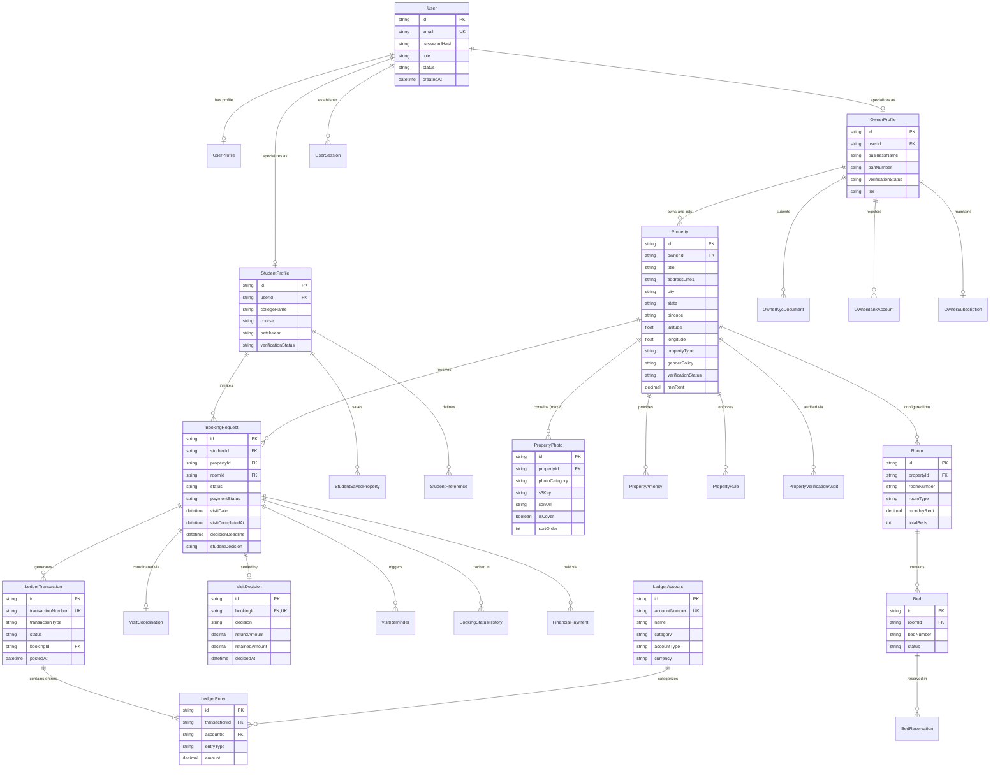

# Academic Project Report: Database Entity-Relationship (ER) Model

## 1. Complete Entity-Relationship Diagram

The following Mermaid diagram details the entity relationships, cardinalities, primary keys (`PK`), and foreign keys (`FK`) governing the COLIN relational database:

---

## 2. Cardinality Rules & Relational Invariants

| Relationship | Cardinality | Business Rule / Relational Constraint |
|---|---|---|
| `User` $\leftrightarrow$ `StudentProfile` | $1:0..1$ | A registered user account may optionally have a single student profile. |
| `User` $\leftrightarrow$ `OwnerProfile` | $1:0..1$ | A registered user account may optionally have a single owner profile. |
| `OwnerProfile` $\leftrightarrow$ `Property` | $1:N$ | An owner may list multiple properties, subject to subscription tier limits (e.g., standard tier maximum: 5). |
| `Property` $\leftrightarrow$ `PropertyPhoto` | $1:0..8$ | A property listing strictly enforces a ceiling of 8 photos across distinct architectural angles. |
| `Property` $\leftrightarrow$ `Room` | $1:N$ | A property consists of one or more rooms with specific room types (`SINGLE`, `DOUBLE`, etc.). |
| `Room` $\leftrightarrow$ `Bed` | $1:N$ | A room contains individual beds tracked for occupancy (`AVAILABLE`, `RESERVED`, `OCCUPIED`). |
| `StudentProfile` $\leftrightarrow$ `BookingRequest` | $1:N$ | A student can initiate multiple guided visit requests over time. |
| `Property` $\leftrightarrow$ `BookingRequest` | $1:N$ | A property receives booking requests from prospective student tenants. |
| `BookingRequest` $\leftrightarrow$ `VisitDecision` | $1:0..1$ | Each completed visit booking possesses at most one post-visit settlement decision. |
| `BookingRequest` $\leftrightarrow$ `LedgerTransaction` | $1:N$ | A visit booking spawns multiple balanced ledger transactions (Collection, Acceptance/Rejection Settlement). |
| `LedgerTransaction` $\leftrightarrow$ `LedgerEntry` | $1:2..N$ | A ledger transaction must contain at least 2 entries (one debit, one credit), with sum of debits equaling sum of credits. |
| `LedgerAccount` $\leftrightarrow$ `LedgerEntry` | $1:N$ | A chart-of-accounts entry categorizes multiple balanced entry lines across journal transactions. |
