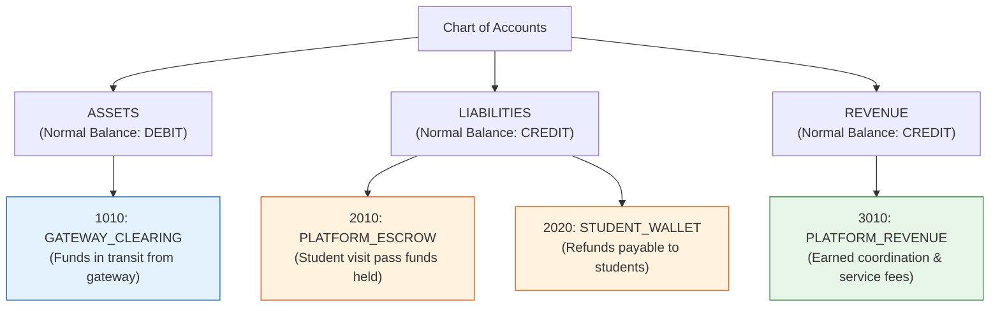
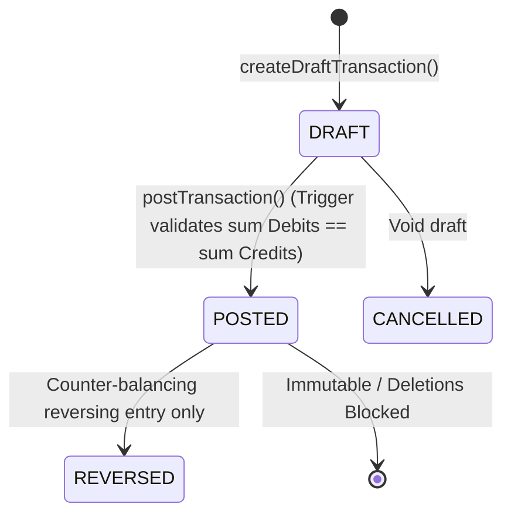

# Academic Project Report: Double-Entry Financial Ledger & Settlement Engine

## 1. Accounting Framework & Compliance

The COLIN platform implements an immutable **Double-Entry Financial Ledger** adhering strictly to **International Accounting Standard (IAS) 1** (*Presentation of Financial Statements*). Unlike typical consumer marketplace prototypes that store financial balances as mutable numerical columns (e.g., `user.walletBalance = balance - amount`), COLIN maintains zero mutable balance fields. Every monetary movement is recorded as an immutable set of balanced debit and credit entries.

### Fundamental Financial Invariant:
For every transaction $T$ composed of entries $e_1, e_2, \dots, e_n$:
$$\sum_{i=1}^{n} \text{Amount}(e_i) \cdot \mathbb{I}(\text{Type}(e_i) = \text{DEBIT}) = \sum_{i=1}^{n} \text{Amount}(e_i) \cdot \mathbb{I}(\text{Type}(e_i) = \text{CREDIT})$$

$$\text{Balance Gap} = \sum \text{Debits} - \sum \text{Credits} \equiv 0.00$$

---

## 2. Chart of Accounts

The platform operates a standardized Chart of Accounts categorized across formal accounting classes:

| Account Number | Account Name | Category | Normal Balance | Description |
|---|---|---|---|---|
| `1010-GATEWAY-CLEARING` | Gateway Clearing Account | `ASSET` | `DEBIT` | Funds captured via payment gateway awaiting bank settlement |
| `2010-PLATFORM-ESCROW` | Visit Pass Escrow Deposits | `LIABILITY` | `CREDIT` | Student fee deposits held in fiduciary custody pending visit |
| `2020-STUDENT-WALLET` | Student Refund Payable | `LIABILITY` | `CREDIT` | Unclaimed 55% refunds owed to students upon visit rejection |
| `3010-PLATFORM-REVENUE`| Platform Coordination Revenue | `REVENUE` | `CREDIT` | Earned fees recognized upon room acceptance or operational retention |

---

## 3. Transaction Posting Scenarios & Mathematical Proofs

### 3.1 Transaction 1: Visit Slot Pass Fee Collection (`₹150.00`)
- **Trigger:** Student confirms slot scheduling and submits payment.
- **Journal Code:** `TX-FEE-*` (`JournalTransactionType.VISIT_FEE_COLLECTION`)

$$\begin{array}{|l|l|c|c|}
\hline
\textbf{Account Number} & \textbf{Account Name} & \textbf{Debit (₹)} & \textbf{Credit (₹)} \\ \hline
1010\text{-GATEWAY-CLEARING} & \text{Gateway Clearing (Asset)} & 150.00 & — \\ \hline
2010\text{-PLATFORM-ESCROW} & \text{Platform Escrow (Liability)} & — & 150.00 \\ \hline
\textbf{Totals} & & \mathbf{150.00} & \mathbf{150.00} \\ \hline
\end{array}$$

$$\Delta = 150.00 - 150.00 = 0.00 \quad \checkmark$$

---

### 3.2 Transaction 2A: Accommodation Acceptance Settlement (`₹150.00`)
- **Trigger:** Student executes "Accept Room" within the 12-hour window.
- **Journal Code:** `TX-DEC-ACC-*` (`JournalTransactionType.VISIT_ACCEPTANCE_SETTLEMENT`)
- **Economic Rationale:** Escrow liability is extinguished; the full ₹150 is recognized as earned platform service revenue.

$$\begin{array}{|l|l|c|c|}
\hline
\textbf{Account Number} & \textbf{Account Name} & \textbf{Debit (₹)} & \textbf{Credit (₹)} \\ \hline
2010\text{-PLATFORM-ESCROW} & \text{Platform Escrow (Liability Extinguished)} & 150.00 & — \\ \hline
3010\text{-PLATFORM-REVENUE} & \text{Platform Service Revenue (Earned)} & — & 150.00 \\ \hline
\textbf{Totals} & & \mathbf{150.00} & \mathbf{150.00} \\ \hline
\end{array}$$

$$\Delta = 150.00 - 150.00 = 0.00 \quad \checkmark$$

---

### 3.3 Transaction 2B: Accommodation Rejection or Expiry (`₹150.00`)
- **Trigger:** Student executes "Decline Room" or background worker expires overdue decision.
- **Journal Code:** `TX-DEC-REJ-*` (`JournalTransactionType.VISIT_REJECTION_REFUND`)
- **Economic Rationale:** Escrow liability of ₹150 is released into two components:
  1. 55% consumer protection refund (₹82.50) owed to student.
  2. 45% operational coordination fee (₹67.50) recognized as platform revenue.

$$\begin{array}{|l|l|c|c|}
\hline
\textbf{Account Number} & \textbf{Account Name} & \textbf{Debit (₹)} & \textbf{Credit (₹)} \\ \hline
2010\text{-PLATFORM-ESCROW} & \text{Platform Escrow (Liability Extinguished)} & 150.00 & — \\ \hline
2020\text{-STUDENT-WALLET} & \text{Student Payable (55\% Refund Guarantee)} & — & 82.50 \\ \hline
3010\text{-PLATFORM-REVENUE} & \text{Platform Coordination Revenue (45\% Retained)} & — & 67.50 \\ \hline
\textbf{Totals} & & \mathbf{150.00} & \mathbf{150.00} \\ \hline
\end{array}$$

$$\Delta = 150.00 - (82.50 + 67.50) = 150.00 - 150.00 = 0.00 \quad \checkmark$$

---

## 4. Ledger Immutability & Database Trigger Protection

To prevent tampering, software bugs, or accidental unbalanced updates, the ledger enforces a 2-phase lifecycle managed by PostgreSQL triggers:

1. **Strict 2-Phase Lifecycle (`DRAFT` $\rightarrow$ `POSTED`):**
   - Transactions are initially staged in `DRAFT` status while entries are inserted.
   - Once all debit and credit entries are present, `postTransaction()` transitions status to `POSTED`.
2. **Database Trigger Enforcement (`trg_verify_ledger_balance`):**
   - A PostgreSQL `BEFORE UPDATE OF status` trigger computes the total debits and credits from `LedgerEntry`.
   - If $\sum \text{Debits} \ne \sum \text{Credits}$, the trigger raises a database exception with severity `FATAL`, aborting the transaction and rolling back changes.
3. **Hard Deletion Prohibition:**
   - Posted ledger records can never be updated or deleted (`DELETE` statements trigger permission denials in `colin_app_runtime`).
   - Correction of accounting errors requires an explicit reversing transaction (`REVERSED`) with counter-balancing entries.
