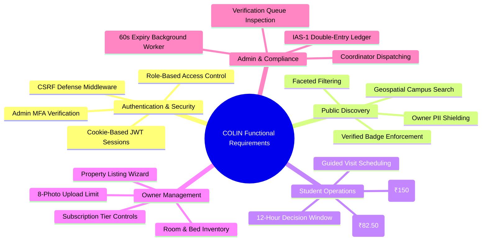

# Academic Project Report: Functional Requirements

## 1. Functional Requirements Overview

The COLIN platform functional architecture is structured around four primary user personas and autonomous background services:
1. **Unauthenticated Public Guest:** Discovers accommodations with privacy restrictions.
2. **Student Scholar:** Books guided visits, manages academic profile, and exercises 12-hour acceptance/rejection decisions.
3. **Property Owner:** Lists student residences, uploads mandatory 8-angle photo sets, and manages room/bed availability.
4. **Platform Administrator:** Approves/rejects property verifications, assigns coordinators, monitors financial ledger balances, and audits system events.
5. **Autonomous Background Worker:** Enforces the 12-hour booking decision deadline without human intervention.

---

## 2. Detailed Functional Requirements Specification

### 2.1 Module 1: Authentication & Identity Management
- **FR-AUTH-01:** The system shall support user registration and authentication across three distinct roles: `STUDENT`, `OWNER`, and `ADMIN`.
- **FR-AUTH-02:** Authentication tokens shall be issued as signed JSON Web Tokens (JWT) stored in HTTP-only, secure, SameSite cookies with fallback Bearer Authorization header support.
- **FR-AUTH-03:** The system shall provide deterministic demo account logins for evaluation:
  - Student: `aarav.mehra@colin.in`
  - Owner: `rajesh.sharma@colin.in`
  - Admin: `admin@colin.in`
- **FR-AUTH-04:** The administrative portal shall require multi-factor credential verification (`AdminMfaCredential`) and enforce separate administrative sessions (`colin_admin_session_token`).
- **FR-AUTH-05:** Passwords shall be cryptographically hashed using `bcryptjs` with a minimum salt round factor of 10.

### 2.2 Module 2: Public Property Discovery & Search
- **FR-DISC-01:** The system shall provide full-text and faceted search across verified properties by city, locality, university/campus proximity, monthly rent budget, and property type (`PG`, `HOSTEL`, `FLAT`).
- **FR-DISC-02:** The system shall support filtering by gender occupancy policy (`BOYS_ONLY`, `GIRLS_ONLY`, `COED`) and specific amenities (WiFi, Air Conditioning, Power Backup, Mess Food, Laundry, Attached Washroom).
- **FR-DISC-03:** The public discovery endpoints shall enforce owner privacy shielding: unauthenticated guests and students shall never receive the property owner's personal email, phone number, or internal administrative notes.
- **FR-DISC-04:** Unverified listings (status `DRAFT`, `SUBMITTED`, `REJECTED`, or `SUSPENDED`) shall be strictly suppressed from public search indexes. Only `VERIFIED` properties shall be exposed.

### 2.3 Module 3: Student Scholar Portal
- **FR-STU-01:** Students shall maintain an academic profile containing university affiliation, course of study, graduation year, and accommodation preferences.
- **FR-STU-02:** Students shall be able to save properties to an individual wishlist and compare up to three properties side-by-side across rent, amenities, rules, and distance.
- **FR-STU-03:** Students shall be able to schedule in-person guided visits by selecting an available calendar slot (`VisitSlot`).
- **FR-STU-04:** The system shall present a simulated payment interface to capture the ₹150.00 visit booking fee with idempotent transaction tokens (`SIM-PAY-*`).
- **FR-STU-05:** Following visit completion by an on-site coordinator, the student portal shall display an active 12-hour decision countdown timer.
- **FR-STU-06:** Students shall execute one of two formal decisions within the 12-hour window:
  - **Accept:** Confirm accommodation acceptance, transitioning booking to `ACCEPTED`.
  - **Decline:** Reject accommodation, transitioning booking to `REJECTED_REFUND_DUE` and triggering the 55% refund guarantee (₹82.50).

### 2.4 Module 4: Property Owner Portal
- **FR-OWN-01:** Property owners shall create and maintain property listings through a multi-step drawer interface detailing address, campus proximity, amenities, and house rules.
- **FR-OWN-02:** The system shall enforce a strict photo upload policy: maximum 8 distinct photographs representing key property zones (facade, bedroom, washroom, mess, recreation, study room, security, utility).
- **FR-OWN-03:** Owners shall define room configurations (`RoomType`: Single, Double, Triple, Four-sharing) and maintain individual bed inventory states (`AVAILABLE`, `RESERVED`, `OCCUPIED`).
- **FR-OWN-04:** Owners shall submit drafted listings to the centralized verification queue, advancing property status to `SUBMITTED`.
- **FR-OWN-05:** The system shall enforce owner subscription limits (e.g., maximum 5 active property listings on the standard tier) and prompt for tier upgrades upon reaching capacity.
- **FR-OWN-06:** Property owners shall be strictly denied access to student visit management tools and direct visitor identity records prior to confirmed lease agreements (`OwnerVisitsAccessDenied`).

### 2.5 Module 5: Admin Control Centre
- **FR-ADM-01:** Administrators shall access an isolated Control Centre (`/admin/*`) protected by dedicated RBAC guards (`AdminProtectedRoute`).
- **FR-ADM-02:** Administrators shall review pending property verifications in `/admin/verification-queue`, inspect 8-angle photo galleries, review safety checklists, and execute approval (`VERIFIED`) or rejection (`REJECTED`) with required audit notes.
- **FR-ADM-03:** Administrators shall manage guided visit assignments (`/admin/visits`), schedule coordinator escorts, mark physical visit completions, and record visit feedback.
- **FR-ADM-04:** The admin dashboard shall provide real-time financial ledger auditing (`/admin/finance`), displaying aggregated balances across Asset, Liability, and Revenue accounts and proving zero-sum debit/credit parity.
- **FR-ADM-05:** Administrators shall have an operational HTTP trigger (`POST /api/v1/admin/bookings/process-expirations`) to manually invoke overdue booking expiration passes on demand.

### 2.6 Module 6: Autonomous Booking Expiry Background Worker
- **FR-WRK-01:** The system shall execute an autonomous background worker daemon (`BookingExpiryWorker`) every 60 seconds (`INTERVAL_MS = 60000`).
- **FR-WRK-02:** The worker shall query bookings where `status === 'DECISION_PENDING'` and `decisionDeadline <= new Date()`.
- **FR-WRK-03:** The worker shall transition overdue bookings to `EXPIRED` within a transactional database boundary (`prisma.$transaction`).
- **FR-WRK-04:** The worker shall execute double-entry ledger postings upon expiration: debiting ₹150 from Escrow, crediting ₹82.50 (55%) to the Student Wallet account, and crediting ₹67.50 (45%) to Platform Revenue.
- **FR-WRK-05:** The worker shall prevent concurrent execution overlap via an in-process mutex lock (`isProcessing`).
- **FR-WRK-06:** The worker shall execute an immediate catch-up sweep on server startup to process expirations accrued during server downtime.
- **FR-WRK-07:** The worker shall support graceful shutdown draining up to 10,000ms upon receiving `SIGTERM` or `SIGINT`.

---

## 3. Requirements Traceability Matrix (RTM)

| Requirement ID | Module | Implementation Component | Test Suite Reference | Status |
|---|---|---|---|:---:|
| `FR-AUTH-01` | Auth | `src/server/api/v1/controllers/auth.controller.ts` | `src/test/auth/auth-unit.test.ts` | **PASS** |
| `FR-AUTH-02` | Auth | `src/server/middleware/auth.ts` | `e2e/security.spec.ts` | **PASS** |
| `FR-AUTH-04` | Auth | `src/server/adminSecurity.ts` | `src/test/admin_auth_and_foundation.test.tsx` | **PASS** |
| `FR-DISC-01` | Discovery | `src/server/api/v1/controllers/public.property.controller.ts` | `src/test/properties.test.tsx` | **PASS** |
| `FR-DISC-03` | Privacy | `src/server/api/v1/controllers/public.property.controller.ts` | `src/test/security/auth-security-deep.test.ts` | **PASS** |
| `FR-STU-03` | Student | `src/server/services/BookingService.ts` | `e2e/student-journey.spec.ts` | **PASS** |
| `FR-STU-04` | Payment | `src/server/services/BookingService.ts` | `e2e/student-journey.spec.ts` | **PASS** |
| `FR-STU-06` | Decision | `src/server/services/BookingService.ts` | `e2e/student-journey.spec.ts` | **PASS** |
| `FR-OWN-02` | Photos | `src/components/owner/PropertyPhotoUploader.tsx` | `e2e/owner-journey.spec.ts` | **PASS** |
| `FR-OWN-05` | Owner | `src/pages/owner/OwnerPropertiesPage.tsx` | `e2e/owner-journey.spec.ts` | **PASS** |
| `FR-ADM-02` | Admin | `src/pages/admin/AdminVerificationQueuePage.tsx` | `src/test/admin_pages.test.tsx` | **PASS** |
| `FR-ADM-04` | Finance | `src/pages/admin/AdminFinancePage.tsx` | `e2e/admin-journey.spec.ts` | **PASS** |
| `FR-WRK-01` | Worker | `src/server/workers/BookingExpiryWorker.ts` | `src/test/reliability/orphan-recovery.test.ts` | **PASS** |
| `FR-WRK-04` | Ledger | `src/server/database/repositories/LedgerRepository.ts` | `src/test/database/backend-orm-integration.test.ts` | **PASS** |
