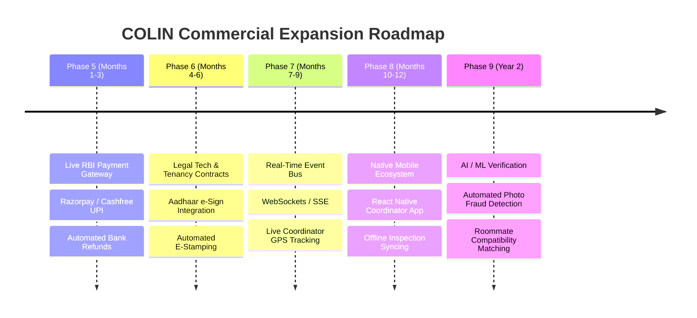

# Academic Project Report: Future Scope & Commercial Deployment Roadmap

## 1. Roadmap Overview

The completion of the COLIN prototype marks the successful validation of the core business logic, role-isolated portals, 12-hour decision lockout, and IAS-1 double-entry accounting. The future scope transitions the platform from an academic prototype to a commercial multi-city enterprise application.

---

## 2. Detailed Future Phase Specifications

### Phase 5: Live Banking Rails & Payment Aggregation
- **Payment Gateway Integration:** Replace `BookingService`'s simulated adapter with Razorpay / Cashfree SDKs supporting UPI Intent, Dynamic QR Codes, and NetBanking.
- **Automated Instant Refunds:** Connect payment aggregator refund APIs directly to the `LedgerRepository` rejection settlement routine, executing bank-to-bank NEFT/IMPS transfers for the 55% refund guarantee (₹82.50) in real time.
- **Escrow Banking Partner:** Establish a formal nodal or escrow account with a scheduled commercial bank (e.g., ICICI Bank or HDFC Bank) under RBI Nodal Account guidelines.

### Phase 6: Legal Tech & Automated Tenancy Contracts
- **Aadhaar e-Sign Integration:** Integrate an authorized Application Service Provider (ASP) such as Digio or Leegality to enable legally binding Aadhaar OTP-based digital signing for student lease agreements.
- **State-Wise Digital E-Stamping:** Automate digital stamp duty procurement across Indian states (e.g., Delhi, Maharashtra, Karnataka) using SHCIL (Stock Holding Corporation of India) e-stamping APIs.
- **Automated Rent Collection (NACH / e-Mandate):** Implement recurring monthly rent collection via NPCI e-NACH mandates, depositing monthly rent directly into verified owner bank accounts (`OwnerBankAccount`).

### Phase 7: Real-Time Event Bus & WebSockets
- **WebSocket Infrastructure:** Deploy a Socket.io / WebSocket connection tier backed by Redis 7 Pub/Sub.
- **Instant Status Push:** Stream live status updates to active browser tabs for:
  - Property verification queue state changes.
  - Guided visit scheduling confirmations.
  - Sub-second decision countdown timer synchronization.
- **Live Coordinator Tracking:** Enable real-time GPS tracking of student guides escorting scholars to inspection locations.

### Phase 8: Mobile Native Applications
- **Cross-Platform Coordinator App:** Develop dedicated React Native / Flutter mobile applications for on-site property verification agents and visit guides.
- **Offline Inspection Sync:** Allow field coordinators to inspect accommodations, record checklist answers, and capture 8-angle photos in areas with poor cellular connectivity, synchronizing with the central API once connectivity resumes.

### Phase 9: AI/ML Photo Authenticity & Roommate Matching
- **Automated Image Quality & Duplication Auditing:** Employ computer vision models (e.g., ResNet / Vision Transformers) to detect stock photos, wide-angle lens distortion, and cross-platform listing duplication.
- **Algorithmic Roommate Matching:** Utilize machine learning classification algorithms (K-Means / Collaborative Filtering) to analyze student lifestyle habits, study schedules, and food preferences to recommend compatible roommates.

### Phase 10: High-Availability Cloud Infrastructure
- **Geographic Clustering:** Transition from single-node PostgreSQL to a high-availability cloud deployment (e.g., AWS Aurora PostgreSQL or Google Cloud SQL) with multi-AZ replication.
- **Connection Pooling:** Introduce PgBouncer connection pooling to support over 5,000 concurrent database connections during annual university intake surges (July–September).
