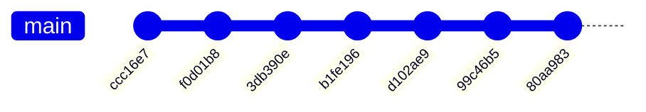

# Academic Project Report: Git Version Control & Repository Structure

## 1. Version Control Metadata & Status

- **Version Control System:** Git (Distributed Version Control)
- **Active Working Branch:** `colin-prototype-completion`
- **Latest Commit Hash:** `80aa98327c2122950e8a4e9a31ecc863bf91faa9`
- **Author / Lead:** SIdDhaRTh_0509 `<clsiddharth7075@gmail.com>`
- **Working Tree Status:** Clean (`nothing to commit, working tree clean`)
- **Remote Push Policy:** Strictly contained locally; zero premature pushes or merges into `main`

---

## 2. Commit Milestone History

The project development followed strict atomic commits, conventional commit syntax, and documented traceability:



| Commit Hash | Author Date | Commit Type | Description & Scope of Changes |
|---|---|---|---|
| `80aa983` | Nov 12, 2026 | `feat(ui)` | Integrate COLIN 3-second logo animation loader overlay into app bootstrap |
| `99c46b5` | Nov 12, 2026 | `docs(evidence)` | Add B.Tech academic technical evidence package in `documentation/evidence/` |
| `d102ae9` | Nov 12, 2026 | `docs(remediation)` | Add final prototype remediation, browser E2E, and expiry worker reports |
| `b1fe196` | Nov 12, 2026 | `test(playwright)` | Account for owner property subscription limit in listing form test |
| `3db390e` | Nov 12, 2026 | `test(playwright)` | Integrate browser end-to-end testing for student, owner, admin, security |
| `f0d01b8` | Nov 12, 2026 | `feat(worker)` | Implement autonomous automatic booking decision expiry worker |
| `ccc16e7` | Nov 12, 2026 | `fix(typescript)` | Resolve compiler errors, API unwrapping, email outbox input, adapter contracts |

---

## 3. Repository File Structure

```
COLIN/
├── public/                                # Static Web Assets served by Vite
│   ├── assets/
│   │   └── colin-logo.png                # Official Static Brand Logo
│   ├── colin-loader.mp4                   # 3-Second Logo Animation (Primary)
│   └── CoLiN_Loader.mp4                   # Static Video Asset Alias
├── frontend/                              # Specification Compatibility Mirror
│   └── public/
│       ├── colin-loader.mp4
│       └── CoLiN_Loader.mp4
├── src/                                   # Application Source Code (Unified Full-Stack)
│   ├── components/                        # UI Component Library
│   │   ├── admin/                         # Admin Control Centre Components
│   │   ├── common/                        # Common Shared UI (ColinLoader, Navbar, Footer)
│   │   ├── home/                          # Public Landing Page Sections
│   │   ├── owner/                         # Property Owner Portal Components
│   │   └── student/                       # Student Scholar Portal Components
│   ├── constants/                         # Central Business Rule Constants
│   │   └── booking.ts                     # Fee (₹150), Refund (₹82.50), 12h Windows
│   ├── context/                           # React Context Providers (State Management)
│   │   ├── AdminAuthContext.tsx           # Administrative RBAC State
│   │   ├── AuthContext.tsx                # Student / Owner Authentication State
│   │   ├── PropertyContext.tsx            # Property Catalog State
│   │   ├── StudentContext.tsx             # Wishlist, Saved Stays State
│   │   └── ToastContext.tsx               # User Notification State
│   ├── pages/                             # Route Page Components
│   │   ├── admin/                         # Admin Control Centre Pages
│   │   ├── owner/                         # Owner Workspace Pages
│   │   └── student/                       # Student Scholar Pages
│   ├── server/                            # Backend REST Application & Services
│   │   ├── api/v1/                        # Version 1 API Layer
│   │   │   ├── controllers/               # HTTP Request Controllers
│   │   │   ├── routes/                    # Express Router Definitions
│   │   │   └── schemas/                   # Zod Request Validation Schemas
│   │   ├── config/                        # Server Configuration & Secrets
│   │   ├── database/                      # Prisma ORM & Repositories
│   │   │   └── repositories/              # Booking, Ledger, Property Repositories
│   │   ├── middleware/                    # CORS, CSRF, JWT Auth, Logging Middleware
│   │   ├── services/                      # BookingService, LocationService
│   │   └── workers/                       # BookingExpiryWorker Daemon
│   ├── test/                              # Vitest Unit & Integration Suites
│   ├── types/                             # TypeScript Shared Domain Interfaces
│   ├── utils/                             # Property Adapters & Helpers
│   ├── App.tsx                            # Root React Component & Routing Gateway
│   ├── main.tsx                           # Client Application Bootstrap Entry
│   ├── index.css                          # Global Tailwind Styling
│   └── vite-env.d.ts                      # CSS Module & Client Declarations
├── prisma/                                # Relational Database Definitions
│   ├── schema.prisma                      # 58 Prisma Models & 50 Enums
│   └── migrations/                        # SQL Migration History
├── e2e/                                   # Playwright Browser E2E Test Suite
│   ├── admin-journey.spec.ts              # Admin Control Centre E2E Tests
│   ├── owner-journey.spec.ts              # Owner Portal E2E Tests
│   ├── security.spec.ts                   # Security & Role Boundary Tests
│   └── student-journey.spec.ts            # Student Scholar Journey Tests
├── documentation/                         # Project Reports & Technical Documentation
│   ├── evidence/                          # Preliminary B.Tech Evidence Drafts
│   └── final-academic-evidence/           # Consolidated Final Academic Package
├── package.json                           # Project Dependencies & NPM Scripts
├── tsconfig.json                          # TypeScript Strict Compiler Settings
├── tailwind.config.js                     # Tailwind Theme & Color System
├── vite.config.ts                         # Vite Bundler & Vitest Settings
└── playwright.config.ts                   # Playwright Browser Runner Settings
```
