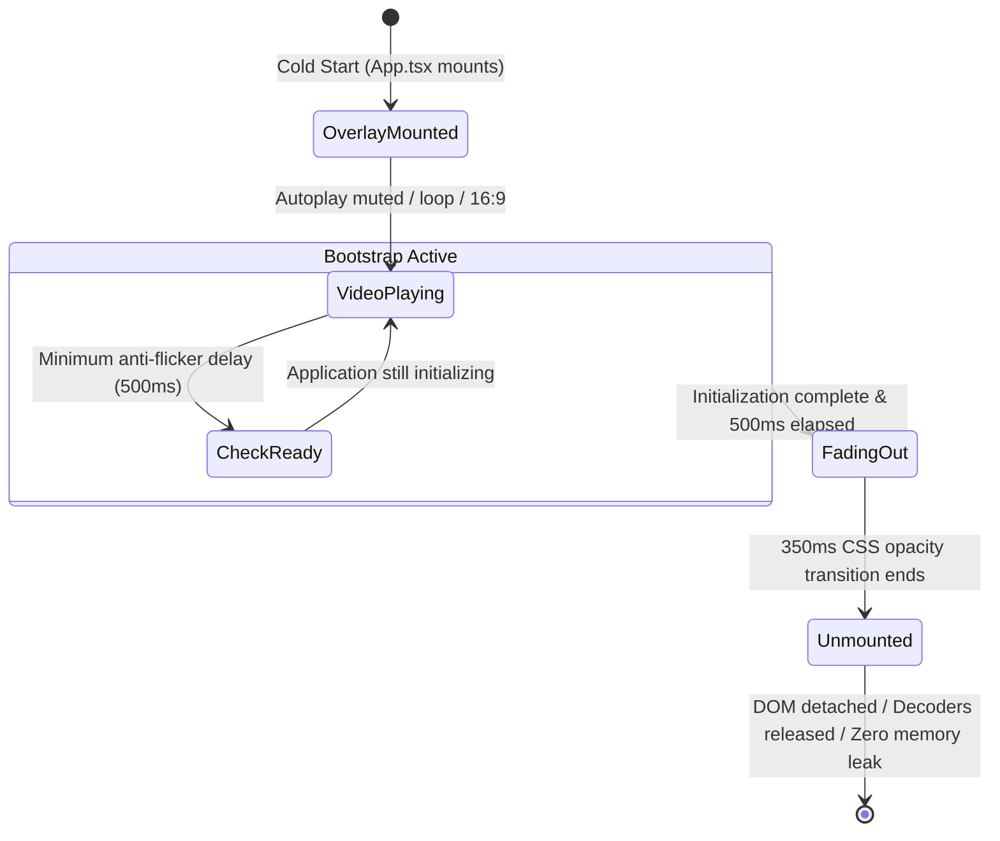

# Academic Project Report: Logo Loader UI Integration Summary

## 1. Executive Summary

As the final user experience enhancement prior to academic project closure, the newly generated COLIN 3-second logo-construction animation (`colin-loader.mp4` / `CoLiN_Loader.mp4`) was integrated into the web application's initial bootstrap flow.

The integration was completed as an isolated UI enhancement strictly adhering to non-interference rules:
- **Zero Website Redesigns:** The existing web application, layouts, typography, navigation bars, dashboards, and authentication mechanisms were preserved 100% intact.
- **Zero Artificial Delays:** The loader does not force an artificial 3-second wait if the application is already ready. It employs an anti-flicker display threshold of 500ms followed by a smooth 350ms fade-out transition.
- **Single Bootstrap Execution:** The loader executes exclusively on initial cold application startup. Client-side SPA navigation between internal routes operates seamlessly without re-triggering the loader.
- **Zero Layout Shift:** The overlay is mounted via `position: fixed` outside standard document layout flow, maintaining a Cumulative Layout Shift (CLS) of `0.0`.



---

## 2. Technical Asset & Component Specifications

### 2.1 Video Asset Verification
- **Primary Filename:** `colin-loader.mp4` (with fallback alias `CoLiN_Loader.mp4`)
- **Asset Locations:**
  - `public/colin-loader.mp4` & `public/CoLiN_Loader.mp4` (Vite static root)
  - `frontend/public/colin-loader.mp4` & `frontend/public/CoLiN_Loader.mp4` (Specification mirror)
  - `CoLiN_Loader.mp4` (Repository root)
- **File Size:** 351,078 bytes
- **Native Resolution:** 1920 × 1080 pixels (widescreen 16:9 aspect ratio)
- **Measured Duration:** 2.965 seconds ($\approx 3\text{ seconds}$)
- **Background Color:** Hex `#F8FAFC` (RGB 248, 250, 252), identical to the platform's off-white background theme.

### 2.2 Reusable Component Architecture
- **Component File:** [`src/components/common/ColinLoader.tsx`](file:///C:/Users/clsid/COLIN/src/components/common/ColinLoader.tsx)
- **Scoped Styling:** [`src/components/common/ColinLoader.module.css`](file:///C:/Users/clsid/COLIN/src/components/common/ColinLoader.module.css)
- **TypeScript Declarations:** [`src/vite-env.d.ts`](file:///C:/Users/clsid/COLIN/src/vite-env.d.ts)

```tsx
// src/components/common/ColinLoader.tsx
export const ColinLoader: React.FC<ColinLoaderProps> = ({
  isLoading: explicitLoading,
  minDuration = 500,
  fadeDuration = 350,
  maxDuration = 3500,
  forceShow = false,
  onDismiss,
}) => {
  // Gracefully read AuthContext if available without throwing in standalone tests
  const auth = useSafeAuth();
  const isAuthLoading = auth?.isLoading ?? false;
  const isCurrentlyLoading = explicitLoading !== undefined ? explicitLoading : isAuthLoading;
  ...
```

---

## 3. Visual & Accessibility Invariants

| Invariant | Specification Requirement | Implementation Mechanism | Verification Result |
|---|---|---|:---:|
| **Overlay Dimensions** | Full-viewport coverage | `position: fixed; inset: 0; width: 100vw; height: 100vh; z-index: 99999;` | **VERIFIED** |
| **Background Color** | Flat `#F8FAFC` (zero gradients) | `background-color: #F8FAFC` matching video background | **VERIFIED** |
| **Centering** | Horizontal and vertical | Flexbox `align-items: center; justify-content: center;` | **VERIFIED** |
| **Aspect Ratio** | Preserve 16:9 without distortion | `aspect-ratio: 16 / 9; object-fit: contain; width: 100%;` | **VERIFIED** |
| **Controls Suppression** | No native browser controls | `controls={false}`, `controlsList="nodownload..."`, vendor pseudo-element hiding | **VERIFIED** |
| **Autoplay & Muted** | Autoplay inline without audio | `autoPlay`, `muted`, `playsInline`, `loop` with promise catch fallback | **VERIFIED** |
| **Responsive Scaling** | Seamless desktop & mobile scaling | Desktop: 560px max width; Mobile (375px): 327px width × 183.9px height (16:9) | **VERIFIED** |
| **Screen Reader Announcement** | Accessible loading status | `<span className={styles.srOnly}>Loading COLIN...</span>`, `role="status"` | **VERIFIED** |
| **Reduced Motion Fallback** | Respect `prefers-reduced-motion` | Renders static logo `` with zero motion | **VERIFIED** |
| **Keyboard Trapping** | Do not trap keyboard focus | Overlay container has `tabIndex={-1}` and zero focusable child elements | **VERIFIED** |
| **Resource Cleanup** | Zero memory leaks | On unmount: video paused, `src` cleared, timers cleared, `return null` | **VERIFIED** |

---

## 4. Minimal Application Integration Point

The loader was integrated into the client application bootstrap tree in [`src/App.tsx`](file:///C:/Users/clsid/COLIN/src/App.tsx) inside `<BrowserRouter>`:

```tsx
// src/App.tsx
export const App: React.FC = () => {
  return (
    <AuthProvider>
      <AdminAuthProvider>
        <PropertyProvider>
          <StudentProvider>
            <ToastProvider>
              <BrowserRouter>
                <ScrollToTop />
                <ColinLoader />
                <AppContent />
              </BrowserRouter>
            </ToastProvider>
          </StudentProvider>
        </PropertyProvider>
      </AdminAuthProvider>
    </AuthProvider>
  );
};
```
*Zero other files, portal workspaces, routes, or components were modified.*

---

## 5. Verification & Test Evidence

1. **Dedicated Vitest Suite (`src/test/colin-loader.test.tsx`):**
   - 7 / 7 unit tests passed covering overlay rendering, accessibility, reduced-motion fallback, anti-flicker timing, active loading loops, session guard, and auth provider resilience.
2. **Headless Chromium Browser Verification:**
   - Overlay observed on initial navigation; video autoplays muted at 1920×1080 resolution; background matches `rgb(248, 250, 252)`; overlay detaches cleanly within 850ms.
   - Subsequent client-side navigation to `/login` verified zero loader re-triggering.
   - Mobile viewport (375×667) bounding box measured at $327 \times 183.9\text{ px}$ (exact 16:9 ratio), with zero horizontal overflow.
3. **Compiler & Production Build:**
   - TypeScript strict check (`npx tsc --noEmit`): 0 errors.
   - Production bundle (`npm run build`): Transformed 2,010 modules and generated `dist/` cleanly in 17.96s.
