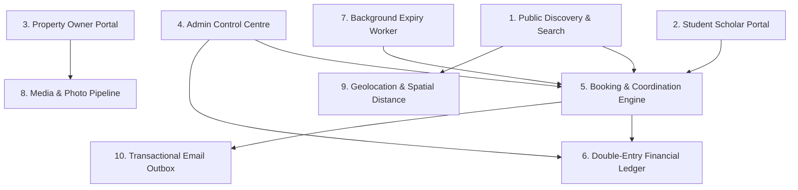

# Academic Project Report: Comprehensive Module Descriptions

## 1. System Module Hierarchy

The COLIN system is partitioned into 10 decoupled functional modules spanning client presentation, backend application services, persistence adapters, and autonomous background workers:

---

## 2. Detailed Module Specifications

### Module 1: Public Discovery & Search Engine
- **Purpose:** Delivers fast, faceted exploration of verified student housing without revealing owner private contact details.
- **Frontend Components:** [`src/pages/HomePage.tsx`](file:///C:/Users/clsid/COLIN/src/pages/HomePage.tsx), [`src/pages/PropertyDetailPage.tsx`](file:///C:/Users/clsid/COLIN/src/pages/PropertyDetailPage.tsx), [`src/components/home/WhyColinSection.tsx`](file:///C:/Users/clsid/COLIN/src/components/home/WhyColinSection.tsx).
- **Backend Components:** `public.property.controller.ts`, `public.property.routes.ts`.
- **Key Capabilities:**
  - Faceted query filtering: city, locality, university campus, budget brackets, gender policy, and room sharing types.
  - Zero-Contact Shielding: Unauthenticated users view accommodation amenities, rent, and verified badges, but cannot view owner personal details.
  - Verification Governance: Automatically excludes any property whose status is not `VERIFIED`.

### Module 2: Student Scholar Portal
- **Purpose:** Serves as the authenticated student's personalized workspace for housing discovery, visit management, and decision mediation.
- **Frontend Components:** [`src/components/student/StudentLayout.tsx`](file:///C:/Users/clsid/COLIN/src/components/student/StudentLayout.tsx), `StudentDashboardPage.tsx`, `StudentExplorePage.tsx`, `StudentVisitsPage.tsx`, `StudentWishlistPage.tsx`, `StudentComparePage.tsx`.
- **Backend Components:** `student.controller.ts`, `booking.controller.ts`.
- **Key Capabilities:**
  - Profile Management: Persists student academic details (college, graduation year) and housing criteria (budget ceiling, food preference).
  - Side-by-Side Comparison: Allows multi-attribute evaluation of up to three properties simultaneously.
  - Guided Visit Tracking: Renders active visit status, assigned coordinator details, and the 12-hour decision countdown widget.

### Module 3: Property Owner Portal
- **Purpose:** Provides landlords and PG managers an enterprise workspace to create listings, manage room inventory, and track physical verification.
- **Frontend Components:** [`src/components/owner/OwnerLayout.tsx`](file:///C:/Users/clsid/COLIN/src/components/owner/OwnerLayout.tsx), `OwnerDashboardPage.tsx`, `OwnerPropertiesPage.tsx`, `OwnerRoomsPage.tsx`, `OwnerCertificationPage.tsx`, `OwnerSubscriptionPage.tsx`.
- **Backend Components:** `owner.property.controller.ts`, `owner.routes.ts`.
- **Key Capabilities:**
  - Multi-Step Listing Creation: Captures property specifications, rules, nearest campus, and monthly rental terms.
  - 8-Photo Upload Policy: Enforces mandatory upload of 8 distinct architectural angles with automatic cover-photo assignment.
  - Room & Bed Inventory: Tracks room configurations and individual bed availability states.
  - Access Boundary Compliance: Blocks owners from accessing student visit management dashboards (`OwnerVisitsAccessDenied`).

### Module 4: Admin Control Centre
- **Purpose:** Enables platform operations personnel to inspect verification submissions, dispatch visit coordinators, and audit financial ledgers.
- **Frontend Components:** [`src/components/admin/AdminLayout.tsx`](file:///C:/Users/clsid/COLIN/src/components/admin/AdminLayout.tsx), `AdminDashboardOverviewPage.tsx`, `AdminVerificationQueuePage.tsx`, `AdminVisitsPage.tsx`, `AdminFinancePage.tsx`.
- **Backend Components:** `admin.property.controller.ts`, `adminSecurity.ts`.
- **Key Capabilities:**
  - Verification Queue: Features photo inspection drawers, safety checklists, and one-click approval/rejection workflows.
  - Visit Coordination Dispatch: Schedules coordinator escorts, marks physical completions, and initiates decision timers.
  - Financial Ledger Dashboard: Visualizes real-time debit and credit totals across the Chart of Accounts, proving zero-sum balance.

### Module 5: Booking & Guided Visit Lifecycle Engine
- **Purpose:** Orchestrates the multi-stage finite state machine governing student visit bookings, payment capture, and decision settlements.
- **Core Files:** `BookingService.ts`, `BookingRepository.ts`, `src/constants/booking.ts`.
- **Key Capabilities:**
  - FSM State Transitions: Manages deterministic progression from `PAYMENT_PENDING` to terminal states.
  - 12-Hour Decision Rule: Immutably anchors `decisionDeadline` to 12 hours after `visitCompletedAt`.
  - Notification Triggers: Queues reminder milestones at 0h, 3h, 6h, 9h, and 11h.

### Module 6: Double-Entry Financial Ledger
- **Purpose:** Provides immutable, IAS-1 compliant accounting for all platform fee collections, escrow holdings, and refund settlements.
- **Core Files:** `LedgerRepository.ts`, PostgreSQL triggers (`verify_ledger_transaction_balance`).
- **Key Capabilities:**
  - Chart of Accounts: Categorizes entries into Asset (Clearing), Liability (Escrow, Student Wallet), and Revenue accounts.
  - Transaction Generator: Employs 2-phase posting (`DRAFT` $\rightarrow$ `POSTED`) ensuring debit/credit parity.
  - Database Trigger Balance Guard: Rejects any transaction where $\sum \text{Debits} \ne \sum \text{Credits}$.

### Module 7: Autonomous Booking Expiry Background Worker
- **Purpose:** Automatically identifies and settles overdue visit decisions every 60 seconds without requiring administrative intervention.
- **Core Files:** `BookingExpiryWorker.ts`, `server.ts`.
- **Key Capabilities:**
  - 60-Second Polling: Executes periodic sweeps querying `status = 'DECISION_PENDING'` and `decisionDeadline <= NOW()`.
  - In-Process Mutex: Employs `isProcessing` flag to prevent overlapping executions during high-latency periods.
  - Startup Catch-Up Recovery: Immediately settles overdue bookings that elapsed during server downtime.
  - Graceful Shutdown Draining: Waits up to 10 seconds for active in-flight transactions to conclude before server termination.

### Module 8: Media & Photo Storage Pipeline
- **Purpose:** Handles property photograph uploads, validates constraints, and optimizes images for web delivery.
- **Core Files:** `ImagePipeline.ts`, `storage.routes.ts`, `S3StorageProvider.ts`, `MockStorageProvider.ts`.
- **Key Capabilities:**
  - Sharp Image Compression: Resizes uploads and transcodes them to modern WebP format.
  - 8-Photo Limit Enforcement: Rejects attempts to upload more than 8 images per property.
  - Dual-Provider Architecture: Uses AWS S3 SDK with presigned URLs when configured, with seamless local filesystem mock fallback.

### Module 9: Geolocation & Spatial Distance Engine
- **Purpose:** Calculates proximity between student properties and educational campuses.
- **Core Files:** `locationService.ts`, `location.controller.ts`, `geospatialMath.ts`.
- **Key Capabilities:**
  - Haversine Trigonometric Calculation: Computes accurate great-circle spatial distances in kilometers.
  - Dual-Provider Geocoding: Queries Google Maps Geocoding API with fallback to deterministic local Indian pin code landmarks.

### Module 10: Transactional Email Outbox Subsystem
- **Purpose:** Implements the transactional outbox pattern for reliable, asynchronous notification dispatch.
- **Core Files:** `EmailOutboxRepository.ts`, `SendGridWebhookHandler.ts`.
- **Key Capabilities:**
  - Outbox Pattern: Enqueues email delivery records inside the primary business database transaction.
  - Delivery Webhooks: Supports SendGrid webhook event processing with duplicate delivery idempotency checks.
