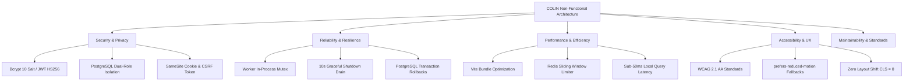

# Academic Project Report: Non-Functional Requirements

## 1. Overview & Quality Attributes

The non-functional requirements (NFRs) for COLIN establish the operational standards, security baselines, architectural tolerances, and accessibility criteria governing the platform.

---

## 2. Non-Functional Requirements Specification

### 2.1 Security & Cryptographic Invariants
- **NFR-SEC-01 (Password Hashing):** All user credentials shall be stored using `bcryptjs` with salt round factor $\ge 10$. Plaintext passwords shall never be logged, cached, or returned in API responses.
- **NFR-SEC-02 (Token Signing & Expiration):** Authentication sessions shall utilize JSON Web Tokens signed with HMAC-SHA256 (`HS256`) using distinct secrets for standard user sessions (`JWT_SECRET`) and administrative sessions (`ADMIN_JWT_SECRET`). Token lifespan shall not exceed 24 hours.
- **NFR-SEC-03 (Cross-Site Request Forgery):** All state-mutating HTTP methods (`POST`, `PUT`, `PATCH`, `DELETE`) relying on cookie authentication shall require a cryptographic CSRF token matching the `colin_csrf_token` cookie value.
- **NFR-SEC-04 (Database Privilege Segmentation):** The application shall connect to PostgreSQL using two distinct role profiles:
  - `colin_app_runtime`: Restricted to DML operations (`SELECT`, `INSERT`, `UPDATE`, `DELETE`) on standard operational tables.
  - `colin_admin_runtime`: Granted DDL and audit logging privileges, isolated from general client traffic.
- **NFR-SEC-05 (Owner PII Redaction):** The API transformation layer shall strip all personally identifiable information (PII) of property owners from public listing view models (`adaptBackendPropertyToFrontend`).

### 2.2 Reliability & Fault Tolerance
- **NFR-REL-01 (ACID Transaction Boundaries):** Multi-entity mutations (e.g., booking creation, payment capture, visit completion, and ledger settlement) shall execute within atomic `prisma.$transaction()` boundaries. Partial failures shall trigger complete rollbacks.
- **NFR-REL-02 (Worker Concurrency Mutex):** The `BookingExpiryWorker` shall enforce an in-process execution lock (`isProcessing`). If a scheduled cycle triggers while an execution is active, the tick shall be skipped immediately to eliminate race conditions.
- **NFR-REL-03 (Graceful Shutdown & Promise Draining):** Upon receiving termination signals (`SIGTERM`, `SIGINT`), the Express server and background workers shall cease accepting new connections and allow in-flight database transactions up to 10,000ms to complete before exiting.
- **NFR-REL-04 (Service Disconnection Resilience):** If external cloud providers (AWS S3, Google Maps, SendGrid, Redis) are unreachable, the system shall seamlessly degrade to deterministic local mock providers without throwing unhandled exceptions.

### 2.3 Performance & Scalability
- **NFR-PERF-01 (API Response Latency):** Core read operations (`GET /api/v1/properties`, `GET /api/v1/health/live`) shall respond within $\le 100\text{ ms}$ under baseline load on local infrastructure.
- **NFR-PERF-02 (Distributed Rate Limiting):** API endpoints shall enforce Redis-backed sliding-window rate limiting (100 requests per 15-minute window for standard endpoints; 5 attempts per 15-minute window for authentication gateways) to prevent brute-force attacks.
- **NFR-PERF-03 (Frontend Bundle Efficiency):** The production frontend bundle compiled via Vite/Rollup shall not exceed 1.25 MB minified for JavaScript and 100 kB for CSS.
- **NFR-PERF-04 (Zero Cumulative Layout Shift):** The initial loading screen overlay (`ColinLoader`) shall be mounted with `position: fixed` outside the document layout flow, guaranteeing a Cumulative Layout Shift (CLS) score of `0.0`.

### 2.4 Usability & Accessibility (a11y)
- **NFR-ACC-01 (WCAG 2.1 AA Conformity):** All text elements shall maintain a minimum contrast ratio of 4.5:1 against their backgrounds (#F8FAFC, #0B3452, #1E293B).
- **NFR-ACC-02 (Reduced Motion Support):** All animated components (including the COLIN logo loader and modal transitions) shall inspect `window.matchMedia('(prefers-reduced-motion: reduce)')` and provide an immediate static fallback (`/assets/colin-logo.png`).
- **NFR-ACC-03 (Screen Reader Announcements):** Background status transitions and loader displays shall be announced to assistive technologies using `role="status"` and `aria-live="polite"`.
- **NFR-ACC-04 (Responsive Viewport Scalability):** The user interface shall scale fluidly across mobile (375px), tablet (768px), desktop (1280px), and ultrawide (1920px) viewports without horizontal clipping or broken containers.

### 2.5 Maintainability & Standards Compliance
- **NFR-MAINT-01 (Strict TypeScript Compliance):** Both frontend and backend codebases shall compile under TypeScript 5.6 in strict mode (`"strict": true`, `"noImplicitAny": true`, `"strictNullChecks": true`) with 0 errors and zero `@ts-ignore` bypasses.
- **NFR-MAINT-02 (Accounting Standards Compliance):** The financial ledger shall comply with International Accounting Standard (IAS) 1 principles of presentation, enforcing zero-sum double-entry balance across all journal transactions.
