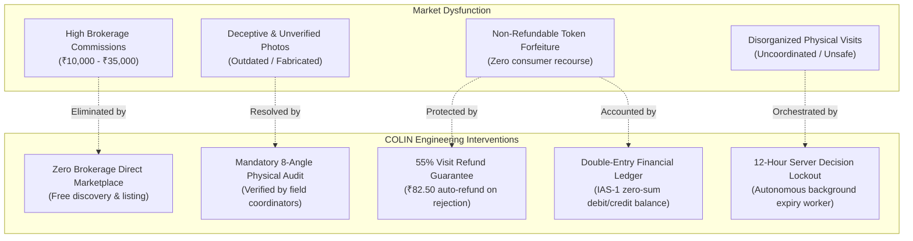

# Academic Project Report: Problem Statement & Objectives

## 1. Problem Statement

### 1.1 Context of Student Accommodation in India
Over 38 million students enroll in higher education institutions across India annually. A significant proportion (over 65% in major educational clusters such as Delhi University, Bengaluru, Pune, Kota, and Hyderabad) migrate from outstations and require off-campus accommodation, primarily paying guest (PG) hostels, private student co-living spaces, and shared rented flats.

### 1.2 Core Market Deficiencies
1. **Unregulated Brokerage Intermediation:** Local brokers charge extortionate non-refundable brokerage fees (typically equivalent to one full month's rent, between ₹10,000 and ₹35,000) for basic introduction without providing ongoing service or accountability.
2. **Deceptive Visual Representations:** Property listings on generic real-estate platforms frequently display edited, wide-angle, outdated, or completely fabricated photographs that conceal sanitation defects, compromised security, and sub-standard amenities.
3. **Arbitrary Token Money Forfeiture:** When students place initial advance token deposits to reserve a room, landlords frequently forfeit deposits if the student subsequently rejects the premises upon discovering discrepancies.
4. **Lack of Operational Accountability & Visit Coordination:** Physical inspections are disorganized, leading to wasted time, safety risks for unaccompanied students, and uncoordinated visits that disrupt current tenants.
5. **Absence of Verifiable Accounting:** Financial transactions between students, properties, and intermediaries lack formal double-entry bookkeeping, audit trails, and automated refund mechanisms.

---

## 2. Project Objectives

### 2.1 Primary Objectives
1. **Develop a Multi-Tenant Role-Isolated Web Platform:** Design and construct four distinct operational workspaces (Public Discovery, Student Scholar Portal, Property Owner Portal, and Admin Control Centre) enforcing strict Role-Based Access Control (RBAC).
2. **Implement an In-Person Physical Verification Workflow:** Create a verifiable audit pipeline requiring property owners to submit 8 standard photographic perspectives (facade, bedroom, washroom, mess, recreation, study room, security, utility), evaluated by field coordinators prior to public indexing.
3. **Engineer an Automated Booking & Guided Visit Lifecycle:** Establish a deterministic finite state machine (`PAYMENT_PENDING` → `FEE_PAID` → `VISIT_SCHEDULED` → `DECISION_PENDING` → `ACCEPTED` / `REJECTED_REFUND_DUE` / `EXPIRED`).
4. **Enforce an Autonomous 12-Hour Decision Expiry Engine:** Build a daemonized server-side background worker executing every 60 seconds with in-process mutex locking, catch-up recovery, and transactional double-entry settlement.
5. **Construct an IAS-1 Double-Entry Financial Ledger:** Implement a balanced financial ledger tracking Asset, Liability, and Revenue accounts where every financial event maintains $\sum \text{Debits} - \sum \text{Credits} = 0$.

### 2.2 Secondary / Architectural Objectives
1. **Zero-Trust Client-Server Separation:** Enforce strict API boundary decoupling between the React frontend client and the Express backend services.
2. **Dual-Role PostgreSQL Security Model:** Segment database access into `colin_app_runtime` (CRUD operations for normal application flows) and `colin_admin_runtime` (elevated administrative privilege, audit logs, and schema migrations).
3. **Resilient Cloud & Fallback Adapters:** Implement dual-provider patterns for object storage (AWS S3 vs. local filesystem mock), geolocation (Google Maps Geocoding vs. spatial pin code mock), and email (SendGrid vs. transactional outbox mock).
4. **Comprehensive Automated Verification:** Validate platform stability via unit tests, PostgreSQL integration tests, and real-browser Playwright E2E test suites.

---

## 3. Measurable Success Criteria

| Objective | Target Metric | Achieved Outcome in Prototype |
|---|---|---|
| **Brokerage Cost Elimination** | 100% Zero Brokerage | Implemented: Free registration, exploration, and listing |
| **Physical Verification Gate** | 100% Verified Public Inventory | Implemented: Draft and pending properties are filtered from public indexing |
| **Visit Refund Guarantee** | Exactly 55% Refund on Rejection | Implemented: ₹82.50 auto-refunded, ₹67.50 platform fee retained |
| **Decision Window Enforcement** | Strict 12-hour limit ($+12\text{h}$) | Implemented: Background worker sweeps every 60s; 9/9 worker tests pass |
| **Ledger Invariance** | $\sum \text{Debits} - \sum \text{Credits} = 0$ | Implemented: Database triggers reject unbalanced transactions |
| **Browser E2E Coverage** | Real DOM execution across 4 journeys | Implemented: 17/17 Playwright E2E browser tests passing |
| **Compiler & Build Integrity** | Strict TypeScript, Zero Errors | Implemented: `tsc --noEmit` exit 0, production build in 17.96s |
