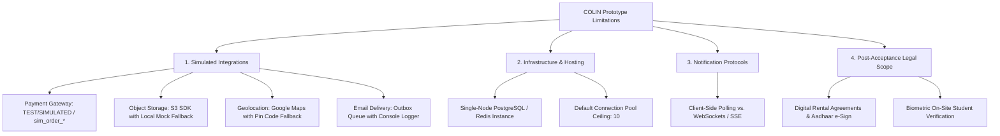

# Academic Project Report: Project Limitations & Environmental Boundaries

## 1. Overview & Classification of Limitations

In an enterprise engineering project, establishing transparent boundaries between verified production-ready mechanisms and prototype simulation adapters is essential. This document provides a formal inventory of the technological, architectural, and environmental limitations of the COLIN prototype.

---

## 2. Detailed Subsystem Limitations

### 2.1 Simulated Payment Gateway (`TEST/SIMULATED`)
- **Limitation:** In accordance with university sandbox guidelines, live banking rails (UPI, NetBanking, Credit/Debit cards) are not connected. Guided visit booking fees (₹150.00) are processed via an internal simulated gateway adapter (`src/server/services/BookingService.ts`).
- **Characteristics:** Orders are generated with prefix `sim_order_`, and transaction references with `SIM-PAY-*`. Idempotency keys (`idemp-*`) prevent duplicate submissions.
- **Production Path:** Integrate an authorized Reserve Bank of India (RBI) licensed payment aggregator (e.g., Razorpay, Cashfree, or PayU) implementing webhook signature verification (`X-Razorpay-Signature`) and automated net-banking auto-refund webhooks.

### 2.2 Dual-Mode Cloud Object Storage (AWS S3)
- **Limitation:** The storage module implements a dual-mode provider architecture (`S3StorageProvider` vs `MockStorageProvider`). In environments lacking active AWS IAM S3 credentials, image uploads route through local filesystem directories (`uploads/`).
- **Production Path:** Provision dedicated Amazon S3 buckets or Cloudflare R2 object stores with pre-signed PUT URLs, restricting client direct uploads and serving assets via an edge CDN (CloudFront/Cloudflare).

### 2.3 Geolocation & Mapping (Google Maps Platform)
- **Limitation:** If `GOOGLE_MAPS_API_KEY` is not provided in the environment, the `GoogleGeolocationProvider` falls back to deterministic mock geocoding based on standard Indian postal pin codes and North Campus landmarks.
- **Production Path:** Activate Google Maps Places Autocomplete and Geocoding APIs with HTTP referer restrictions and daily quota monitoring.

### 2.4 Transactional Email Delivery (SendGrid)
- **Limitation:** Emails generated during registration, booking confirmation, and reminder milestones are stored in the database table `EmailOutbox`. In development environments, an in-memory dispatcher logs emails to the server console rather than transmitting via live SMTP.
- **Production Path:** Configure DNS records (SPF, DKIM, DMARC) on the official domain (`colin.in`) and attach SendGrid/Postmark webhooks to reconcile delivery, bounce, and open events.

### 2.5 Real-Time Communication Boundaries
- **Limitation:** Real-time updates for property verification queue changes, coordinator assignments, and student decision countdowns rely on page refreshes, tab re-focusing, or manual client polling buttons (`Refresh Queue`, `Refresh Ledger`).
- **Production Path:** Implement Server-Sent Events (SSE) or WebSockets backed by Redis Pub/Sub to push instant notifications directly to active client browser tabs.

### 2.6 Post-Acceptance Tenancy & Legal Scope
- **Limitation:** The COLIN prototype formally terminates its business lifecycle upon accommodation acceptance (`ACCEPTED`) or rejection (`REJECTED_REFUND_DUE`).
- **Excluded Features:** Digitally signed rental agreements, Aadhaar e-Sign verification, recurring monthly rent collection via NACH e-mandates, and on-site biometric fingerprint/facial scanning are designated for future commercial phases.
