# Academic Project Report: Project Overview
## COLIN — Verified Student Living & Campus Accommodations Platform

**Institution:** Department of Computer Science & Engineering (B.Tech Program)  
**Project Title:** COLIN: Enterprise-Grade Verified Student Housing & Guided Accommodations Platform  
**System Classification:** Full-Stack Enterprise Web Application & Distributed Ledger System  
**Academic Year:** 2026–2027  
**Status:** Prototype Complete & Verified (Engineering Phase Officially Closed)  

---

## 1. Abstract

Finding safe, affordable, and authentic student accommodation near tertiary educational institutions across urban Indian hubs (e.g., Delhi University North/South Campus, Bengaluru, Pune, Kota) remains plagued by broker exploitation, deceptive imagery, arbitrary token forfeiture, and lack of verified accountability. 

**COLIN** (*Campus Operations & Living Infrastructure Network*) is an enterprise-grade digital accommodation platform designed to eliminate brokerage intermediaries, ensure 100% physical ground verification of student properties, formalize in-person guided inspections, and guarantee consumer financial protection through an automated, IAS-1 compliant double-entry financial ledger and server-enforced decision mediation engine.

The platform provides four independent, role-isolated portals:
1. **Public Discovery Portal:** Fast, filterable public exploration with owner privacy shielding and zero unauthorized contact leakage.
2. **Student Scholar Portal:** Academic profile management, personalized discovery, guided visit slot scheduling with simulated payment processing, and post-visit acceptance/rejection mediation.
3. **Property Owner Portal:** Comprehensive property lifecycle management, 8-angle photographic verification pipelines, room and bed inventory controls, and inspection tracking.
4. **Admin Control Centre:** Physical audit verification queues, visit coordination dispatching, financial ledger audits, and system configuration.

---

## 2. Platform Vision & Value Proposition

```mermaid
graph TD
    subgraph Traditional Broker Market
        B1["Fragmented Local Brokers"] --> B2["Fake / Outdated Photos"]
        B2 --> B3["Excessive Brokerage (1 Month Rent)"]
        B3 --> B4["Zero Visit Refunds & Arbitrary Terms"]
    end

    subgraph COLIN Platform Paradigm
        C1["Zero Brokerage Direct Marketplace"] --> C2["100% In-Person Physical Verification"]
        C2 --> C3["55% In-Person Visit Refund Guarantee"]
        C3 --> C4["IAS-1 Double-Entry Financial Ledger"]
        C4 --> C5["Autonomous 12-Hour Decision Expiry Worker"]
    end

    style B1 fill:#ffebee,stroke:#c62828,stroke-width:1px
    style B2 fill:#ffebee,stroke:#c62828,stroke-width:1px
    style B3 fill:#ffebee,stroke:#c62828,stroke-width:1px
    style B4 fill:#ffebee,stroke:#c62828,stroke-width:1px

    style C1 fill:#e8f5e9,stroke:#2e7d32,stroke-width:2px
    style C2 fill:#e8f5e9,stroke:#2e7d32,stroke-width:2px
    style C3 fill:#e8f5e9,stroke:#2e7d32,stroke-width:2px
    style C4 fill:#e8f5e9,stroke:#2e7d32,stroke-width:2px
    style C5 fill:#e8f5e9,stroke:#2e7d32,stroke-width:2px
```

### Core Value Drivers:
- **Zero Brokerage Guarantee:** Students directly interface with verified property owners without paying intermediary commission.
- **Physical Verification Badge:** Properties undergo rigorous on-site verification before public indexing. Unverified or drafted listings remain strictly invisible.
- **Consumer Financial Guarantee:** Visit slot scheduling requires a nominal ₹150 slot pass fee. If a student physically visits and determines the accommodation does not match their expectations, 55% (₹82.50) is automatically refunded, while 45% (₹67.50) covers operational coordination.
- **Strict 12-Hour Server Decision Lockout:** Following visit completion, students have an immutable 12-hour decision window to accept or decline the room. An autonomous background worker monitors deadlines and executes transactional expirations every 60 seconds.
- **Immutable Double-Entry Accounting:** Every rupee collected, held in escrow, disbursed, or retained as revenue is recorded in a double-entry ledger adhering to International Accounting Standard (IAS) 1, with database triggers enforcing $\sum \text{Debits} = \sum \text{Credits}$.

---

## 3. Scope of Academic Prototype

| Subsystem | Prototype Implementation Status | Engineering Classification |
|---|---|---|
| **Frontend Portals (React 18 / Tailwind)** | Public, Student, Owner, and Admin portals fully operational with client routing, layout isolation, responsive UI, and custom loader | **Implemented & Tested** |
| **Backend REST Services (Express 5)** | Modular API v1 gateway with versioned routing, request validation, cookie/header auth, and error pipelines | **Implemented & Tested** |
| **Relational Database (Prisma / PostgreSQL 18)** | 58 models, 50 enums, relational foreign keys, custom CHECK constraints, and dual-role security (`colin_app_runtime`, `colin_admin_runtime`) | **Implemented & Tested** |
| **Booking & Decision Lifecycle** | Multi-step state machine (`PAYMENT_PENDING` through `ACCEPTED` / `REJECTED_REFUND_DUE` / `EXPIRED`) with 12h countdown timer | **Implemented & Tested** |
| **Automatic Booking Expiry Worker** | Autonomous 60s background daemon with in-process mutex, startup catch-up recovery, and graceful shutdown draining | **Implemented & Tested** |
| **Double-Entry Financial Ledger** | Ledger accounts, balanced journal transactions, and real-time zero-sum balance verification | **Implemented & Tested** |
| **Simulated Payment Gateway** | Idempotent ₹150 visit pass capture with `sim_order_*` / `SIM-PAY-*` transaction references | **Simulated & Tested** |
| **Cloud Object Storage (S3 / R2)** | Dual-provider image pipeline (sharp transformation, 8-angle policy) with local filesystem mock fallback | **Mock-Integrated & Tested** |
| **Geolocation (Google Maps Platform)** | Spatial distance computation, campus boundary matching, and deterministic postal code fallback | **Mock-Integrated & Tested** |
| **Transactional Email Dispatch (SendGrid)** | Outbox queue pattern with idempotency tracking and local mock delivery logger | **Mock-Integrated & Tested** |
| **Cache & Distributed Rate Limiting** | Redis 7 sliding-window rate limiting, token revocation blacklists, and in-memory mock fallback | **Live & Mock Tested** |
