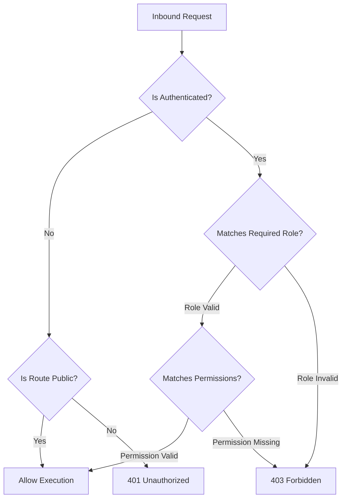

# Academic Project Report: Security Architecture & Cryptographic Controls

## 1. Security Framework Overview

The COLIN security architecture implements defense-in-depth across the application lifecycle: presentation layer input hygiene, HTTP gateway middleware validation, cryptographic credential protection, role-based boundary enforcement, and database privilege segregation.

```mermaid
graph TD
    subgraph 1. Network & Gateway Perimeter
        CORS["Strict CORS Whitelist"]
        SEC_HDR["Security Headers\n(HSTS, CSP, X-Frame-Options: DENY)"]
        RATE["Redis Sliding Window Rate Limiter"]
    end

    subgraph 2. Authentication & Session Boundary
        COOKIE["HTTP-Only, Secure, SameSite Cookie"]
        CSRF["CSRF Token Verification Middleware"]
        JWT["HMAC-SHA256 JWT Verification"]
        RBAC["Role & Permission Guards (Student / Owner / Admin)"]
    end

    subgraph 3. Application Domain Security
        ZOD["Zod Schema Validation & Input Sanitization"]
        PII["Owner PII Redaction Filter"]
        TX["Atomic ACID Transaction Scopes"]
    end

    subgraph 4. Data Persistence Security
        DUAL["Dual-Role PostgreSQL Runtime\n(colin_app_runtime vs colin_admin_runtime)"]
        BCRYPT["Bcrypt Salt >= 10 Password Storage"]
        AUDIT["Immutable Audit Ledger (SystemAuditLog)"]
    end

    Network --> 1. Network & Gateway Perimeter
    1. Network & Gateway Perimeter --> 2. Authentication & Session Boundary
    2. Authentication & Session Boundary --> 3. Application Domain Security
    3. Application Domain Security --> 4. Data Persistence Security
```

---

## 2. Authentication & Session Management

### 2.1 Password Hashing & Storage
- **Algorithm:** `bcryptjs` adaptive cryptographic hash.
- **Cost Factor:** Work factor parameter of 10 rounds ($\approx 100\text{ ms}$ compute cost per hash on modern CPUs).
- **Storage Contract:** Only the resulting 60-character bcrypt hash string is stored in the database (`passwordHash`). Plaintext credentials are wiped from memory immediately following verification.

### 2.2 Dual-Token JWT Architecture
To prevent privilege escalation across standard consumer users and platform administrators, the platform enforces independent cryptographic signing keys:

| Token Type | Signer Secret | Issued For | Lifespan | Storage Mechanism |
|---|---|---|---|---|
| **User Access Token** | `JWT_SECRET` | Students, Property Owners | 24 Hours | HTTP-only cookie (`colin_access_token`) |
| **Admin Access Token** | `ADMIN_JWT_SECRET` | SuperAdmins, Support Leads | 8 Hours | Dedicated cookie / Local storage (`colin_admin_session_token`) |

- **Verification Invariant:** Attempting to authenticate an administrative route using a standard user JWT fails cryptographically: the token cannot be verified using `ADMIN_JWT_SECRET`.

---

## 3. Cross-Site Request Forgery (CSRF) Defense

The platform enforces a cryptographic Double-Submit Cookie CSRF pattern for all state-mutating HTTP methods (`POST`, `PUT`, `PATCH`, `DELETE`):
1. **Token Generation:** The server issues an unguessable 32-byte cryptographic token stored in an accessible cookie `colin_csrf_token`.
2. **Client Submission:** The frontend extracts the token and attaches it to the custom HTTP header `X-CSRF-Token` on every mutation request.
3. **Middleware Verification (`csrfProtectionMiddleware`):**
   - Read-only methods (`GET`, `HEAD`, `OPTIONS`) bypass verification.
   - For mutation requests, the server validates:
     $$\text{Cookie}(\text{colin\_csrf\_token}) \equiv \text{Header}(\text{X-CSRF-Token})$$
   - If missing or mismatched, the request is terminated immediately with HTTP `403 Forbidden` (`CSRF_TOKEN_MISMATCH`).

---

## 4. Role-Based Access Control (RBAC) & Boundary Isolation



### Security Boundary Matrix:
1. **Public Discovery Routes (`/api/v1/properties`):**
   - Accessible by guests.
   - PII filter strips owner telephone, email, and internal administrative notes.
   - Only returns properties with `verificationStatus === 'VERIFIED'`.
2. **Student Routes (`/api/v1/students`, `/api/v1/bookings`):**
   - Guarded by `requireRole('STUDENT')`.
   - Students can only view their own bookings (`WHERE studentId = req.user.id`).
3. **Owner Routes (`/api/v1/owner/properties`):**
   - Guarded by `requireRole('OWNER')`.
   - Ownership isolation enforced: owners can only mutate properties matching `ownerId = req.user.id`.
   - Access to unassigned visitor identities or visit management is strictly denied (`OwnerVisitsAccessDenied`).
4. **Admin Control Centre (`/api/v1/admin/*`):**
   - Guarded by `requireAdmin` and MFA session verification.
   - Public and owner sessions navigating to `/admin/*` are terminated and redirected to `/admin/login`.

---

## 5. Threat Modeling: STRIDE Analysis

| Threat Class | Identified Attack Vector | Platform Architectural Mitigation | Status |
|---|---|---|:---:|
| **Spoofing** | Attacker attempts to forge user or admin identities | Signed HMAC-SHA256 JWTs with dual-secret separation and bcrypt password hashing | **MITIGATED** |
| **Tampering** | Man-in-the-middle modifies booking fee or ledger balances | Full HTTPS, CSRF validation, and PostgreSQL trigger-enforced ledger balance parity | **MITIGATED** |
| **Repudiation** | User denies scheduling visit or coordinator denies inspection | Immutable audit log records in `SystemAuditLog` and journal entries in `LedgerTransaction` | **MITIGATED** |
| **Information Disclosure** | Competitor scrapes landlord phone numbers and emails | `adaptBackendPropertyToFrontend` explicitly strips owner PII from all public responses | **MITIGATED** |
| **Denial of Service** | Bot floods login gateway with brute-force attempts | Redis-backed sliding-window rate limiter (5 attempts / 15 min on auth; 100 / 15 min standard) | **MITIGATED** |
| **Elevation of Privilege** | Student navigates directly to `/admin/finance` | Server middleware inspects role claims; frontend employs `AdminProtectedRoute` gateway | **MITIGATED** |
