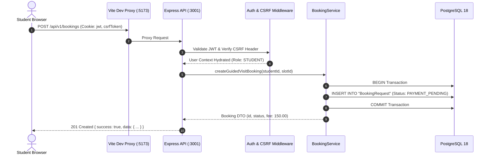

# Academic Project Report: System Architecture

## 1. High-Level Architectural Design

The COLIN platform is architected as an N-tier enterprise web application adhering to clean architecture principles: separation of concerns, zero-trust network boundaries, strict repository abstractions, and resilient dual-role persistence.

```mermaid
flowchart TD
    subgraph Tier 1: Client Presentation Layer
        P1["Public Discovery Portal\n(Vite / React 18 / React Router)"]
        P2["Student Scholar Portal\n(Protected Workspace)"]
        P3["Property Owner Portal\n(Protected Workspace)"]
        P4["Admin Control Centre\n(MFA / RBAC Guarded)"]
        LDR["ColinLoader Overlay\n(Initial App Bootstrap)"]
    end

    subgraph Tier 2: API Gateway & Security Pipeline
        Proxy["Vite Dev Proxy / Reverse Proxy\n(:5173 -> :3001)"]
        MW1["Correlation ID (requestIdMiddleware)"]
        MW2["Security Headers & Strict CORS"]
        MW3["Rate Limiter (Redis Sliding Window)"]
        MW4["Auth & CSRF Context Extractor"]
        MW5["Role & Permission Guards\n(requireRole, requireAdmin)"]
    end

    subgraph Tier 3: Service & Domain Logic Tier
        S_Auth["Authentication & Admin Security Service"]
        S_Prop["Property Service & Photo Pipeline"]
        S_Book["Booking & Visit Coordination Service"]
        S_Ledg["Double-Entry Financial Ledger Engine"]
        S_Loc["Geolocation & Campus Spatial Service"]
        S_Mail["Transactional Email Outbox Service"]
        W_Exp["Autonomous Booking Expiry Worker\n(60s Cadence / Mutex Guarded)"]
    end

    subgraph Tier 4: Persistence & Infrastructure Tier
        DB_App[("PostgreSQL 18: colin_app_runtime\n(Marketplace, Bookings, Ledger)")]
        DB_Adm[("PostgreSQL 18: colin_admin_runtime\n(Admin Accounts, MFA, Audit Logs)")]
        Cache[("Redis 7 In-Memory Cache\n(Sliding Windows, Token Blacklists)")]
        Storage["Object Storage / File System\n(AWS S3 / Local Mock Storage)"]
    end

    Tier 1 --> Proxy
    Proxy --> MW1 --> MW2 --> MW3 --> MW4 --> MW5

    MW5 --> S_Auth
    MW5 --> S_Prop
    MW5 --> S_Book
    MW5 --> S_Loc

    S_Book --> S_Ledg
    S_Book --> S_Mail
    W_Exp --> S_Book

    S_Prop --> Storage
    S_Auth --> Cache
    MW3 --> Cache

    S_Auth --> DB_Adm
    S_Prop --> DB_App
    S_Book --> DB_App
    S_Ledg --> DB_App
    W_Exp --> DB_App
```

---

## 2. Tier-by-Tier Architectural Breakdown

### 2.1 Tier 1: Client Presentation Layer
- **Framework & Runtime:** React 18 with Concurrent Root rendering and TypeScript strict type checking.
- **Routing & Workspace Partitioning:** `react-router-dom` v6 provides client-side route resolution, nested portal layouts, and declarative route guards (`AdminProtectedRoute`, `StudentLayout`, `OwnerLayout`).
- **Initial Bootstrap Loader (`ColinLoader`):** A dedicated, non-blocking full-viewport overlay displays the official 3-second logo construction animation (`colin-loader.mp4`) during cold startup, utilizing a 500ms anti-flicker delay and a 350ms fade-out transition.

### 2.2 Tier 2: API Gateway & Security Pipeline
- **HTTP Engine:** Express 5.3.0 providing native asynchronous exception propagation.
- **Request Pipeline:**
  1. `requestIdMiddleware`: Assigns a UUID correlation token to every inbound request (`X-Request-Id`).
  2. `securityHeadersMiddleware`: Emits `X-Content-Type-Options: nosniff`, `X-Frame-Options: DENY`, and strict Content Security Policies.
  3. `createCorsMiddleware`: Whitelists permitted frontend origins (`http://localhost:5173`, `http://localhost:3000`).
  4. `cookieParser` & `express.json`: Enforces a 10MB memory ceiling to eliminate denial-of-service memory exhaustion.
  5. `authContextMiddleware`: Inspects HTTP-only cookies and Bearer headers, validating tokens and hydrating `req.user`.
  6. `csrfProtectionMiddleware`: Validates CSRF double-submit cookies on state-mutating requests (`POST`, `PUT`, `DELETE`).
  7. `errorHandlerMiddleware`: Redacts internal database exceptions, returning RFC-7807 compliant error envelopes.

### 2.3 Tier 3: Service & Domain Layer
- **`BookingService`:** Encapsulates the guided visit state machine, coordinates ₹150 visit fee capture, enforces the 12-hour decision deadline, and dispatches refund transactions.
- **`LedgerRepository` / `LedgerService`:** Implements double-entry journal postings adhering to IAS-1. Employs database transactions to post balanced debit/credit entries simultaneously.
- **`BookingExpiryWorker`:** A standalone background daemon executing every 60,000ms. Queries overdue decisions (`decisionDeadline <= NOW()`), invokes transactional expiration, releases reserved slots, and settles refunds.
- **`ImagePipeline`:** Integrates `multer` streaming and `sharp` processing, generating normalized WebP images and validating the 8-angle property policy.
- **`LocationService`:** Computes spatial distances from campus coordinates using the Haversine trigonometric formula, with dual-mode Google Maps / local landmark resolution.

### 2.4 Tier 4: Persistence & Infrastructure Tier
- **Database Engine:** PostgreSQL 18 managed through Prisma ORM v5.22.0.
- **Dual-Role Security Segmentation:**
  - `colin_app_runtime`: Restricted DML permissions for marketplace, bookings, and ledger data.
  - `colin_admin_runtime`: Privileged role for migrations, superadmin account management, and system-level audit logs.
- **Cache Infrastructure:** Redis 7 managing atomic sliding-window rate limit counters and revoked JWT jti tokens.

---

## 3. Communication Protocols & Data Exchange



### Protocol Standards:
1. **Network Boundary:** Frontend interfaces via HTTP REST JSON contracts over port 5173 (proxied to port 3001).
2. **Payload Envelope:** Standardized response wrapper `{ success: boolean, data?: T, error?: { code, message, details }, meta?: { requestId, timestamp } }`.
3. **Idempotency Keys:** Payment and decision endpoints accept `Idempotency-Key` headers (`idemp-*`) to eliminate duplicate transactions caused by network retries.
